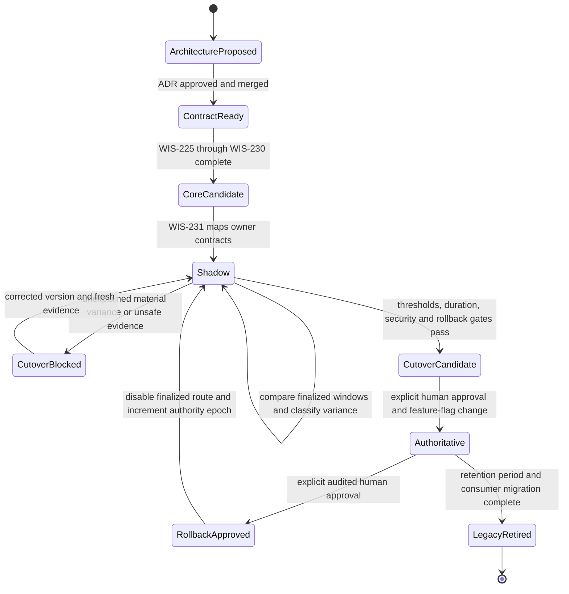

# ADR 0001: OEE authority, coexistence, and MES integration

> **Current state (WIS-633, checked 2026-11-03).** The runtime is Go. The retained OEE component is
> `internal/oee` (contracts, timeline, kernel, readiness, loss, cost, evidence pack) and
> `internal/oeeservice` (runs, leases, policy, persistence), inside the Go Supervisor. The Python,
> Pydantic and FastAPI names in this ADR are design history; that code was decommissioned and is not in
> this repository. Only the `CANDIDATE` and `SUPERSEDED` truth states exist (migration 029). See the
> `oee-authority-and-mes-coexistence` skill and `docs/oee-foundation.md`.

> Component scope: this ADR governs the retained OEE component and its optional
> historical MES integration. The independent AI Supervisor product is governed by
> [the current architecture](../independent-supervisor.md); MES is not a prerequisite.

- Status: Proposed
- Date: 2026-09-10
- Linear: [WIS-223](https://linear.app/wisedo-technology/issue/WIS-223/wis-2221-freeze-oee-authority-coexistence-and-integration-adr)
- GitHub: [issue #4](https://github.com/Wisedo-Technology/plantops-oee-intelligence/issues/4)
- Parent: [WIS-222](https://linear.app/wisedo-technology/issue/WIS-222/epic-oee-and-downtime-intelligence-core-v1)
- Supersedes: none

## 1. Decision summary

wiseDo will build the OEE Intelligence Core as an independent, tenant-scoped Python service with a pure deterministic calculation pipeline. The core becomes the sole target authority for **finalized-window** Availability, Performance, Quality, OEE, TEEP, downtime/loss classification, modeled cost-of-loss, and calculation provenance.

MES owner services remain authoritative for source facts. The existing MES `services/oee-svc` remains the provisional live accumulator and compatibility surface during migration. It does not become a second accepted source of finalized formula truth.

The integration boundary is versioned OpenAPI/JSON over HTTPS. The OEE core does not read another service's database, consume the same owner event stream as an MES projection, mutate MES state, write a PLC, or expose caller-selected network destinations. C++, MQTT, and gRPC are not part of this module's v1 architecture; they require a separately measured transport or hard-real-time need.

The WIS-222 sequence is intentionally gated:

1. WIS-223 merges this authority and coexistence ADR.
2. WIS-225 creates strict versioned contracts, repository foundations, persistence boundaries, and CI without formulas.
3. Later children implement normalization, formulas, downtime/loss, cost, API, and release in the declared order.
4. WIS-231, owned in the MES repository, performs live owner-service integration, shadow comparison, cutover, and rollback.

## 2. Context and reviewed baseline

This decision is based on the MES integration branch at commit:

`93915a8ccaf0b0c32dfe298a78e98324a96b0b91`

Repository: `Wisedo-Technology/mes`

The baseline must be refreshed by WIS-231 before implementation cutover. This pin makes the design review reproducible; it is not permission for the OEE core to import MES source or persistence models.

Reviewed MES boundaries include:

- `services/oee-svc` — current provisional OEE projection and API
- `services/historian-svc` — equipment-state, raw signal, and signal-quality facts
- `services/production-svc` — work-order, product, and declared production facts
- `services/quality-svc` — inspection, disposition, reject, scrap, and rework facts
- `services/master-data-svc` — asset, work-center, routing, standard-cycle, and target calendar-policy authority
- `services/insights-svc` — present analytical presentation/read-model behavior
- `services/reporting-svc` and WIS-221/WIS-232 — report definition/export boundary

Current MES behavior is not silently adopted as the new product definition. The following pinned observations require explicit contracts, product decisions, and golden vectors:

- `services/iot-gateway-svc/src/factoryos_iot_gateway/connectors/envelope.py` stamps tenant and connection identity from the trusted gateway connection. This makes the gateway the authenticated ingress authority while Historian remains the durable telemetry-history authority.
- `services/historian-svc/src/factoryos_historian_svc/models.py` and `ingest.py` retain value, event time, and signal quality with a tenant/machine/metric/time natural identity. A WIS-231 adapter must preserve trusted ingress identity and durable-history revision separately.
- `services/oee-svc/src/factoryos_oee_svc/mutations.py` currently maps missing denominators to zero and clamps components into `[0, 1]`; that behavior is compatibility evidence, not an approved finalized readiness or formula policy.
- `services/oee-svc/src/factoryos_oee_svc/materializer.py` synthesizes planned time as run plus downtime and derives a tenant-wide ideal cycle from averaged capacity/takt inputs. Finalized planned-time and ideal-cycle revision rules remain WIS-224 decisions.
- `services/production-svc/src/factoryos_production_svc/main.py` publishes operation completion without every item, routing revision, standard-cycle, and atomic-outbox attribute required for deterministic replay. The production model itself has richer pinned context; WIS-231 requires a versioned owner contract rather than database access.
- `services/quality-svc/src/factoryos_quality_svc/main.py` publishes inspection identifiers without the complete plant/line/shift, quantity/UOM, order/product, and final disposition identity required by the current OEE consumer. `services/oee-svc/src/factoryos_oee_svc/materializer.py` expects different fields and increments one unit per accepted event. A versioned quality fact must be introduced; one inspection must never be inferred to equal one unit.
- `services/oee-svc/src/factoryos_oee_svc/main.py` emits downtime-close data without the full scope required by its own materializer. WIS-231 must use a scoped downtime contract or deterministic state-timeline normalization.
- `services/master-data-svc/src/factoryos_master_data_svc/mutations.py` stores positive operation-level standard cycle values, while its current creation event does not carry the complete effective routing/operation revision. Final calculation uses an immutable, effective-dated owner snapshot.
- `libs/python/factoryos-core/src/factoryos/core/time.py` currently uses fixed UTC shift boundaries; finalized calculation needs an explicit IANA zone and versioned calendar with DST behavior.
- `services/insights-svc/src/factoryos_insights_svc/queries.py` and `apps/factoryos-web/src/app/(dashboard)/insights/analytics/page.tsx` average already-computed percentages. Final consumers must instead use an accepted evidence pack and permitted numerators/denominators; they cannot average OEE percentages as a replacement formula.
- `services/oee-svc/src/factoryos_oee_svc/worker.py` and `scheduler.py` do not yet provide verified commit/scheduling evidence for the intended runtime path. Existing `oee-svc` is therefore a provisional compatibility path, not production-grade finalized truth.
- `infra/docker-compose/apicurio/initial-schemas/` contains no committed authoritative producer schemas at the pinned baseline. Checked-in versioned schemas, fixtures, and provider/consumer compatibility gates are prerequisites for event-backed integration.

No formula or resolution for those gaps is selected in this ADR. An unresolved product rule must produce a blocked downstream issue, not an implementation guess.

## 3. Drivers

The design must provide:

1. one accepted authority for each fact and each derived result;
2. deterministic replay from immutable, versioned inputs and policy;
3. tenant isolation at every API, persistence, cache, and evidence boundary;
4. explicit data quality and readiness rather than silent interpolation or clamping;
5. coexistence with live MES dashboards while the new core is shadow-validated;
6. a read-only, provenance-rich contract for Reporting and Insights;
7. independent development without copying MES database models;
8. bounded work, cancellation, safe errors, and no partial publication;
9. a reversible cutover with no dual accepted formula truth.

## 4. Considered approaches

### A. Independent deterministic core with MES-owned adapters — chosen

MES assembles versioned owner facts through WIS-231 and calls the independent core. The core validates, normalizes, calculates, and publishes an immutable evidence pack. Reporting consumes the evidence pack read-only.

Benefits:

- one pure calculation authority;
- independently testable contracts and golden vectors;
- no shared database or duplicate event consumer;
- controlled shadow comparison and rollback;
- reusable across industries after policy publication.

Cost:

- explicit versioned contracts and a staged integration are mandatory;
- finalized metrics are not instant live telemetry.

### B. Expand the existing MES OEE service — rejected

This is faster initially but retains coupling to provisional ingestion and makes independent versioning, replay, customer-specific policy, and reusable evidence contracts harder. It also makes it difficult to distinguish live estimates from finalized metrics.

### C. Let the new service consume all owner events directly — rejected

This duplicates MES consumers and offsets, risks contradictory projections, and gives two systems competing interpretations of source events. It also increases operational and tenant-isolation surface before calculation semantics are stable.

### D. Let Reporting or Insights calculate OEE — rejected

Presentation systems must not create another formula authority. Reporting and Insights may render, aggregate only where the evidence contract explicitly permits it, and link to provenance. They do not recompute A/P/Q/OEE/TEEP.

## 5. Authority and ownership matrix

| Datum or decision | Authoritative owner | Integration transport | Required identity/provenance | OEE-core use |
| --- | --- | --- | --- | --- |
| Authenticated field ingress identity | MES IoT Gateway | Carried as Historian-snapshot provenance; WIS-231 performs no separate Gateway read | trusted tenant and connection binding, machine, metric, value, quality, timestamp | Admission evidence only; not a calculated fact |
| Retained equipment state, counter observation, time, and signal quality | MES Historian | WIS-231 reads a versioned Historian API snapshot | tenant, site, asset, metric, event/source revision, occurred/recorded time, quality | Durable input fact; never silently repaired |
| Work order, operation, product, and declared produced quantity | MES Production | WIS-231 reads a versioned Production API snapshot | order/operation/product revision, asset or line scope, unit, occurred/recorded time | Input fact and attribution context |
| Inspection and final quality disposition | MES Quality | WIS-231 reads a versioned Quality API snapshot | inspection/disposition revision, order/product scope, accepted/reject/scrap/rework quantities and unit | Input fact |
| Asset, work-center, routing, and ideal-cycle references | MES Master Data | WIS-231 reads a versioned Master Data API snapshot | entity revision, effective range, unit, approval/publication state | Input reference; exact revision required |
| Shift, calendar, planned exclusion, and timezone facts | MES Master Data | WIS-231 reads a versioned Master Data calendar API snapshot | IANA zone, calendar/shift revision, effective range | Input reference; exact revision required |
| Calculation and readiness policy | OEE Intelligence Core | OEE API and governed OEE persistence | tenant, immutable policy revision, publication/effective range, digest | Governs calculation |
| Canonical normalized timeline | OEE Intelligence Core | Internal pure-domain result and evidence pack | dataset digest, normalizer version, policy revision | Derived authority |
| Finalized A/P/Q/OEE/TEEP | OEE Intelligence Core | `OeeEvidencePackV1` | dataset, policy, calculation and code-version digests | Finalized result authority |
| Downtime/loss hierarchy and modeled cost | OEE Intelligence Core | `OeeEvidencePackV1` | taxonomy/rate revisions, units, currency, assumptions, exclusions | Finalized derived authority |
| Provisional live metric | Existing MES `services/oee-svc` | Existing MES API/UI | explicit `PROVISIONAL` label and observation time | Compatibility/live view only |
| Report layout, scheduling, delivery, and export | WIS-232 Reporting | Versioned Reporting API consuming evidence | evidence-pack identity/digest; no source DB | Presentation only |
| Main-system integration, shadow comparison, routing flag | WIS-231 in MES | MES-owned adapters and deployment configuration | pinned contract versions and audit trail | Integration/cutover authority |
| PLC/HMI commands and machine safety | MES edge/command subsystem | Bounded command path | separate safety contract | Never owned or invoked by this module |

Modeled-cost rates are OEE-owned governed policy inputs administered by an authorized customer/product role. They are not ledger truth, do not imply realized savings, and cannot perform implicit foreign-exchange conversion. Their exact currency, unit, effective revision, rounding, and interpretation are frozen by WIS-228 before implementation.

For the first integration, WIS-231 assembles one immutable dataset through read-only, versioned owner API snapshots. It does not create new owner-event subscriptions or offsets. Existing owner events may continue to maintain each owner's own read model, but the only boundary into this repository is a bounded `OeeDatasetV1` request over HTTPS. A later event-backed assembly path requires a superseding integration decision and must preserve the same single-consumer and provenance rules.

### 5.1 Source conflict rule

Facts are not merged merely because they share timestamps or labels. Each fact carries an authoritative owner, stable identity, revision, effective scope, occurred time, recorded time, unit, and quality. Duplicate, contradictory, cross-tenant, unversioned, or ambiguously scoped facts cannot be silently selected. The published calculation policy determines whether the dataset is `LIMITED`, `NOT_READY`, or `INVALID`; it never invents source facts.

### 5.2 Result authority rule

Before cutover, existing live consumers may use the visibly provisional MES value, while finalized-evidence consumers receive no accepted pack. The new result is candidate shadow evidence only. After a formally recorded WIS-231 cutover, the core evidence-pack result is the sole accepted finalized result. A consumer cannot select between old and new formulas per request.

### 5.3 Truth state is not readiness

Readiness (`READY`, `LIMITED`, `NOT_READY`, `INVALID`) describes whether a particular dataset and policy can make a governed calculation claim. Truth state describes how a result may be used during migration:

- `PROVISIONAL`: live compatibility output from the existing MES service;
- `CANDIDATE`: immutable new-core evidence available only for shadow comparison;
- `ACCEPTED`: the core evidence pack selected by the server-owned finalized authority registry for a scope and authority epoch;
- `SUPERSEDED`: immutable evidence replaced by a correction, policy revision, calculation revision, or authority transition.

A `READY` candidate is still not accepted. Only the audited finalized-evidence router may attach accepted authority metadata. Legacy provisional output is never upgraded to an evidence pack. There is no `BOTH_ACCEPTED` state.

## 6. Component and data-flow design

```mermaid
flowchart LR
    subgraph MES[wiseDo MES owner boundary]
        IOT[IoT Gateway\nauthenticated ingress]
        HIST[Historian\nretained state, counters, quality]
        PROD[Production\norders, products, quantities]
        QUAL[Quality\ndispositions, scrap, rework]
        MASTER[Master Data\nshifts, calendars, ideal cycle]
        LEGACY[Existing oee-svc\nPROVISIONAL live value]
        ADAPTER[WIS-231 Dataset Adapter\nversioned reads and contract mapping]
        COMPARE[WIS-231 Shadow Comparator]
        GATE[Audited cutover gate]
        AUTH[(Finalized authority registry\nCORE or NONE plus authority epoch)]
        ROUTER[Finalized evidence router]
    end

    subgraph CORE[plantops-oee-intelligence]
        API[OEE API\nRequestContext and bounds]
        VALIDATE[Contract and provenance validation]
        NORMALIZE[Pure timeline normalizer]
        CALC[Pure calculation pipeline]
        STORE[(Governed policy, run, evidence metadata)]
        PACK[Immutable OeeEvidencePackV1]
    end

    subgraph CONSUMERS[Read-only consumers]
        LIVE[Legacy live API and UI\nexplicitly PROVISIONAL]
        REPORT[WIS-232 Reporting]
        INSIGHTS[Insights]
        UI[PlantOps UI]
    end

    IOT --> HIST
    HIST --> ADAPTER
    PROD --> ADAPTER
    QUAL --> ADAPTER
    MASTER --> ADAPTER
    ADAPTER -->|OeeDatasetV1 over HTTPS| API
    API --> VALIDATE --> NORMALIZE --> CALC --> PACK
    API --> STORE
    PACK --> STORE
    PACK -->|candidate evidence| COMPARE
    LEGACY -->|provisional comparison value| COMPARE
    COMPARE -->|variance evidence only| GATE
    GATE -->|atomic approved transition| AUTH
    PACK --> ROUTER
    AUTH -->|CORE or NONE plus epoch| ROUTER
    LEGACY --> LIVE
    ROUTER --> REPORT
    ROUTER --> INSIGHTS
    REPORT --> UI
    INSIGHTS --> UI
```

Forbidden shortcuts are intentionally absent:

- no OEE-core connection to an owner database;
- no OEE-core subscription to an owner event bus already projected by MES;
- no Reporting/Insights calculation edge;
- no OEE-core write edge to MES or PLCs.

The comparator never merges, averages, or repairs legacy and candidate values. Only the MES-owned finalized-evidence router may expose an `OeeEvidencePackV1`, and it stamps the accepted core provider and authority epoch. Before cutover or after rollback, its registry state is `NONE` and finalized consumers receive a bounded not-ready/unavailable response. The raw legacy payload flows only to the separately labelled provisional live surface; it never flows into an evidence-pack consumer.

## 7. Conceptual class boundaries

These names define responsibility boundaries for WIS-225. They do not select formula implementations.

```mermaid
classDiagram
    direction LR

    class RequestContext {
      +tenant_id: UUID
      +actor_id: UUID
      +scopes: FrozenSet~str~
      +trace_id: str
    }

    class OeeDatasetV1 {
      <<immutable contract>>
      +schema_id: oee.wisedo.io/v1
      +dataset_id: UUID
      +window: HalfOpenInterval
      +as_of: UTCInstant
      +source_watermarks: bounded tuple
      +source_facts: bounded tuple
      +provenance_digest: str
    }

    class CalculationPolicyV1 {
      <<immutable published contract>>
      +policy_revision_id: UUID
      +effective_range: HalfOpenInterval
      +canonical_digest: str
    }

    class OeeEvidencePackV1 {
      <<immutable result contract>>
      +status: READY|LIMITED|NOT_READY|INVALID
      +reason_codes: bounded tuple
      +dataset_digest: str
      +policy_digest: str
      +calculation_version: str
    }

    class CalculationApplicationService {
      +calculate(context, dataset, expected_policy_revision)
      +get_evidence(context, evidence_id)
    }

    class DatasetContractVerifier {
      <<port>>
      +verify(context, dataset)
    }

    class ReadinessEvaluator {
      <<pure port>>
      +evaluate(dataset, policy)
    }

    class TimelineNormalizer {
      <<pure port>>
      +normalize(dataset, policy)
    }

    class OeeCalculationKernel {
      <<pure port>>
      +evaluate(timeline, policy)
    }

    class DowntimeClassifier {
      <<pure port>>
      +classify(timeline, policy)
    }

    class LossCostModel {
      <<pure port>>
      +model(losses, policy)
    }

    class EvidencePackBuilder {
      <<pure port>>
      +build(inputs, outputs, provenance)
    }

    class PolicyRepository {
      <<port>>
      +get_effective_published(context, scope, window, expected_revision)
    }

    class CalculationUnitOfWork {
      <<port>>
      +reserve(context, request_identity)
      +commit_candidate(context, evidence_pack)
      +rollback()
    }

    class EvidenceRepository {
      <<port>>
      +get(context, evidence_id)
    }

    class MesDatasetAdapter {
      <<MES-owned adapter>>
      +assemble(owner_snapshots)
    }

    class ReportingEvidenceConsumer {
      <<WIS-232-owned consumer>>
      +render(evidence_pack)
    }

    RequestContext --> CalculationApplicationService
    OeeDatasetV1 --> CalculationApplicationService
    CalculationPolicyV1 --> CalculationApplicationService
    CalculationApplicationService --> DatasetContractVerifier
    CalculationApplicationService --> PolicyRepository
    CalculationApplicationService --> TimelineNormalizer
    CalculationApplicationService --> ReadinessEvaluator
    TimelineNormalizer --> OeeCalculationKernel
    TimelineNormalizer --> DowntimeClassifier
    OeeCalculationKernel --> EvidencePackBuilder
    DowntimeClassifier --> LossCostModel
    LossCostModel --> EvidencePackBuilder
    CalculationApplicationService --> CalculationUnitOfWork
    CalculationApplicationService --> EvidenceRepository
    EvidencePackBuilder --> OeeEvidencePackV1
    MesDatasetAdapter --> OeeDatasetV1
    OeeEvidencePackV1 --> ReportingEvidenceConsumer
```

### 7.1 Purity constraint

`TimelineNormalizer`, `OeeCalculationKernel`, `DowntimeClassifier`, `LossCostModel`, and `EvidencePackBuilder` are deterministic domain components. They receive every time, policy, unit, rounding, taxonomy, rate, and version input explicitly. They cannot read a clock, network, database, environment variable, random source, global cache, or mutable singleton.

Application orchestration may use repositories and identity context. It passes immutable values into the pure pipeline and atomically publishes a terminal evidence result. A failed, cancelled, or stale run cannot publish a partial `READY` result.

`CalculationUnitOfWork` atomically reserves idempotency, stores the terminal run and evidence, and creates any internal candidate-publication record. It is not a direct Reporting publisher. Splitting those writes into independently committed repository calls is forbidden because it permits partial publication.

The public calculation path does not allow a normal caller to select an arbitrary historical or draft policy. The service chooses the one published policy effective for the authenticated tenant/scope/window. An optional expected revision is only a concurrency guard; mismatch fails rather than silently running different semantics. Historical replay, when implemented, requires a distinct authorization and always records the exact immutable policy revision.

## 8. Versioned boundary contracts

WIS-225 will define strict Pydantic v2 and generated JSON Schema/OpenAPI artifacts under:

- package namespace: `wisedo_plantops_oee`;
- API namespace: `/v1/oee`;
- schema identity: `oee.wisedo.io/v1`;
- image namespace: `ghcr.io/wisedo-technology/plantops-oee-intelligence`.

The three public contract families are:

1. `OeeDatasetV1` — immutable, bounded source facts and their provenance;
2. `CalculationPolicyV1` — immutable published calculation, time, readiness, taxonomy, and cost-policy references;
3. `OeeEvidencePackV1` — terminal status, reason codes, calculated outputs when allowed, assumptions, exclusions, input/policy/code digests, and evidence links.

Contract rules:

- strict unknown-field rejection;
- tenant comes only from verified `RequestContext`, never request JSON;
- UUID identities and explicit units;
- UTC timestamps plus explicit IANA zone where civil-time projection is needed;
- half-open windows `[start, end)`;
- Decimal values serialized as canonical strings once scale/rounding is approved;
- bounded request bytes, fact counts, interval counts, reason codes, string lengths, and execution time;
- canonical serialization and deterministic digests;
- immutable published schema revisions;
- provider and consumer fixtures checked in CI;
- additive-looking changes are not assumed compatible when strict clients reject unknown fields; compatibility is proven by consumer tests.

Payload fields, formulas, precedence, scale, and numeric bounds are finalized in their owning child issues. WIS-225 may create strict shapes only where WIS-223 and the child acceptance contract already decide the semantics.

## 9. Readiness and failure semantics

Business readiness is distinct from HTTP transport success.

| Status | Meaning | Publication rule | Typical causes |
| --- | --- | --- | --- |
| `READY` | Complete, authorized, internally consistent evidence satisfies the published policy for the entire requested window | Immutable evidence pack may contain governed finalized results | All required owner facts, revisions, units, time scope, and policy are present and valid |
| `LIMITED` | A deterministic supported result exists, but the published policy requires explicit material exclusions or reduced scope | Evidence pack must expose exclusions and may be barred from compliance/contract use by policy | Supported partial scope or documented quality degradation; never silent imputation |
| `NOT_READY` | A recoverable evidence or publication prerequisite is missing, stale, ambiguous, or temporarily unavailable | No finalized numeric claim for the affected scope | Owner snapshot unavailable, missing approved policy, incomplete window, unresolved late fact |
| `INVALID` | The request or evidence violates an invariant and cannot be safely evaluated | Reject or seal a safe terminal invalid result; never retry blindly | Cross-tenant identity, malformed contract, contradictory canonical identity, digest mismatch, impossible time range |

Stable reason codes are bounded, machine-readable, versioned, and ordered by an explicit precedence. Diagnostics are safe and bounded. They never contain tokens, credentials, raw upstream bodies, owner URLs, SQL, or sensitive source payloads.

### 9.1 Failure table

| Condition | Required behavior | Forbidden behavior |
| --- | --- | --- |
| Owner unavailable before dataset assembly | WIS-231 withholds dataset or core returns `NOT_READY`; bounded retry occurs outside pure kernel | Reuse an unqualified stale snapshot |
| Stale or incomplete source window | `NOT_READY`, or `LIMITED` only when a published policy explicitly permits the exact exclusion | Fill gaps with zero or assumed runtime |
| Duplicate exact fact | Canonically deduplicate only by stable owner identity and revision; record contribution once | Deduplicate by timestamp/value coincidence |
| Conflicting fact revisions | `NOT_READY` while resolution is pending, or `INVALID` for an impossible identity conflict | Last-write-wins inside the calculation |
| Ambiguous product/order/asset mapping | `NOT_READY` with bounded reason | Pick first match or positional row |
| Unknown unit or conversion | `INVALID` or `NOT_READY` per published contract | Infer a unit from field name |
| Unauthorized or cross-tenant evidence | Fail before repository lookup/calculation; zero source or publication side effects | Trust a body/query tenant identifier |
| Policy not published/effective | `NOT_READY` | Use latest draft or local default |
| Deadline/cancellation | Cancel and reap work; clean temporary state; publish no partial success | Continue in background and later mark success |
| Persistence failure after calculation | No visible evidence pack unless terminal state and evidence are atomically sealed | Return `READY` from in-memory result |
| Reporting unavailable | Final evidence remains retrievable from its owner; Reporting retries read-only | OEE recalculates or pushes into Reporting DB |

## 10. Coexistence, shadow validation, and cutover

### 10.1 Shadow requirements

WIS-231 assembles the same finalized-window source dataset for the new core and obtains the comparable provisional/legacy result without creating a second owner-event consumer. Each variance record includes:

- tenant/site/asset/window identity;
- old and new result identities and versions;
- dataset/policy/code digests;
- component-level A/P/Q and duration/count contributions;
- classified cause: expected policy change, known legacy defect, source-contract gap, implementation defect, or unresolved;
- reviewer and disposition.

Unexplained material variances block cutover. Thresholds and minimum observation duration are product/release decisions in WIS-231, not constants invented here.

### 10.2 Cutover

Cutover is an audited MES routing decision. The flag changes the finalized authority registry from `NONE` to the exact core provider/version for a tenant/site cohort and increments its authority epoch. It is not a request parameter. The change requires:

- WIS-222 v0.1.0 release evidence;
- WIS-232 consumer compatibility;
- owner-contract integration gates;
- completed shadow criteria;
- clean security/architecture review;
- explicit product and integration-owner approval;
- tested rollback.

### 10.3 Rollback and retirement

Rollback changes the finalized authority registry from the core provider to `NONE` for affected cohorts and increments the authority epoch. It does not relabel or wrap the legacy value as finalized evidence. Existing live compatibility consumers may continue to use the separate visibly `PROVISIONAL` legacy surface, while WIS-232 and every finalized-evidence consumer receive bounded `NOT_READY`/unavailable semantics until a core version is accepted again. Rollback does not delete new-core runs, mutate sealed evidence, or pretend that the failed cutover never happened. After stabilization, shadowing resumes with a corrected version.

The router does not fall back automatically per request when the accepted core provider is unavailable. It exposes a bounded unavailable/not-ready result. Re-enabling a finalized provider requires an explicit audited transition and authority-epoch increment.

Legacy retirement occurs only after the declared retention window, all consumers use the new evidence contract, rollback evidence is retained, and no supported cohort depends on legacy finalized calculations. Live ingestion responsibilities may remain in MES even after formula authority moves.

## 11. Security and reliability model

| Threat | Control |
| --- | --- |
| Caller spoofs tenant/site/role | Verified `RequestContext`; tenant absent from public bodies; composite tenant keys/FKs; FORCE RLS with non-owner runtime role in WIS-225+ |
| Confused-deputy access to MES | WIS-231 uses audience- and tenant-scoped service identity; OEE contracts contain logical source identities, not caller URLs or credentials |
| Direct owner-DB coupling | Network policy and architecture tests prohibit owner database drivers/credentials; integration uses versioned APIs/contracts only |
| Duplicate event consumption or dual truth | MES-owned dataset adapter; one accepted result route; feature flag is server-owned and audited |
| Stale/replayed evidence | Owner revision, occurred/recorded time, dataset/policy/code digests, idempotency identity, window qualification |
| Silent corruption or ambiguous facts | Strict schemas, units, stable IDs, bounded reason codes, fail-closed readiness |
| Secret/PII leakage | Opaque IDs, minimized facts, structured allowlisted logs, no tokens/raw bodies/URLs/credentials in evidence or diagnostics |
| Unbounded work/DoS | Request-byte, fact, interval, window, concurrency, CPU/wall-time, memory, and output bounds; cancellation and backpressure |
| Partial or late success after cancellation | Fenced run ownership and atomic terminal publication in WIS-229; cancelled generation cannot later seal success |
| Formula or policy drift | Immutable published policy and code version; canonical golden vectors; no hidden clock/network/database reads |
| Unsafe downstream recomputation | Provider/consumer fixtures and contract tests; evidence pack is the derived truth boundary |

## 12. Persistence boundary

PostgreSQL 16 with SQLAlchemy 2 and Alembic is permitted only for OEE-owned governed state such as:

- immutable policy and taxonomy revisions plus publication/effective state;
- calculation-run reservation, idempotency, cancellation, and terminal status;
- immutable evidence-pack metadata and audit/outbox records if their emitting requirement is approved;
- tenant-scoped configuration owned by this module.

It is not a historian, owner-data warehouse, duplicate production/quality store, or route to another service's tables. Source facts arrive inside a bounded `OeeDatasetV1`; retention of source contributions is minimized and governed by the evidence contract.

Every tenant-owned table uses tenant in its primary and foreign keys. RLS is enabled and forced. The runtime role is not the table owner and has no `BYPASSRLS`. Tenant context is derived from validated identity and set transaction-locally; missing context defaults deny. Pool-reuse, rollback, background-worker, and cross-tenant FK tests are mandatory.

## 13. Testing and acceptance strategy

### 13.1 WIS-223 architecture checks

- all required authorities have exactly one named owner;
- every integration edge has a versioned transport and provenance rule;
- no owner-database, PLC, duplicate-consumer, or dual-result-truth edge exists;
- component, class, lifecycle, failure, security, and ownership views agree;
- no unresolved formula is disguised as a default;
- independent architecture review reports no Critical or Important finding.

### 13.2 WIS-225 contract and repository checks

- deterministic OpenAPI and JSON Schema generation with drift check;
- strict unknown-field, type, unit, timestamp, UUID, Decimal, collection, and request-size rejection;
- caller tenant fields rejected and cross-tenant access produces zero calculation/publication work;
- public DTO immutability and canonical byte/digest fixtures;
- provider/consumer fixtures without live MES;
- format, lint, strict typing, unit/property/security, migration, no-skips, secret, dependency, and container gates;
- CODEOWNERS and documented branch/review policy.

### 13.3 Later calculation checks

- RED golden vectors approved by the product-rule owner before each formula implementation;
- property tests for temporal partitioning, unit consistency, monotonic contribution accounting, and byte-stable replay;
- adversarial overlap, gap, duplicate, conflict, counter reset/wrap, late correction, DST, cross-midnight, mixed-product, zero-denominator, scrap/rework, and >100% performance cases;
- no clock/network/database/random access in pure-domain packages;
- every numeric output reconciles to explicit source contributions, policy revision, and reason codes.

### 13.4 WIS-231 integration checks

- provider/consumer compatibility against pinned schema artifacts;
- hostile tenant/site identity and expired-token tests before owner calls;
- source API timeout/cancellation and bounded retry tests;
- shadow comparison over labelled datasets with explained variance;
- feature-flag cohort, audit, rollback, and no-dual-truth tests;
- live integration, deployment, pilot acceptance, and revenue validation reported as distinct states.

## 14. Existing-code reuse

The new repository may reuse ideas, fixtures, public schema patterns, and verified identity conventions. It must not copy or import MES persistence models or make private implementation details part of its public contract.

Reuse decisions:

- retain the existing MES OEE service for provisional live presentation during migration;
- reuse the MES standard `RequestContext` claims semantically through a language-neutral contract, not source import;
- reuse versioned owner APIs and event schemas only after explicit compatibility fixtures exist;
- use MES WIS-231 for adapter/orchestration and cutover rather than duplicating that code here;
- use WIS-232 for rendering/export rather than adding report generation here.

## 15. Explicit non-goals

This ADR and WIS-225 do not deliver:

- approved A/P/Q/OEE/TEEP formulas or threshold values;
- timeline normalization decisions not already frozen by a child acceptance contract;
- live owner-service adapters or event consumers;
- HMI, SCADA, PLC, OPC UA, Modbus, or command behavior;
- dashboards, report designer, PDF/CSV generation, or schedules;
- predictive maintenance or machine-learning inference;
- customer-specific industry policy without a published pack/revision;
- deployment, cutover, pilot acceptance, or realized-ROI claims.

## 16. Consequences

Positive consequences:

- Ayush can implement an isolated core against frozen, testable boundaries;
- MES keeps operational source authority and live compatibility;
- customers receive explainable, replayable finalized calculations;
- Reporting and UI have a stable evidence contract;
- formula changes become governed versions instead of hidden code changes.

Costs and constraints:

- the live demo continues using provisional MES output until integration gates pass;
- source owners must expose sufficient version, time, unit, and quality evidence;
- product owners must approve decision tables before formulas are coded;
- shadow operation and variance review add delivery work but are required for truthful cutover.

## 17. Ayush handoff and first-day workflow

Until this ADR is merged, Ayush works only on WIS-223.

1. Read WIS-222, WIS-223, this ADR, and linked MES integration issue WIS-231.
2. Confirm that each authority, failure state, and cutover decision is understandable without inspecting private database schemas.
3. Raise questions as ADR review comments; do not resolve missing product rules in code.
4. Run the repository documentation checks supplied by the PR.
5. Request review from the product/MES/security owner.
6. After this ADR merges, branch WIS-225 from the new `main` and begin with RED contract tests.

WIS-225's initial abstract boundaries should mirror Section 7. Implementations remain empty or deliberately unavailable until their owning issue begins. Health/readiness endpoints may exist, but no endpoint may return a fabricated calculation.

## 18. Human approval and change control

Named owners:

- ADR author and implementation owner: Ayush Kumar
- Product formulas, downtime policy, and commercial interpretation: Anshul Rathore
- MES integration and cutover acceptance: Anshul Rathore through WIS-231
- Security and independent code-review approval: Anshul Rathore; automated Codex/Ruflo review is supporting evidence only
- Reporting architecture input: WIS-221
- Reporting implementation consumer: WIS-232

After acceptance, changes to source authority, finalized-result ownership, public schema families, tenant boundary, integration direction, or cutover semantics require a superseding ADR. A code change cannot silently override this document.

## 19. Acceptance traceability

| WIS-223 acceptance item | ADR section |
| --- | --- |
| Exact MES commit and paths | 2 |
| Named source and result authorities | 5 |
| Existing OEE coexistence | 1, 5, 10 |
| Provisional versus finalized evidence | 5.2, 8, 10 |
| No DB/event duplication/dual truth/MES mutation | 4, 6, 11, 15 |
| Shadow, cutover, rollback, retirement | 10 |
| Reporting consumer without recomputation | 4, 5, 6, 14 |
| PLC/machine safety excluded | 1, 5, 15 |
| Versioned HTTPS boundary | 1, 8 |
| Required diagrams and ownership matrix | 5, 6, 7, 10 |
| Failure table | 9 |
| Threat model | 11 |
| Test strategy | 13 |
| Named human owners | 18 |

## 20. Review record

The PR discussion is the review record. WIS-223 is complete only when:

- this ADR is merged;
- an independent review reports no Critical or Important finding;
- the exact PR, merge SHA, and evidence are linked to WIS-223 and WIS-222;
- no implementation is represented as delivered by this architecture-only change.
