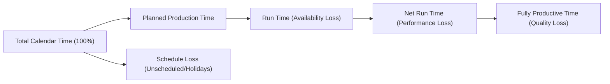

# OEE Calculation — Industry-Standard Implementation Guide

> Component scope: this document details industry-standard OEE formulas for the retained OEE component.
> The independent AI Supervisor product is governed by [docs/independent-supervisor.md](../../independent-supervisor.md) (PRD v2.0).
> Production arithmetic for the AI Supervisor uses exact rational arithmetic (`math/big`) and ties-to-even decimal rounding in Go (`internal/production`).

| Field              | Value                                                                         |
| :----------------- | :---------------------------------------------------------------------------- |
| **Document**       | 0005 — OEE Calculation (Industry-Standard)                                    |
| **Status**         | Retained Component Reference                                                  |
| **ADR References** | ADR 0001 Sec. 7.1, ADR 0002 Sec. 5, 12, 13                                    |
| **Authors**        | Ayush Kumar (Implementation Owner), Anshul Rathore (Product & Formulas Owner) |
| **Created**        | 2026-09-24                                                                    |

---

## 1. What Is OEE?

**Overall Equipment Effectiveness (OEE)** is the gold-standard KPI for
measuring manufacturing productivity. It was created by Seiichi Nakajichi
as part of **Total Productive Maintenance (TPM)** and is standardized by:
**Overall Equipment Effectiveness (OEE)** is the gold-standard KPI for measuring manufacturing productivity and asset utilization. Introduced by Seiichi Nakajima as a core pillar of **Total Productive Maintenance (TPM)**, OEE is standardized globally by:

- **ISO 22400-2:2014** — Key Performance Indicators for Manufacturing
  Operations Management
- **SEMI E10-0304** — Equipment Reliability, Availability, and
  Maintainability
- **ISA-95 / IEC 62264** — Enterprise-Control System Integration
- **ISO 22400-2:2014** — Key Performance Indicators for Manufacturing Operations Management
- **SEMI E10-0304** — Specification for Definition and Measurement of Equipment Reliability, Availability, and Maintainability
- **ISA-95 / IEC 62264** — Enterprise-Control System Integration Standards

OEE answers one question: _"Of the planned production time, what
percentage was truly productive?"_
OEE answers a fundamental operational question: _"Of the planned production time, what percentage was truly productive?"_

```
OEE  =  Availability  ×  Performance  ×  Quality
```

$$\text{OEE} = \text{Availability} \times \text{Performance} \times \text{Quality}$$

### 1.1 World-Class Targets

### 1.1 World-Class Benchmarks

| Factor       | World-Class Target |
| ------------ | ------------------ |
| Availability | ≥ 90 %             |
| Performance  | ≥ 95 %             |
| Quality      | ≥ 99.9 %           |
| **OEE**      | **≥ 85 %**         |

| Factor           | World-Class Target | Typical Plant Starting Point |
| :--------------- | :----------------- | :--------------------------- |
| **Availability** | $\ge 90.0\%$       | $50\% - 70\%$                |
| **Performance**  | $\ge 95.0\%$       | $60\% - 75\%$                |
| **Quality**      | $\ge 99.9\%$       | $85\% - 95\%$                |
| **Overall OEE**  | **$\ge 85.0\%$**   | **$40\% - 60\%$**            |

An OEE of 85 % is the accepted benchmark; most plants start at 40–60 %.
An OEE score of $85\%$ is universally recognized as world-class manufacturing excellence.

---

## 2. The Three OEE Factors — Exact Formulas

## 2. The Three OEE Factors — Exact Mathematical Formulas

### 2.1 Availability

Availability measures how much of the **Planned Production Time** the
equipment actually ran.
Availability measures the proportion of scheduled operating time that the asset is actually functioning without downtime stops.

```
                        Run Time
Availability  =  ─────────────────────────
                  Planned Production Time
```

$$\text{Availability} = \frac{\text{Run Time}}{\text{Planned Production Time}}$$

Where:

```
Planned Production Time  =  Total Calendar Time  −  Schedule Loss
Run Time                 =  Planned Production Time  −  Stop Time (Downtime)
```

$$\text{Planned Production Time} = \text{Total Calendar Time} - \text{Schedule Loss}$$

**Schedule Loss** (plant holidays, no orders, no shift scheduled) is
**excluded** from the denominator. It reduces the planned window, not the
availability ratio. Only losses _within_ planned production time reduce
Availability.
$$\text{Run Time} = \text{Planned Production Time} - \text{Stop Time (Downtime)}$$

**Stop Time includes:**
**Schedule Loss** (such as plant holidays, unstaffed shifts, or lack of customer demand) is intentionally excluded from the denominator. It reduces total scheduled time rather than penalizing asset reliability. Only downtime incurred _during_ planned production time reduces Availability.

| #   | Loss Category                     | Examples                                                 |
| --- | --------------------------------- | -------------------------------------------------------- |
| 1   | **Equipment Failure (Breakdown)** | Tooling failure, unplanned maintenance, electrical fault |
| 2   | **Setup & Adjustment**            | Changeover, material shortage, warmup, calibration       |

**Stop Time components (The Big Two Availability Losses):**

These are the first two of the **Six Big Losses**.

| #   | Loss Category                      | Description & Examples                                                           |
| :-- | :--------------------------------- | :------------------------------------------------------------------------------- |
| 1   | **Equipment Failure (Breakdowns)** | Unplanned maintenance, mechanical/electrical breakdown, tooling failure          |
| 2   | **Setup & Adjustments**            | Tooling changeover, product transitions, warm-up, calibration, material shortage |

> [!NOTE]
> **Mapping to this project:**
> `EquipmentStateFactV1.state_code` carries the raw state
> (`PRODUCING`, `STANDBY`, `DOWN`, etc.). The normalizer policy maps
> these to **Run / Stop / Schedule-Loss** buckets. The mapping is a
> product rule inside `CalculationPolicyV1`, never hardcoded.
> `EquipmentStateFactV1.state_code` records raw telemetry (`PRODUCING`, `STANDBY`, `DOWN`, `BLOCKED`). The normalizer policy projects these intervals into canonical `RUN`, `STOP`, and `SCHEDULE_LOSS` buckets. State categorization is governed by `CalculationPolicyV1` and must never be hardcoded in application logic.

---

### 2.2 Performance

Performance measures whether equipment ran at its theoretical maximum
speed during Run Time.
Performance evaluates whether the machine ran at its maximum rated engineering speed while operating.

```
                   Ideal Cycle Time  ×  Total Pieces Produced
Performance  =  ──────────────────────────────────────────────
                                 Run Time
```

$$\text{Performance} = \frac{\text{Ideal Cycle Time} \times \text{Total Pieces Produced}}{\text{Run Time}}$$

Equivalently:

```
                   Actual Output
Performance  =  ─────────────────────────
                 Theoretical Max Output
$$\text{Performance} = \frac{\text{Total Pieces Produced}}{\text{Run Time} \div \text{Ideal Cycle Time}} = \frac{\text{Actual Output}}{\text{Theoretical Maximum Output}}$$

where  Theoretical Max Output  =  Run Time  ÷  Ideal Cycle Time
```

Where:

- **Ideal Cycle Time (ICT):** The minimum theoretical duration required to produce one unit (specified in engineering master data).
- **Total Pieces Produced:** The sum of all output (**conforming + defective**) produced during `Run Time`.

- **Ideal Cycle Time** = fastest possible time per unit from the
  equipment specification or approved engineering standard. This travels
  inside `CalculationPolicyV1`.
- **Total Pieces Produced** = **good + defective** units during Run
  Time. Performance counts ALL output, not just good units.
  **Performance losses (The Big Two Speed Losses):**

**Performance losses (Big Losses 3–4):**

| #   | Loss Category            | Description & Examples                                                                 |
| :-- | :----------------------- | :------------------------------------------------------------------------------------- |
| 3   | **Idling & Minor Stops** | Micro-stops (< 5 min), optical sensor misreads, component jams, hopper blockages       |
| 4   | **Reduced Speed**        | Machine wear, operator inexperience, motor vibration, thermal/environmental throttling |

| #   | Loss Category            | Examples                                                |
| --- | ------------------------ | ------------------------------------------------------- |
| 3   | **Idling & Minor Stops** | Sensor blocked, material jam, component misalignment    |
| 4   | **Reduced Speed**        | Worn tooling, suboptimal program, environmental factors |

> [!WARNING]
> **Performance Overshoot:** Performance can exceed $100\%$ if the configured Ideal Cycle Time is overly conservative. Under ADR 0002 Sec. 5, the calculation kernel **must never silently clamp Performance to $1.0$**. The policy dictates whether this yields an advisory notification, triggers `INVALID`, or remains uncapped. Clamping obscures critical engineering inaccuracies.

> **Warning — Performance can exceed 100 %** when the Ideal Cycle Time
> is set too conservatively. A governed system MUST NOT silently clamp
> to 100 %. The policy decides the behavior: flag as `INVALID`, allow
> the overshoot, or record an advisory warning. Clamping hides real
> engineering data and violates ADR 0002 Sec. 5 (no clamping, no
> zero-denominator substitution).

> [!NOTE]
> **Mapping to this project:**
> `ProductionCounterFactV1.quantity` gives the total count.
> `ProductionCounterFactV1.unit` gives the UoM.
> Ideal Cycle Time will be a new field on `CalculationPolicyV1`.
> `ProductionCounterFactV1.quantity` provides total count. `ProductionCounterFactV1.unit` defines the measurement unit. `ideal_cycle_time` is loaded strictly from `CalculationPolicyV1`.

---

### 2.3 Quality

Quality measures how many of the produced units met quality standards
on the first pass (First Pass Yield).
Quality quantifies the fraction of output that complies with quality specifications on the first pass (First Pass Yield).

```
                Good Units
Quality  =  ──────────────────
             Total Units Produced
```

$$\text{Quality} = \frac{\text{Good Units}}{\text{Total Units Produced}}$$

Where:

```
Total Units Produced  =  Good Units  +  Defective Units (Scrap + Rework)
```

$$\text{Total Units Produced} = \text{Good Units} + \text{Defective Units (Scrap + Rework)}$$

**Quality losses (Big Losses 5–6):**
**Quality losses (The Big Two Quality Losses):**

| #    | Loss Category                            | Examples                                                                              |
| ---- | ---------------------------------------- | ------------------------------------------------------------------------------------- |
| 5    | **Process Defects (Production Rejects)** | In-process scrap, rework during stable run                                            |
| 6    | **Startup Rejects (Reduced Yield)**      | Scrap during warmup, after changeover                                                 |
| #    | Loss Category                            | Description & Examples                                                                |
| :--- | :---                                     | :---                                                                                  |
| 5    | **Process Defects**                      | In-line dimensional failure, cosmetic defects, scrap produced during steady-state run |
| 6    | **Startup Rejects (Yield Losses)**       | Off-spec product during line ramp-up, post-changeover tuning, or calibration          |

> **Rework policy:** Whether rework-passed units count as "good" depends
> on the `CalculationPolicyV1`. Pharma and automotive treat rework as
> defective. Electronics assembly may count rework-passed as good. This
> is a **policy decision**, never hardcoded in domain code.
> [!IMPORTANT]
> **Rework Policy:** Whether reworked items are counted as conforming is an Anshul-approved product rule defined in `CalculationPolicyV1.rework_counts_as_good`. In medical and aerospace, rework is strictly defective; in general assembly, rework meeting QC specifications may count as good. This behavior must never be hardcoded.

> [!NOTE]
> **Mapping to this project:**
> `QualityFactV1.good_units` / `.total_units` / `.scrap_units` /
> `.rework_units` carry these quantities as `CanonicalDecimalString`.
> `QualityFactV1.good_units`, `total_units`, `scrap_units`, and `rework_units` provide exact quantities as canonical strings (`scale <= 6`).

---

## 3. The Combined OEE Formula

Putting all three together:
Multiplying the three factors yields:

```
         Run Time       Ideal Cycle Time × Total Count       Good Count
OEE  =  ──────────  ×  ──────────────────────────────────  × ───────────
         Planned Time              Run Time                  Total Count
```

$$\text{OEE} = \left(\frac{\text{Run Time}}{\text{Planned Time}}\right) \times \left(\frac{\text{Ideal Cycle Time} \times \text{Total Count}}{\text{Run Time}}\right) \times \left(\frac{\text{Good Count}}{\text{Total Count}}\right)$$

Simplifying algebraically:
Canceling common algebraic terms yields:

```
         Ideal Cycle Time  ×  Good Count
OEE  =  ──────────────────────────────────
               Planned Production Time
```

$$\text{OEE} = \frac{\text{Ideal Cycle Time} \times \text{Good Count}}{\text{Planned Production Time}}$$

This simplified form is useful for verification but the decomposed three-
factor form MUST be computed and stored individually because each factor
pinpoints a different class of loss.
While the simplified formula is useful for spot checks, a production OEE system **must calculate and store all three individual components** because each metric exposes fundamentally distinct operational bottlenecks.

---

## 4. TEEP — Total Effective Equipment Performance

TEEP extends OEE to account for **ALL calendar time**, including
schedule losses:
**TEEP** measures asset efficiency against total calendar time (24/7/365, or 168 hours per week), revealing untapped capacity hidden by shift scheduling.

```
TEEP  =  Loading  ×  OEE
```

$$\text{TEEP} = \text{Loading} \times \text{OEE}$$

Where:

```
                  Planned Production Time
Loading  =  ───────────────────────────────
                 Total Calendar Time
```

$$\text{Loading (Utilization)} = \frac{\text{Planned Production Time}}{\text{Total Calendar Time}}$$

Fully expanded:
Expanded:

$$\text{TEEP} = \frac{\text{Run Time}}{\text{Total Calendar Time}} \times \text{Performance} \times \text{Quality}$$



TEEP = Loading × Availability × Performance × Quality

````

TEEP answers: *"How effectively are we using our total available
calendar time?"* A plant running one shift per day may have 85 % OEE
but only 28 % TEEP, revealing capacity opportunity.

---

## 5. The Six Big Losses Framework (Nakajima TPM)

The Six Big Losses is the standard taxonomy for categorizing
manufacturing losses:
```mermaid
flowchart TD
    subgraph S1["Total Calendar Time"]
        subgraph S2["Planned Production Time"]
            subgraph S3["Operating / Run Time"]
                subgraph S4["Net Operating Time"]
                    subgraph S5["Fully Productive Time"]
                        Val["Good Pieces Produced × Ideal Cycle Time"]
                    end
                    Q1["Loss 5: Process Defects"]
                    Q2["Loss 6: Startup Rejects"]
                end
                P1["Loss 3: Idling & Minor Stops"]
                P2["Loss 4: Reduced Speed"]
            end
            A1["Loss 1: Equipment Breakdown"]
            A2["Loss 2: Setup & Changeover"]
        end
        SL["Schedule Loss: Unplanned Orders, Holidays, Plant Shutdowns"]
    end

    style Val fill:#2e7d32,color:#ffffff,stroke:#1b5e20
    style A1 fill:#c62828,color:#ffffff,stroke:#b71c1c
    style A2 fill:#c62828,color:#ffffff,stroke:#b71c1c
    style P1 fill:#ef6c00,color:#ffffff,stroke:#e65100
    style P2 fill:#ef6c00,color:#ffffff,stroke:#e65100
    style Q1 fill:#6a1b9a,color:#ffffff,stroke:#4a148c
    style Q2 fill:#6a1b9a,color:#ffffff,stroke:#4a148c
    style SL fill:#455a64,color:#ffffff,stroke:#263238
````

┌─────────────────────────── Total Calendar Time ─────────────────────────────┐
│ │
│ ┌───────────────────── Planned Production Time ─────────────────────────┐ │
│ │ │ │
│ │ ┌───────────────────────── Run Time ──────────────────────────────┐ │ │
│ │ │ │ │ │
│ │ │ ┌────────────────── Net Run Time ───────────────────────────┐ │ │ │
│ │ │ │ │ │ │ │
│ │ │ │ ┌──────────── Fully Productive Time ──────────────────┐ │ │ │ │
│ │ │ │ │ │ │ │ │ │
│ │ │ │ │ Good Pieces × Ideal Cycle Time │ │ │ │ │
│ │ │ │ │ │ │ │ │ │
│ │ │ │ └─────────────────────────────────────────────────────┘ │ │ │ │
│ │ │ │ │ │ │ │
│ │ │ │ Loss 5: Process Defects ◄── Quality losses │ │ │ │
│ │ │ │ Loss 6: Startup Rejects ◄── Quality losses │ │ │ │
│ │ │ └───────────────────────────────────────────────────────────┘ │ │ │
│ │ │ │ │ │
│ │ │ Loss 3: Idling & Minor Stops ◄── Performance losses │ │ │
│ │ │ Loss 4: Reduced Speed ◄── Performance losses │ │ │
│ │ └─────────────────────────────────────────────────────────────────┘ │ │
│ │ │ │
│ │ Loss 1: Equipment Failure ◄── Availability losses │ │
│ │ Loss 2: Setup & Adjustment ◄── Availability losses │ │
│ └───────────────────────────────────────────────────────────────────────┘ │
│ │
│ Schedule Loss (no orders / not scheduled) │
└─────────────────────────────────────────────────────────────────────────────┘

```

### 5.1 Loss → OEE Factor Mapping
### 5.1 Six Big Losses Mapping

| Big Loss | OEE Factor   | Category   | Source in This Project      |
| -------- | ------------ | ---------- | --------------------------- |
| 1        | Availability | Breakdown  | `DowntimeFactV1` (UNPLANNED) |
| 2        | Availability | Setup      | `DowntimeFactV1` (PLANNED)   |
| 3        | Performance  | Micro-stop | Inferred from state gaps     |
| 4        | Performance  | Slow cycle | Inferred from counter rate   |
| 5        | Quality      | Defects    | `QualityFactV1.scrap_units`  |
| 6        | Quality      | Yield loss | `QualityFactV1.scrap_units` (startup window) |
| Big Loss | OEE Factor | Category | Project Domain Mapping |
| :--- | :--- | :--- | :--- |
| **Loss 1** | Availability | Unplanned Stop | `DowntimeFactV1` where `category = UNPLANNED` |
| **Loss 2** | Availability | Planned Stop | `DowntimeFactV1` where `category = PLANNED` |
| **Loss 3** | Performance | Micro-Stops | Short intervals between expected cycles ($\le 5 \text{ min}$) |
| **Loss 4** | Performance | Speed Reduction | Actual run rate slower than `ideal_cycle_time` |
| **Loss 5** | Quality | Production Rejects | `QualityFactV1.scrap_units` during steady-state run |
| **Loss 6** | Quality | Startup Rejects | `QualityFactV1.scrap_units` within changeover/warmup window |

Classification of loss 3 vs. 4 requires the taxonomy revision in
`CalculationPolicyV1.taxonomy_version`. Loss 5 vs. 6 requires knowing
whether the quality batch falls within a startup/changeover window.

---

## 6. Calculation Methods

The industry recognizes three valid approaches. The
`CalculationPolicyV1` must declare which one the tenant uses:
The service supports three standard calculation methodologies configured per tenant policy:

### 6.1 Count-Based OEE (Most Common — Discrete Manufacturing)
### 6.1 Count-Based OEE (Discrete Manufacturing)
- **Availability:** $\frac{\text{Run Time}}{\text{Planned Time}}$
- **Performance:** $\frac{\text{Ideal Cycle Time} \times \text{Total Count}}{\text{Run Time}}$
- **Quality:** $\frac{\text{Good Count}}{\text{Total Count}}$
- *Target Industries:* Automotive, CNC machining, electronics packaging, injection molding.

```

Availability = Run Time / Planned Production Time
Performance = (Ideal Cycle Time × Total Count) / Run Time
Quality = Good Count / Total Count

```

**Best for:** Automotive, electronics, packaging, bottling — any
process that produces countable discrete units.

### 6.2 Time-Based OEE (Continuous Process)
- **Availability:** $\frac{\text{Run Time}}{\text{Planned Time}}$
- **Performance:** $\frac{\text{Net Run Time}}{\text{Run Time}}$
- **Quality:** $\frac{\text{Valuable Operating Time}}{\text{Net Run Time}}$
- *Target Industries:* Chemical refineries, steel mills, beverage bottling, paper production.

```

Availability = Run Time / Planned Production Time
Performance = Net Run Time / Run Time
Quality = Valuable Operating Time / Net Run Time

```

Where:

- **Net Run Time** = Run Time − speed-loss time (time lost to slow
  running)
- **Valuable Operating Time** = Net Run Time − quality-loss time

**Best for:** Chemical plants, steel mills, refineries, food processing
— continuous flow with no discrete unit count.

### 6.3 Hybrid OEE
Combines continuous-time availability monitoring with discrete product counting for packaging and assembly cells.

```

Availability = Time-based (same as above)
Performance = Count-based (same as above)
Quality = Count-based (same as above)

````

**Best for:** Mixed environments where availability is calendar-driven
but output is counted.

---

## 7. Calculation Rules — What MUST NOT Be Violated
## 7. Governing Rules — Non-Negotiable Constraints

These constraints come from ADR 0001/0002 and industry standards:
1. **Exact Decimal Arithmetic:** All calculations must use `Decimal` (scale $\le 6$). IEEE 754 floating-point operations are strictly forbidden.
2. **Zero Clamping:** Components must never be clamped into $[0, 1]$. An overshoot is diagnostic evidence that must be surfaced.
3. **No Zero-Denominator Substitution:** If `Planned Time = 0`, the kernel emits `NOT_READY` with `MISSING_DATA`, never a fabricated `0.00%`.
4. **No Percentage Averaging:** OEE percentages must never be averaged across shifts, lines, or assets. Consumers must aggregate raw numerators and denominators and calculate the ratio over the union.
5. **No Ambient System Clock:** The pure domain receives immutable timestamps and clock values via injected ports. `datetime.now()` is prohibited in domain code.
6. **Deterministic Replay:** Identical inputs (`OeeDatasetV1`, `CalculationPolicyV1`, code version) must yield byte-identical `OeeEvidencePackV1` payloads.

### 7.1 Exact Decimal Arithmetic
---

All governed quantities use `Decimal` (Python `decimal` module), never
`float`. Binary floating point introduces rounding errors that compound
across shift/day/month aggregations and break byte-stable replay.
## 8. Domain Model Mapping & Flow

The `OeeRatio` domain type enforces this:
```mermaid
flowchart TD
    subgraph Inputs["Inputs (Bounded & Verified)"]
        DS["OeeDatasetV1<br/>- equipment_states<br/>- counters<br/>- quality_records<br/>- downtime_events<br/>- master_data"]
        POL["CalculationPolicyV1<br/>- oee_method<br/>- ideal_cycle_time<br/>- rework_counts_as_good<br/>- rounding_scale<br/>- rounding_mode"]
    end

- `numerator: Decimal` (non-negative)
- `denominator: Decimal` (strictly positive)
- `unit: str` (canonical unit code)
- `policy_revision_id: UUID` (binds the ratio to exact semantics)
    subgraph Kernel["Pure Domain Kernel (calculate)"]
        T1["1. Timeline Normalizer<br/>(order & segment intervals)"]
        T2["2. Compute Availability Ratio<br/>(Run / Planned)"]
        T3["3. Compute Performance Ratio<br/>(Output / Target)"]
        T4["4. Compute Quality Ratio<br/>(Good / Total)"]
        T5["5. Composite OEE = A × P × Q"]
        T6["6. TEEP = Loading × OEE"]
        T7["7. Six Big Losses Breakdown"]
        T8["8. Modeled Cost Attribution"]
    end

### 7.2 No Clamping
    subgraph Output["Output (Terminal Sealed Pack)"]
        EP["OeeEvidencePackV1<br/>- availability (OeeRatio)<br/>- performance (OeeRatio)<br/>- quality (OeeRatio)<br/>- oee (OeeRatio)<br/>- teep (OeeRatio)<br/>- loss_breakdown<br/>- cost_breakdown<br/>- cryptographic digests"]
    end

Performance > 100 % is NOT silently capped. If Ideal Cycle Time is set
too fast for the actual equipment, Performance will exceed 1.0. The
policy decides the response (flag, warn, allow). Clamping hides real
data.

### 7.3 No Zero-Denominator Substitution

If Planned Production Time = 0 (no shift scheduled), the result is
`NOT_READY` with reason code `MISSING_DATA`, not `0 %`. Zero denominators
are a business-logic decision, not a math trick.

### 7.4 No Percentage Averaging

**NEVER average OEE percentages** across shifts, lines, or periods.
This is mathematically incorrect. Example:

    DS --> T1
    POL --> T1
    T1 --> T2 --> T5
    T1 --> T3 --> T5
    T1 --> T4 --> T5
    T5 --> T6 --> T7 --> T8 --> EP
````

Shift A: OEE = 90% (Planned = 4 hours)
Shift B: OEE = 60% (Planned = 8 hours)

WRONG: (90 + 60) / 2 = 75%
RIGHT: Sum numerators / Sum denominators → weighted result

```
### 8.1 Domain Ratio Representation (`OeeRatio`)

The correct approach is to sum the individual numerators and
denominators across periods, then recalculate the ratio:

```

Total Good × Ideal Cycle Time = (ShiftA good × ICT) + (ShiftB good × ICT)
Total Planned Time = 4h + 8h = 12h
Correct OEE = Total numerator / Total denominator

```

### 7.5 No Implicit Rounding

Rounding scale (number of decimal places) and rounding mode
(`HALF_UP`, `HALF_EVEN`, `FLOOR`, `CEILING`) come from the
`CalculationPolicyV1`, never from code defaults.

### 7.6 No Clock Reads in Domain Code

All timestamps come from the injected `Clock` port in the application
layer. The pure domain kernel receives values, never a clock object.
`datetime.now()` is forbidden in any domain module.

### 7.7 Byte-Stable Replay

Same `OeeDatasetV1` + `CalculationPolicyV1` + code version =
byte-identical `OeeEvidencePackV1`. This enables golden-vector testing
and audit.

---

## 8. Mapping OEE to This Project's Domain Model

### 8.1 Input → Kernel → Output Flow

```

                                    ┌─────────────────────────────────┐
                                    │       CalculationPolicyV1       │
                                    │  ┌──────────────────────────┐   │
                                    │  │ oee_method               │   │
                                    │  │ ideal_cycle_time         │   │
                                    │  │ rework_counts_as_good    │   │
                                    │  │ rounding_scale           │   │
                                    │  │ rounding_mode            │   │
                                    │  │ zero_denominator_behavior│   │
                                    │  │ performance_cap          │   │
                                    │  │ calculation_version      │   │
                                    │  │ taxonomy_version         │   │
                                    │  └──────────────────────────┘   │
                                    └──────────────┬──────────────────┘
                                                   │

┌──────────────────────────────┐ │
│ OeeDatasetV1 │ ▼
│ ┌────────────────────────┐ │ ┌──────────────────────────────────┐
│ │ equipment_states │──┼───▶│ calculate() kernel │
│ │ counters │──┼───▶│ ┌──────────────────────────┐ │
│ │ quality_records │──┼───▶│ │ 1. Normalize timeline │ │
│ │ downtime_events │──┼───▶│ │ 2. Compute Availability │ │
│ │ master_data │──┼───▶│ │ 3. Compute Performance │ │
│ │ provenance │ │ │ │ 4. Compute Quality │ │
│ └────────────────────────┘ │ │ │ 5. Compute OEE = A×P×Q │ │
└──────────────────────────────┘ │ │ 6. Compute TEEP │ │
│ │ 7. Classify losses │ │
│ │ 8. Model cost │ │
│ └──────────────────────────┘ │
└──────────────┬───────────────────┘
│
▼
┌──────────────────────────────────┐
│ OeeEvidencePackV1 │
│ ┌──────────────────────────┐ │
│ │ availability: RatioMetric│ │
│ │ performance: RatioMetric │ │
│ │ quality: RatioMetric │ │
│ │ oee: RatioMetric │ │
│ │ teep: RatioMetric │ │
│ │ loss_breakdown │ │
│ │ cost_breakdown │ │
│ │ result_status │ │
│ │ dataset_digest │ │
│ │ policy_digest │ │
│ └──────────────────────────┘ │
└──────────────────────────────────┘

````

### 8.2 Fact Type → OEE Factor Mapping

| Dataset Fact Type           | OEE Factor    | How It's Used                              |
| --------------------------- | ------------- | ------------------------------------------ |
| `EquipmentStateFactV1`      | Availability  | Map `state_code` → Run/Stop/Schedule via policy |
| `ProductionCounterFactV1`   | Performance   | Total count × Ideal Cycle Time ÷ Run Time  |
| `QualityFactV1`             | Quality       | `good_units` ÷ `total_units`               |
| `DowntimeFactV1`            | Availability  | Accumulate stop time by category            |
| `MasterDataReferenceV1`     | All           | Civil timezone → UTC projection for shifts  |

### 8.3 The `OeeRatio` in Practice

Each OEE factor is stored as an `OeeRatio` with exact Decimal
arithmetic:

```python
# Example: Availability = 420 minutes run / 480 minutes planned
# Example: 420 minutes run time out of 480 minutes planned production
availability = OeeRatio(
    numerator=Decimal("25200"),       # 420 min × 60 = 25200 seconds
    denominator=Decimal("28800"),     # 480 min × 60 = 28800 seconds
    numerator=Decimal("25200"),       # 420 min × 60s
    denominator=Decimal("28800"),     # 480 min × 60s
    unit="ratio",
    policy_revision_id=policy.policy_revision_id,
)
# availability.value() → Decimal("0.875")  (87.5%)
assert availability.value() == Decimal("0.875")  # 87.5% exact
````

---

## 9. Worked Example — Count-Based OEE

## 9. Comprehensive Numerical Example

A packaging line runs for a single 8-hour shift:
A high-speed bottling line operates on an 8-hour shift ($480 \text{ min}$):

| Data Point                            | Value                                      |
| ------------------------------------- | ------------------------------------------ |
| Shift length                          | 480 minutes                                |
| Planned breaks (2 × 15 min)           | 30 minutes                                 |
| **Planned Production Time**           | **450 min**                                |
| Downtime (changeover)                 | 40 minutes                                 |
| Downtime (jam)                        | 20 minutes                                 |
| **Total Stop Time**                   | **60 min**                                 |
| **Run Time**                          | **390 min**                                |
| Ideal Cycle Time                      | 1.0 seconds                                |
| Total Pieces Produced                 | 19,500                                     |
| Good Pieces                           | 19,200                                     |
| Defective Pieces                      | 300                                        |
| Parameter                             | Value                                      |
| :---                                  | :---                                       |
| Total Shift Duration                  | $480 \text{ min}$                          |
| Scheduled Breaks (2 $\times$ 15 min)  | $30 \text{ min}$                           |
| **Planned Production Time**           | **$450 \text{ min}$ ($27,000 \text{ s}$)** |
| Unplanned Stoppage (Motor Failure)    | $40 \text{ min}$                           |
| Planned Stoppage (Product Changeover) | $20 \text{ min}$                           |
| **Total Downtime**                    | **$60 \text{ min}$ ($3,600 \text{ s}$)**   |
| **Operating Run Time**                | **$390 \text{ min}$ ($23,400 \text{ s}$)** |
| Ideal Cycle Time (ICT)                | $1.0 \text{ s / bottle}$                   |
| Total Bottles Produced                | $19,500 \text{ units}$                     |
| Conforming Quality Bottles            | $19,200 \text{ units}$                     |
| Scrap / Defective Bottles             | $300 \text{ units}$                        |

**Availability:**
$$\text{Availability} = \frac{23,400 \text{ s}}{27,000 \text{ s}} = 0.866667 \quad (86.67\%)$$

```
390 / 450  =  0.8667  =  86.67%
```

$$\text{Performance} = \frac{1.0 \text{ s} \times 19,500 \text{ bottles}}{23,400 \text{ s}} = \frac{19,500}{23,400} = 0.833333 \quad (83.33\%)$$

**Performance:**
$$\text{Quality} = \frac{19,200 \text{ bottles}}{19,500 \text{ bottles}} = 0.984615 \quad (98.46\%)$$

```
(1.0 sec × 19,500) / (390 × 60 sec)  =  19,500 / 23,400  =  0.8333  =  83.33%
```

$$\text{OEE} = 0.866667 \times 0.833333 \times 0.984615 = 0.711111 \quad (71.11\%)$$

**Quality:**
$$\text{Loading} = \frac{450 \text{ min}}{480 \text{ min}} = 0.937500 \quad (93.75\%)$$

```
19,200 / 19,500  =  0.9846  =  98.46%
```

$$\text{TEEP} = 0.937500 \times 0.711111 = 0.666667 \quad (66.67\%)$$

**OEE:**

```
0.8667  ×  0.8333  ×  0.9846  =  0.7111  =  71.11%
```

**TEEP (Loading = 450 / 480 = 0.9375):**

```
0.9375  ×  0.7111  =  0.6667  =  66.67%
```

---

## 10. Frozen Formula Baseline (ADR Policy)

The pure deterministic KPI kernel over the canonical timeline implements the following non-negotiable formula baseline:

1. **Planned Production Time (PPT):**
   $$\text{Planned Production Time} = \text{Eligible Scheduled Time} - \text{Policy-Approved Planned Exclusions}$$
   In canonical timeline: $\text{Planned Production Time} = \text{Run Time} + \text{Classified Stop Duration}$.

2. **Operating Run Time:**
   $$\text{Run Time} = \text{Planned Production Time} - \text{Classified Stop Duration}$$

3. **Availability:**
   $$\text{Availability} = \frac{\text{Run Time}}{\text{Planned Production Time}}$$

4. **Ideal Run Time:**
   $$\text{Ideal Run Time} = \sum_{i} \left( \text{Total Count Contribution}_i \times \text{Effective Ideal Cycle Revision}_i \right)$$

5. **Performance:**
   $$\text{Performance} = \frac{\text{Ideal Run Time}}{\text{Run Time}}$$

6. **Quality:**
   $$\text{Quality} = \frac{\text{Good Count}}{\text{Total Count}}$$
   Where $\text{Total Count} = \text{Conforming Count} + \text{Scrap Count} + \text{Rework Count}$.  
   If $\text{rework\_counts\_as\_good} = \text{true}$, $\text{Good Count} = \text{Conforming Count} + \text{Rework Count}$; otherwise $\text{Good Count} = \text{Conforming Count}$.

7. **Overall Equipment Effectiveness (OEE):**
   $$\text{OEE} = \text{Availability} \times \text{Performance} \times \text{Quality}$$

8. **Total Effective Equipment Performance (TEEP):**
   $$\text{Loading} = \frac{\text{Planned Production Time}}{\text{Total Calendar Time}}$$
   $$\text{TEEP} = \text{OEE} \times \text{Loading} = \text{OEE} \times \frac{\text{Planned Production Time}}{\text{Total Calendar Time}}$$

All arithmetic uses exact rational precision (`math/big.Rat`) and configurable decimal rounding (scale 0–6, modes: `HALF_EVEN`, `HALF_UP`, `FLOOR`, `CEILING`). Raw values are strictly retained; physically suspicious values (e.g., Performance > 100%) are flagged `LIMITED` or `INVALID` by policy and are **never silently clamped**.

---

## 11. Published Decision Table Outcomes

| Scenario / Decision | Condition | Mathematical / System Behavior | Status / Reason Code |
| :--- | :--- | :--- | :--- |
| **Zero Planned Production Time** | $\text{PPT} = 0$ (no schedule / full shutdown) | Denominator is zero. Returns zero metric without NaN/Inf or panic. | `NOT_READY` with `ZERO_DENOMINATOR` and `MISSING_DATA` |
| **Zero Operating Run Time** | $\text{Run Time} = 0$ (full downtime) | Performance denominator is zero. Availability = 0, Performance returns zero metric. No NaN/Inf. | `NOT_READY` with `ZERO_DENOMINATOR` |
| **Zero Production Output** | $\text{Total Count} = 0$ | Quality denominator is zero. Returns safe zero metric. No NaN/Inf. | `NOT_READY` with `ZERO_DENOMINATOR` |
| **Zero Calendar Time** | $\text{Total Calendar Time} = 0$ | TEEP denominator is zero. Safe zero metric returned. | `INVALID` with `ZERO_DENOMINATOR` |
| **Performance Overshoot** | $\text{Ideal Run Time} > \text{Run Time}$ ($P > 1.0$) | Raw value retained without silent clamping. Under `ALLOW_AND_RETAIN`, raw value is preserved and surfaced. | `LIMITED` with `PERFORMANCE_OVERSHOOT` (`EXCEEDS_THEORETICAL_BOUNDS`) |
| **Availability Overshoot** | $\text{Run Time} > \text{PPT}$ ($A > 1.0$) | Physically impossible without invalid schedule data. Raw ratio preserved. | `INVALID` with `AVAILABILITY_OVERSHOOT` |
| **Invalid Quality Counts** | $\text{Good Count} > \text{Total Count}$ | Physically contradictory data. Fails closed. | `INVALID` with `INVALID_QUALITY_COUNTS` |
| **Mixed Products** | Multiple SKUs produced in window | $\text{Ideal Run Time} = \sum (\text{Count}_k \times \text{ICT}_k)$. Each product evaluates its matching approved cycle. | `READY` |
| **Changing Ideal Cycle** | ICT revision changes at boundary $t$ | Slices prior to $t$ bind Rev A; slices after $t$ bind Rev B via effective windows. | `READY` |
| **Missing Ideal Cycle** | SKU has no approved ICT revision | Fails closed on ideal run time calculation. | `NOT_READY` with `MISSING_POLICY`, `MISSING_IDEAL_CYCLE` |
| **Unit Conversion** | ICT in `min/unit`, `ms/unit`, or counts in `dozen` | Normalized using exact rational factors to canonical seconds and unit pieces. | `READY` |
| **Parallel Assets / Rollup** | Line aggregation across parallel assets or shifts | Sum raw numerators and denominators across children; compute ratio on union. **Never average percentages.** | `READY` (aggregates child reasons) |
| **Rework Accounting** | Reworked units produced | Controlled by `rework_counts_as_good`. If true, added to Good Count; if false, excluded from Good Count. | `READY` |
| **Scrap Accounting** | Scrap units produced | Counted as defects. Included in Total Count, excluded from Good Count. | `READY` |
| **Microstops** | Unplanned stop duration $\le 300\text{s}$ (configurable) | Classified as Loss 3 (Idling & Minor Stops) under Performance loss tracking. | `READY` |
| **Negative Counter Deltas** | Counter drop without reset/rollover evidence | Fails closed. Cannot fabricate missing counts or infer unproved reset. | `NOT_READY` with `NEGATIVE_COUNTER_DELTA` |
| **Counter Reset / Rollover** | Counter drop with explicit rollover/reset proof | Computes monotonic delta using $(T - \text{prev}) + \text{curr}$ or baseline reset. | `READY` |

---

## 12. Implemented Pure Go Kernel (`internal/oee`)

The pure deterministic KPI kernel is implemented in Go under `internal/oee`:

- **`internal/oee/kernel.go`**: Pure calculation kernel (`CalculateKPIs`), line rollup aggregation (`AggregateKPIResults`), exact decimal formatting (`FormatDecimal`), unit normalization, and deterministic calculation digest (`ComputeKPICalculationDigest`).
- **`internal/oee/timeline.go`**: Canonical timeline projection, state classification, interval merging, and monotonic counter delta calculation with rollover/reset evidence.
- **`internal/oee/readiness.go`**: Bounded reason code precedence and readiness evaluation (`READY`, `LIMITED`, `NOT_READY`, `INVALID`).
- **`internal/oee/kernel_test.go`**: Golden vector verification (ADR 0005 Sec. 9), zero denominator protection, mixed product / changing cycle tests, mathematical rollup tests, property tests (conservation and multiplicative component identities).

---

---

## 12. References

- Nakajima, S. (1988). _Introduction to TPM_. Productivity Press.
- ISO 22400-2:2014 — KPIs for Manufacturing Operations Management.
- SEMI E10-0304 — Equipment Reliability, Availability, and Maintainability.
- ISA-95 / IEC 62264 — Enterprise-Control System Integration.
- Vorne Industries — OEE.com (industry reference and benchmarks).
- Nakajima, Seiichi (1988). _Introduction to TPM: Total Productive Maintenance_. Productivity Press.
- ISO 22400-2:2014: _Automation systems and integration — Key performance indicators for manufacturing operations management — Part 2: Definitions and descriptions_.
- SEMI E10-0304: _Standard for Definition and Measurement of Equipment Reliability, Availability, and Maintainability_.
