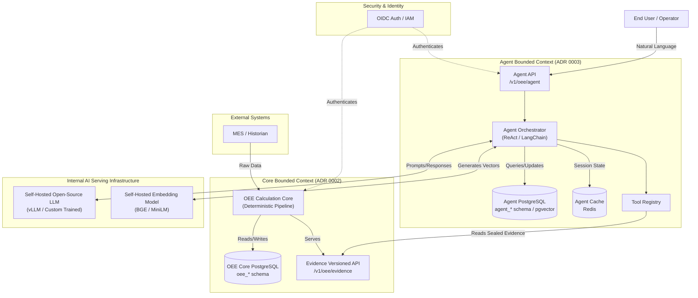
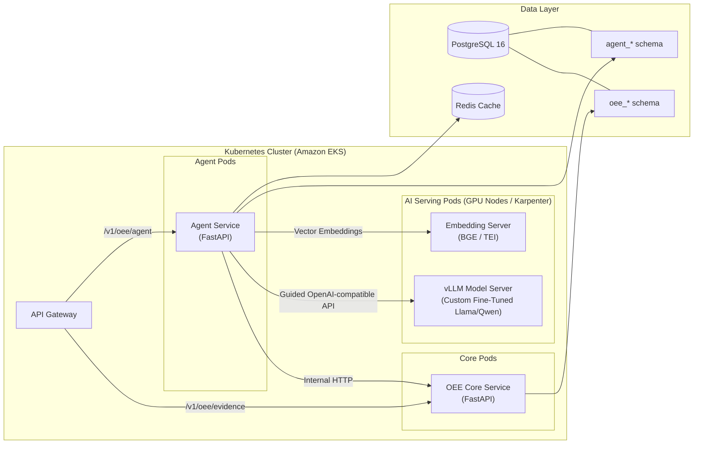

# OEE Intelligence AI Agent Harness

> **Current state (WIS-633, checked 2026-11-03).** Not built as written, and superseded. The agent
> harness that exists is Go: `internal/agent` (WIS-275), with the investigation, interview,
> configuration-draft and chat specialists. It has no Python, FastAPI, LangChain or Redis, and no
> pgvector yet (WIS-627 is waiting on a decision). Retrieval is designed in
> `docs/onboarding-agent/README.md` §4.3. See the `supervisor-agent-runtime` and
> `supervisor-onboarding-agent` skills and rules 08 and 11.

> Component scope: this ADR represents an earlier advisory-agent proposal for the retained OEE component.
> The independent AI Supervisor product is governed by [docs/independent-supervisor.md](../../independent-supervisor.md) (PRD v2.0).
> The AI Supervisor backend, investigation gateway, and approval coordination follow rule 01 (Go owns authority; since 2026-11-12 Python components are allowed only as methods behind a Go-validated contract) with zero MES dependency.

**Status:** historical proposal (retained component)  
**Scope:** WIS-233 AI-assisted OEE diagnostics and advisory intelligence  
**Prerequisite:** ADR 0002 OEE Intelligence Core Module Design  
**Runtime target:** Python 3.12, FastAPI, LangChain/custom orchestration, pgvector, Redis

## 1. Purpose and governing decisions

The purpose of this document is to define the architecture and boundaries for the AI Agent Layer (the "Agent") within the PlantOps OEE Intelligence service. The Agent is designed as an advisory intelligence layer that consumes sealed `OeeEvidencePackV1` evidence from the OEE core service. It provides natural-language diagnostics, anomaly detection, root-cause analysis, and predictive recommendations based on strictly deterministic core outputs.

The governing decisions that are **NON-NEGOTIABLE** for this implementation are:

1. **Read-Only Consumer:** The agent never bypasses the deterministic calculation pipeline. It is strictly a consumer of sealed evidence from the core service.
2. **No State Mutation:** The agent never mutates OEE core state (datasets, policies, or sealed evidence).
3. **No Metric Fabrication:** The agent never fabricates metrics. If a metric cannot be found in a sealed evidence pack, the agent must refuse to provide it.
4. **Advisory Role:** The agent's outputs are strictly advisory, not authoritative. They do not override, modify, or replace the core's `READY` / `NOT_READY` evidence determinations.
5. **Subordination:** The agent design is subordinate to the principles laid out in ADR 0001 (Architecture Principles) and ADR 0002 (OEE Intelligence Core Module Design).

## 2. Architecture overview

The Agent sits DOWNSTREAM of the OEE core as a completely separate bounded context. By physically and logically separating the deterministic OEE calculation engine from the non-deterministic LLM-based agent, we maintain absolute trust in the core metrics while providing advanced diagnostic capabilities.

### 2.1 Logical Architecture Diagram



### 2.2 Key Distinctions

- **Database Schema:** The agent has its own dedicated PostgreSQL schema (using the `agent_*` prefix) containing vector data, conversation history, and agent state. It does NOT have direct database access to the `oee_*` schema.
- **Evidence Access:** The agent consumes evidence entirely through the core's RESTful API interface (`/v1/oee/evidence/{evidenceId}`).
- **Shared Infrastructure:** OIDC Auth and Tenant Context mechanisms remain shared to ensure seamless security boundary propagation.

## 3. Agent capabilities

The Agent provides the following primary capabilities, designed to leverage the deterministic outputs of the core engine.

### 3.1 Natural-language OEE diagnostics

The agent answers ad-hoc questions about OEE performance (e.g., "Why did OEE drop on Line 3 last shift?"). It translates these questions into structured tool calls to fetch relevant `OeeEvidencePackV1` records, summarizes the breakdown of Availability, Performance, and Quality losses, and explains the primary drivers of degradation in plain language.

### 3.2 Anomaly detection

By utilizing statistical methods on cached metrics combined with LLM-based pattern recognition, the agent can identify unusual operational patterns. This includes identifying anomalous downtime frequencies, unexplained performance degradation against historical baselines, and quality defect spikes relative to standard golden vectors.

### 3.3 Root-cause analysis

The agent correlates downtime taxonomy categories with loss classifications. By looking across multiple evidence packs, it can identify systemic issues (e.g., "The primary cause of the 12% drop in Availability is recurring 'Micro-stops' associated with 'Packaging Jam' reason codes on Machine B").

### 3.4 Trend analysis

This capability involves multi-period comparisons of primary metrics (Availability, Performance, Quality, OEE, TEEP). The agent provides contextual explanations for these trends, differentiating between structural changes (e.g., a new policy threshold) and operational changes.

### 3.5 Predictive maintenance recommendations

Leveraging historical evidence pattern analysis, the agent can surface predictive insights. For instance, if specific performance degradation patterns historically precede a major breakdown, the agent can highlight this correlation as an advisory warning.

### 3.6 Policy impact simulation

The agent supports "what-if" scenarios, such as "What would OEE look like under a different availability threshold?" It achieves this by constructing simulated `CalculationPolicyV1` parameters, requesting the core (if supported by a simulation endpoint) or approximating the impact based on existing evidence packs, strictly labeling the output as simulated/advisory.

## 4. Integration boundaries with OEE core

The boundaries between the Agent and the OEE Core are strict, enforcing a one-way flow of trusted data.

### 4.1 Authentication and Authorization

- The agent authenticates to the core service using the standard OIDC provider.
- It receives a `RequestContext` containing the current tenant context.
- The agent strictly inherits tenant isolation from the core; it can only query evidence belonging to the authenticated tenant.

### 4.2 Data Access Protocol

- **Read-Only:** The agent accesses evidence via `GET /v1/oee/evidence/*` endpoints.
- **No Direct DB Access:** The agent cannot issue SQL queries against the core's tables.
- **No Raw Data Access:** The agent cannot access raw MES datasets (`OeeDatasetV1`). It only sees the final, processed, and sealed `OeeEvidencePackV1`.

### 4.3 Forbidden Operations

The agent CANNOT:

- Submit calculation requests or trigger re-calculations.
- Modify calculation policies or golden vectors.
- Write to the core PostgreSQL schema.
- Override a `NOT_READY` or `LIMITED` calculation state.

## 5. Agent orchestration architecture

The agent utilizes a ReAct (Reasoning + Acting) orchestration pattern to break down complex queries into multi-step evidence analysis tasks.

### 5.1 ReAct Pattern

1. **Thought:** The LLM analyzes the user's request.
2. **Action:** The LLM decides to call a specific tool to fetch data.
3. **Observation:** The tool executes, retrieves sealed evidence, and returns the data to the LLM.
4. **Thought/Action Loop:** The LLM iterates until it has sufficient evidence to formulate a complete answer.
5. **Final Output:** The LLM generates the response, strictly citing the retrieved evidence.

### 5.2 Tool-Calling Architecture

The agent is equipped with a specific set of constrained tools:

- `query_evidence(scope: str, window_start: datetime, window_end: datetime)`: Retrieves sealed evidence packs for a specific scope and time window.
- `query_evidence_trends(scope: str, periods: int, period_type: str)`: Retrieves historical evidence across multiple time windows for trend analysis.
- `lookup_downtime_taxonomy(reason_code: str)`: Resolves specific reason codes to their broader categories based on the tenant's taxonomy.
- `compare_metrics(period_a_start, period_a_end, period_b_start, period_b_end, scope)`: Performs a structured numerical comparison of A/P/Q/OEE between two periods.
- `explain_readiness(evidence_id: UUID)`: Fetches and interprets `NOT_READY` or `LIMITED` reason codes from an evidence pack.

### 5.3 System Prompt Design

The system prompt embeds core OEE domain knowledge to guide the LLM's reasoning:

- Strict definitions of OEE = Availability × Performance × Quality.
- Definitions of TEEP (Total Effective Equipment Performance) and the Six Big Losses.
- Directives on tone, advisory nature, and strict adherence to evidence.

### 5.4 Memory and State

- **Conversation Memory:** Redis is used to back session state, maintaining the context of multi-turn conversations.
- **Context Window Management:** Evidence packs are summarized or relevant excerpts are extracted to fit within LLM context limits while retaining metric accuracy.

### 5.5 Grammar-Guided Structured Decoding for Open-Source LLMs

Commercial proprietary APIs rely on closed black-box function calling. To ensure deterministic reliability with self-hosted open-source models (Llama 3.1 / Qwen 2.5):

1. **Schema-Constrained Logit Masking:** The orchestrator enforces strict Pydantic models on tool-call outputs and structured responses using vLLM's guided decoding engine (`guided_json` / Outlines).
2. **Deterministic Syntax:** At each token generation step, the inference engine masks out tokens that would violate the tool parameter JSON schema. This guarantees:
    - Zero malformed JSON responses.
    - Exact type compliance (`datetime`, bounded strings, enum reason codes).
    - Strict adherence to the `citations` array format with valid UUID patterns.
3. **Native Chat Templates:** Prompts are formatted using the model's exact tokenizer chat template (e.g., Llama 3.1 `<|start_header_id|>` tokens), eliminating prompt-drift artifacts.

## 6. Data model and persistence

The Agent operates its own distinct PostgreSQL schema and Redis cache.

### 6.1 Database Schema (`agent_*`)

```sql
-- PostgreSQL 16 with pgvector
CREATE SCHEMA IF NOT EXISTS agent;

CREATE TABLE agent.agent_conversation (
    conversation_id UUID PRIMARY KEY,
    tenant_id UUID NOT NULL,
    user_id VARCHAR NOT NULL,
    created_at TIMESTAMPTZ NOT NULL DEFAULT NOW(),
    updated_at TIMESTAMPTZ NOT NULL DEFAULT NOW(),
    title VARCHAR
);
CREATE INDEX idx_agent_conversation_tenant ON agent.agent_conversation(tenant_id);

CREATE TABLE agent.agent_message (
    message_id UUID PRIMARY KEY,
    conversation_id UUID NOT NULL REFERENCES agent.agent_conversation(conversation_id) ON DELETE CASCADE,
    tenant_id UUID NOT NULL,
    role VARCHAR NOT NULL, -- 'user', 'assistant', 'system', 'tool'
    content TEXT,
    tool_calls JSONB,
    tool_results JSONB,
    citations JSONB, -- Array of evidence_ids referenced
    created_at TIMESTAMPTZ NOT NULL DEFAULT NOW()
);

CREATE TABLE agent.agent_insight_cache (
    insight_id UUID PRIMARY KEY,
    tenant_id UUID NOT NULL,
    scope VARCHAR NOT NULL,
    window_start TIMESTAMPTZ NOT NULL,
    window_end TIMESTAMPTZ NOT NULL,
    insight_type VARCHAR NOT NULL,
    content JSONB NOT NULL,
    provenance JSONB NOT NULL, -- Array of evidence_ids
    expires_at TIMESTAMPTZ NOT NULL,
    created_at TIMESTAMPTZ NOT NULL DEFAULT NOW()
);

CREATE TABLE agent.agent_embedding (
    embedding_id UUID PRIMARY KEY,
    tenant_id UUID NOT NULL,
    evidence_id UUID NOT NULL,
    summary TEXT NOT NULL,
    vector_data vector(1024), -- BAAI/bge-large-en-v1.5 (1024d) or all-MiniLM-L6-v2 (384d)
    created_at TIMESTAMPTZ NOT NULL DEFAULT NOW()
);
CREATE INDEX idx_agent_embedding_vector ON agent.agent_embedding USING hnsw (vector_data vector_l2_ops);

CREATE TABLE agent.agent_audit_entry (
    audit_id UUID PRIMARY KEY,
    tenant_id UUID NOT NULL,
    user_id VARCHAR NOT NULL,
    action VARCHAR NOT NULL,
    resource_id UUID,
    details JSONB,
    created_at TIMESTAMPTZ NOT NULL DEFAULT NOW()
);
```

### 6.2 Embedding Strategy

The `pgvector` extension is used to store and query semantic representations of OEE contexts. We do NOT embed raw data; rather, we embed:

1. Summaries of evidence packs (e.g., "Shift 1 on Line A: OEE 72%. Major loss in Availability due to 45 min unplanned downtime (Code: JAM_01).")
2. Explanations of readiness failures.
3. Historical downtime patterns.

This enables semantic search, such as finding similar historical occurrences of a specific complex failure mode.

## 7. Safety, governance, and guardrails

Because LLMs are non-deterministic, robust guardrails are strictly enforced before any response is returned to the user.

### 7.1 Provenance and Citations

All agent outputs MUST include evidence provenance. Every generated claim or metric must cite the exact `evidenceId` it was derived from. The UI will render these as clickable citations linking to the core evidence pack.

### 7.2 Confidence Scoring

Agent responses include a confidence score (HIGH, MEDIUM, LOW):

- **HIGH:** Exact metric match found in a recent, `READY` evidence pack.
- **MEDIUM:** Inferred from multiple evidence packs or older historical data.
- **LOW:** Limited evidence available, or derived from `LIMITED` readiness state evidence.

### 7.3 Hallucination Prevention

1. **Validation Layer:** A post-generation structured output validator parses metrics from the LLM response and strictly compares them against the cited evidence pack in memory. If a mismatch is detected, the response is blocked and a fallback message is generated.
2. **Refusal Behavior:** The system prompt explicitly commands the agent to refuse to answer if the required evidence cannot be found via tool calls.
3. **No Fabricated IDs:** Tool calls must only use `evidence_id`s that have been verified to exist in the current session context.

### 7.4 Audit and Cost Controls

- **Audit Logging:** Every user query, LLM response, referenced evidence ID, and tool call is logged in `agent_audit_entry` with strict tenant isolation.
- **Rate Limiting:** Per-tenant and global budgets are enforced on LLM API calls.
- **Token Tracking:** Token usage is tracked per request to monitor costs, trigger budget alerts, and automatically throttle abusive usage patterns.
- **Content Filtering:** Strict tenant context enforcement ensures no cross-tenant evidence leakage occurs, and sensitive credentials (JWTs) are stripped from any context passed to the LLM.

## 8. API design

The Agent API conforms to the existing `/v1/oee/` namespace structure and utilizes RFC 9457 for error responses.

### 8.1 API Endpoints

- `POST /v1/oee/agent/query`: Submit a natural language question. Returns a structured answer with citations.
- `GET /v1/oee/agent/insights/{scope}`: Retrieve pre-computed insights for an equipment, line, or site scope.
- `POST /v1/oee/agent/simulate`: Submit a policy impact simulation request.
- `GET /v1/oee/agent/conversations/{conversationId}`: Retrieve conversation history.
- `DELETE /v1/oee/agent/conversations/{conversationId}`: Clear a specific conversation.

### 8.2 Contract Examples

**Request:** `POST /v1/oee/agent/query`

```json
{
    "conversation_id": "123e4567-e89b-12d3-a456-426614174000",
    "query": "Why was OEE so low on Line 1 yesterday?",
    "scope": "line-1",
    "time_context": {
        "start": "2023-10-25T00:00:00Z",
        "end": "2023-10-25T23:59:59Z"
    }
}
```

**Response:**

```json
{
    "response_text": "OEE on Line 1 yesterday was 54.2%. The primary driver was a significant drop in Availability (62.1%), caused by 3 hours of unplanned downtime due to 'Packaging Jam' (Code: PJ-404). Performance and Quality remained within normal bounds.",
    "confidence": "HIGH",
    "citations": [
        {
            "evidence_id": "987f6543-e21b-34c5-b678-1234567890ab",
            "metric_referenced": "OEE",
            "value": 54.2
        },
        {
            "evidence_id": "987f6543-e21b-34c5-b678-1234567890ab",
            "metric_referenced": "Availability",
            "value": 62.1
        }
    ],
    "tool_calls_executed": ["query_evidence", "lookup_downtime_taxonomy"]
}
```

### 8.3 Error Responses (RFC 9457)

```json
{
    "type": "https://api.plantops.com/errors/agent-hallucination-prevented",
    "title": "Unverified Metric Output Detected",
    "status": 409,
    "detail": "The agent attempted to provide a metric that could not be verified against the cited evidence pack.",
    "instance": "/v1/oee/agent/query"
}
```

## 9. Deployment architecture

The Agent is deployed as a physically separate container from the OEE Core, allowing independent scaling based on LLM usage and memory requirements.

### 9.1 Deployment Diagram



### 9.2 Container Configuration

- **Isolation:** Runs as a non-root user.
- **Resource Limits:** Standard CPU/memory limits for FastAPI orchestration; heavy GPU acceleration is offloaded to the dedicated `vLLM` server.
- **Environment Variables:**
  - `INTERNAL_LLM_URL`: Internal endpoint for self-hosted vLLM (`http://oee-llm-server.ai-inference.svc.cluster.local:8000/v1`)
  - `INTERNAL_EMBEDDING_URL`: Internal endpoint for Text Embeddings Inference (`http://oee-embed.ai-inference.svc.cluster.local:8080`)
  - `EMBEDDING_MODEL_NAME`: Name of the self-hosted embedding model (`BAAI/bge-large-en-v1.5`)
  - `REDIS_URL`: URL for session state and rate limiting
  - `AGENT_DB_DSN`: PostgreSQL connection string scoped strictly to the `agent_*` schema

## 10. Technology choices

1. **Dedicated Open-Source LLM Inference:** The agent connects exclusively to our self-hosted, domain-fine-tuned open-source LLM server (vLLM serving custom-trained Llama 3.1 / Qwen 2.5 checkpoints, as defined in ADR 0004). Commercial third-party APIs (OpenAI, Anthropic) are strictly excluded to maintain complete data sovereignty, eliminate external API dependencies, and prevent proprietary manufacturing data from leaving the enterprise VPC boundary.
2. **Orchestration Framework:** LangChain / custom lightweight ReAct runner is selected for deterministic tool-calling interfaces, strict JSON parsing, and full traceability.
3. **Vector Store:** `pgvector` inside PostgreSQL 16. This reuses our existing PostgreSQL operational expertise, avoids introducing a new database technology (like Pinecone or Milvus), and simplifies transactional consistency with conversational state.
4. **Embedding Model:** Open-source `BAAI/bge-large-en-v1.5` (1024d) or `sentence-transformers/all-MiniLM-L6-v2` (384d) self-hosted within the service container or on an internal embedding sidecar.
5. **Caching:** Redis is selected for session state, conversation memory, and rate limiting due to its high performance and native TTL support.

## 11. Testing strategy

Ensuring the reliability of a non-deterministic agent requires specific testing methodologies:

1. **Golden Q&A Test Vectors:** A comprehensive suite of input questions mapped to expected tool calls and output facts to verify domain accuracy.
2. **Hallucination Detection Tests:** Automated tests that intentionally inject prompt variations to verify that the output validation layer correctly blocks hallucinated metrics.
3. **Tenant Isolation Tests:** Assertions verifying that an agent operating under Tenant A's context absolutely cannot retrieve or generate insights based on Tenant B's evidence packs.
4. **Tool-Calling Correctness:** Unit tests verifying that the LLM correctly maps parameters (scope, timestamps) to the internal tool functions.
5. **Cost and Latency Benchmarks:** Tracking average tokens per query and time-to-first-token to ensure the service meets operational SLAs.
6. **Adversarial Prompt Injection Tests:** Validating that the agent resists attempts to break character, expose system prompts, or bypass read-only constraints.

## 12. Delivery order

The implementation of the AI Agent Harness will follow this phased approach:

1. **Phase 1: Foundation:** Agent schema creation (`agent_*`), conversation data models, and API endpoint stubs.
2. **Phase 2: Core Integration:** Implementation of the evidence consumer client communicating with the core's `/v1/oee/evidence` API.
3. **Phase 3: Orchestration:** Definition of the core tools (`query_evidence`, `lookup_downtime_taxonomy`) and initial ReAct loop implementation.
4. **Phase 4: Semantic Search:** Integration of `pgvector` and the embedding generation pipeline for evidence summaries.
5. **Phase 5: Insights Pipeline:** Development of the asynchronous pipeline to generate and cache pre-computed insights.
6. **Phase 6: Simulation:** Implementation of policy impact simulation tooling.
7. **Phase 7: Hardening:** Implementation of strict structured output validation, hallucination guardrails, audit logging, and comprehensive testing.

## 13. Change control

Consistent with the principles established in ADR 0002 (Section 14):

- The Agent model version, prompt definitions, and tool schemas are strictly versioned.
- Changes to the underlying LLM model or significant changes to the system prompt require benchmarking against the Golden Q&A Test Vectors before deployment.
- Any future changes to agent capabilities that affect its level of authority (e.g., proposing automated policy changes) require a superseding Architecture Decision Record, as it would violate the current "Read-Only Consumer" constraint.
