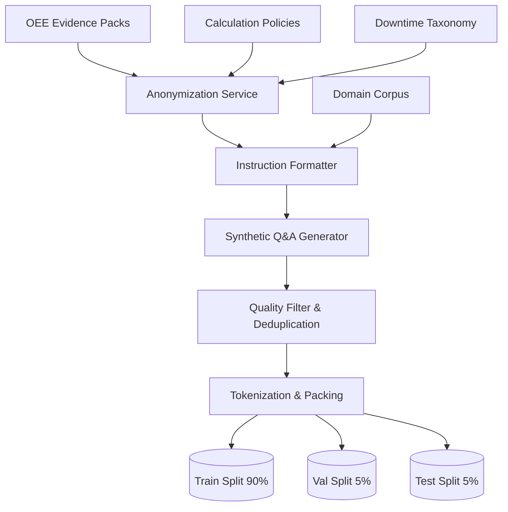
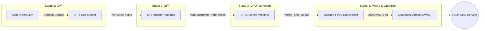
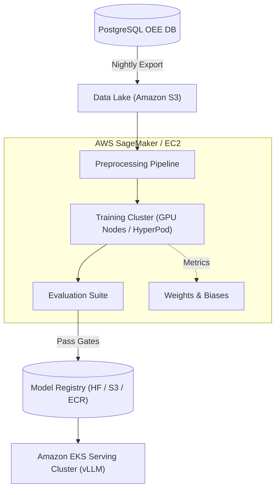

# OEE Intelligence LLM Training Pipeline

> **Current state (WIS-633, checked 2026-11-03).** A proposal; not part of the Supervisor runtime. The
> only Python in this repository is the optional, offline AWS training workload in `deploy/aws/`
> (`training/train.py`, `training/preprocess.py`, `scripts/launch_training.py`), which rule 01
> allows. Its infrastructure is Terraform. The Supervisor calls models only through Go HTTP
> clients (`internal/agent`). See the `supervisor-llm-training-pipeline` and
> `supervisor-aws-training` skills.

**Status:** proposed  
**Scope:** WIS-234 Domain-specific LLM for OEE intelligence  
**Prerequisite:** ADR 0002 OEE Intelligence Core Module Design, ADR 0003 AI Agent Harness  
**Runtime target:** Python 3.12, Hugging Face Transformers, PEFT/TRL, vLLM, CUDA 12.x

## 1. Purpose and training objectives

The PlantOps OEE Intelligence service relies on a deterministic calculation kernel to ensure absolute correctness of Overall Equipment Effectiveness (OEE) metrics. However, interpreting these metrics, analyzing downtime events, and explaining the intricate rules defined in the `CalculationPolicyV1` require advanced natural language understanding.

Generic Large Language Models (LLMs) struggle in this domain for several reasons:

- They lack deep manufacturing and OEE domain knowledge.
- They frequently hallucinate complex OEE formulas or incorrectly aggregate variables across different time windows or production lines.
- They misunderstand specific downtime taxonomies and reason codes that are unique to industrial plant floors.

To bridge this gap, this ADR defines the architecture and pipeline for training/fine-tuning a domain-specific LLM. This model will power the AI Agent Harness (defined in ADR 0003).

### Target Capabilities

The domain-specific model must acquire the following capabilities:

- **OEE formula reasoning:** Deep understanding of Availability × Performance × Quality, Total Effective Equipment Performance (TEEP), and the Six Big Losses framework.
- **Downtime root-cause analysis:** Inferring underlying issues from complex, plant-specific taxonomy reason codes and correlating them with historical trends.
- **Policy interpretation:** Reading and comprehending `CalculationPolicyV1` documents to fluently explain the rules, thresholds, and conditions applied to a given tenant's calculations.
- **Evidence explanation:** Interpreting the precise values within an `OeeEvidencePackV1` to explain how a specific metric was derived and why it fluctuated.
- **Readiness reasoning:** Explaining `NOT_READY`, `LIMITED`, or `INVALID` statuses using granular reason codes and providing actionable remediation advice.
- **Multi-shift/multi-line comparison:** Analyzing trends across disparate datasets, normalizing for shift differences, and surfacing operational insights.

> [!IMPORTANT]
> **NON-GOAL:** The model does NOT replace the deterministic calculation kernel. It explains and analyzes; it does not compute. The system will never fabricate metrics, and generation is unavailable until an approved policy and golden vectors exist.

---

## 2. Model selection

Selecting the correct base model is critical for balancing reasoning capability, deployment cost, and inference latency. This system strictly utilizes **100% open-source / open-weights foundation models**, trained and fine-tuned entirely in-house. Commercial closed-source APIs (such as OpenAI or Anthropic) are explicitly excluded to ensure complete data sovereignty, air-gapped readiness, zero third-party licensing exposure, and absolute privacy for plant telemetry.

### Open-Source Base Model Comparison

| Model                | Parameters           | License             | Fine-tune Cost | Inference Latency | Multilingual | Reasoning   | Recommendation                    |
| :------------------- | :------------------- | :------------------ | :------------- | :---------------- | :----------- | :---------- | :-------------------------------- |
| **Llama 3.1 8B**     | 8B                   | Llama 3.1 Community | Low            | Fast (<30ms)      | Good         | Good        | **Dev, edge & cost-sensitive** |
| **Llama 3.1 70B**    | 70B                  | Llama 3.1 Community | High           | Moderate (~60ms)  | Strong       | Strong      | **Production primary**         |
| **Qwen 2.5 72B**     | 72B                  | Apache 2.0          | High           | Moderate (~65ms)  | Excellent    | Exceptional | **Advanced math & logic**      |
| **Qwen 2.5 14B/32B** | 14B / 32B            | Apache 2.0          | Moderate       | Fast (~40ms)      | Excellent    | Very Strong | High-efficiency mid-tier          |
| **Mistral 7B v0.3**  | 7B                   | Apache 2.0          | Low            | Fast (<30ms)      | Moderate     | Good        | Alternative 7B base               |
| **Mixtral 8x7B**     | 46.7B (12.9B active) | Apache 2.0          | Moderate       | Fast (MoE)        | Good         | Strong      | High-throughput MoE serving       |
| **Gemma 2 9B/27B**   | 9B / 27B             | Gemma Terms         | Low-Moderate   | Fast              | Good         | Good        | Alternative open weights          |

### Recommendation and In-House Training Strategy

- **Development, Prototyping & Edge:** **Llama 3.1 8B with QLoRA (4-bit)**. Trains on a single commodity GPU, provides rapid iteration cycles, and can be deployed directly on edge industrial gateways.
- **Production (Self-Hosted Primary):** **Llama 3.1 70B with LoRA** or **Qwen 2.5 72B**. These deliver world-class reasoning for complex multi-shift root cause analysis, downtime taxonomy disambiguation, and multi-variable OEE loss calculations without sending a single byte of telemetry to external APIs.
- **High-Throughput Serving:** **Mixtral 8x7B (MoE)** or **Llama 3.1 8B (AWQ 4-bit)** as high-concurrency options for high-frequency dashboard queries.
- **Degraded-Mode High-Availability Fallback:** A dedicated self-hosted quantized standby instance (Llama 3.1 8B AWQ) running inside the private VPC, guaranteeing that the service never fails over to external proprietary APIs.

---

## 3. Cloud platform evaluation

Fine-tuning large language models requires specialized, high-memory GPU infrastructure. The table below evaluates major cloud platforms and specialized AI infrastructure providers.

| Platform        | GPU Options        | Managed Fine-tuning | Cost (A100 80GB/hr) | MLOps     | Data Sovereignty | Recommendation       |
| --------------- | ------------------ | ------------------- | ------------------- | --------- | ---------------- | -------------------- |
| AWS (SageMaker) | p4d/p5 (A100/H100) | Yes (JumpStart)     | ~$5-8               | Excellent | Strong           | Recommended          |
| GCP (Vertex AI) | A100, TPU v5e      | Yes (native)        | ~$4-7               | Excellent | Strong           | Viable alternative   |
| Azure AI Studio | NC/ND-series       | Yes (Azure AI)      | ~$5-8               | Good      | Strong           | Microsoft ecosystem  |
| Lambda Labs     | A100/H100          | No                  | ~$1.5-2.5           | Minimal   | Limited          | Cost-optimized burst |
| RunPod          | A100/H100          | No                  | ~$1.5-3             | Minimal   | Limited          | Burst training       |
| Together AI     | Managed            | Yes (fine-tune API) | Pay-per-token       | Good      | Moderate         | Managed API fallback |

### Recommended Architecture

- **Training:** **AWS SageMaker Training Jobs / HyperPod** for managed fine-tuning pipelines. It provides zero-egress integration with our existing AWS S3 data lake and RDS databases, native EFA (Elastic Fabric Adapter) multi-node networking, robust IAM role isolation, and automated cluster recovery. For purely cost-optimized experimental runs on synthetic data, **AWS EC2 Spot Instances** (`p4d.24xlarge` / `g5.12xlarge`) or **Lambda Labs** will be utilized.
- **Fallback / Standby Infrastructure:** A warm-standby self-hosted pod running a quantized open-source model (Llama 3.1 8B AWQ on AWS EKS, or Amazon Bedrock endpoint restricted strictly to open-weights Llama 3.1) for zero-downtime failover during primary cluster updates or capacity spikes, completely eliminating closed third-party dependencies.

---

## 4. Training data preparation

The quality of the fine-tuned model is entirely dependent on the quality of its training data. The data pipeline aggregates from five primary sources to create high-quality instruction and preference pairs.

### Source 1: OEE Evidence Packs

- **Content:** Sealed `OeeEvidencePackV1` records containing calculated metrics, raw counters, applied reason codes, and computation provenance.
- **Anonymization:** A strict pipeline strips `tenant_id`, user/actor references, equipment serial numbers, and proprietary shift names.
- **Format:** Conversion to instruction format where the raw evidence is provided as context, and Q&A pairs explore how metrics were derived.

### Source 2: Calculation Policies

- **Content:** `CalculationPolicyV1` JSON documents defining rules, state thresholds, valid downtime taxonomies, and shift schedules.
- **Format:** "Given this policy, explain the availability threshold and how TEEP is derived for this line" → structured natural language answer.

### Source 3: Downtime Taxonomy

- **Content:** Hierarchical loss classification trees extracted from policies.
- **Format:** Mapping reason codes (e.g., `ERR-304`) to their category (e.g., `Micro-stop`), generating detailed explanations and recommended corrective actions.

### Source 4: Synthetic Q&A Generation

To build conversational robustness while keeping all intellectual property in-house, we utilize self-hosted open-source teacher models (e.g., Llama 3.1 70B Instruct or Qwen 2.5 72B Instruct running locally) along with deterministic template engines to synthesize instruction pairs directly from the structured evidence packs.

Examples of template structures:

- "What was the OEE for {equipment} during {window}?" → extract from evidence.
- "Why was run {run_id} NOT_READY?" → analyze readiness reason codes.
- "Compare availability between {period_a} and {period_b}." → multi-evidence reasoning.
- "What are the top 3 downtime causes for {line} this month?" → aggregation logic.
- "Explain the cost impact of unplanned downtime on {site}." → cost-of-loss analysis.

**Quality Filtering:** Deduplication, format validation, and an LLM-as-a-Judge answer completeness scoring mechanism.

```python
# Synthetic Data Pipeline Snippet
from pydantic import BaseModel
import json


class InstructionPair(BaseModel):
    instruction: str
    input: str
    output: str
    source: str


def generate_evidence_qa(evidence_pack: dict, policy: dict) -> list[InstructionPair]:
    """
    Generates structured Q&A pairs from an anonymized evidence pack.
    """
    pairs = []
    # Example: OEE Breakdown
    oee_val = evidence_pack["metrics"]["oee"]
    availability = evidence_pack["metrics"]["availability"]

    pairs.append(
        InstructionPair(
            instruction="Explain the final OEE calculation based on the provided evidence.",
            input=f"Evidence: {json.dumps(evidence_pack)}",
            output=f"The overall OEE is {oee_val * 100:.2f}%. This is driven by an availability of {availability * 100:.2f}%, "
            f"performance of {evidence_pack['metrics']['performance'] * 100:.2f}%, and "
            f"quality of {evidence_pack['metrics']['quality'] * 100:.2f}%.",
            source="synthetic_evidence_generator",
        )
    )
    return pairs


def format_llama_3_chat(instruction: str, context: str, response: str) -> str:
    """Format pair into Llama 3.1 native special tokens for tokenizer-level alignment."""
    return (
        "<|begin_of_text|><|start_header_id|>system<|end_header_id|>\n"
        "You are the wiseDo PlantOps OEE Domain Intelligence Assistant. "
        "You explain metrics using only sealed OeeEvidencePackV1 facts. "
        "Metric fabrication is strictly prohibited.<|eot_id|>\n"
        f"<|start_header_id|>user<|end_header_id|>\n"
        f"{instruction}\n\nContext:\n{context}<|eot_id|>\n"
        f"<|start_header_id|>assistant<|end_header_id|>\n"
        f"{response}<|eot_id|>"
    )
```

### Source 5: Manufacturing Domain Corpus

- **Content:** Open standards like ISA-95 / IEC 62264, Nakajima's TPM (Total Productive Maintenance), the Six Big Losses framework, and generalized downtime classification best practices.
- **Purpose:** Continued pre-training to steep the model in industrial terminology.

### Data Pipeline Architecture



### Estimated Dataset Sizes

- **Continued Pre-training:** 500M–2B tokens of manufacturing corpus.
- **Supervised Fine-Tuning (SFT):** 50K–200K high-quality instruction pairs (Alpaca format).
- **Direct Preference Optimization (DPO):** 5K–20K preference pairs (chosen vs. rejected responses).

---

## 5. Fine-tuning architecture

To update model weights efficiently without exorbitant compute costs, Parameter-Efficient Fine-Tuning (PEFT) is required, specifically LoRA (Low-Rank Adaptation) and its quantized variant, QLoRA.

### Fine-tuning Methodology Comparison

| Method              | GPU Memory (8B) | GPU Memory (70B) | Training Time | Quality   | Cost      |
| ------------------- | --------------- | ---------------- | ------------- | --------- | --------- |
| Full fine-tune      | 60GB+           | 500GB+           | Long          | Best      | Very High |
| LoRA (r=64)         | 20GB            | 160GB            | Moderate      | Very Good | Moderate  |
| QLoRA (4-bit, r=64) | 10GB            | 48GB             | Fast          | Good      | Low       |

**Recommendation:** QLoRA for 8B development/prototyping, and LoRA (bf16) for 70B production models to maximize quality.

### Training Hyperparameters (8B QLoRA SFT)

```yaml
# config/qlora_8b.yaml
model_name: meta-llama/Llama-3.1-8B-Instruct
quantization: 4bit (nf4)
lora_r: 64
lora_alpha: 128
lora_dropout: 0.05
lora_target_modules:
    [q_proj, k_proj, v_proj, o_proj, gate_proj, up_proj, down_proj]
learning_rate: 2e-4
warmup_ratio: 0.03
num_train_epochs: 3
per_device_train_batch_size: 4
gradient_accumulation_steps: 4
max_seq_length: 4096
bf16: true
gradient_checkpointing: true
optimizer: paged_adamw_8bit
lr_scheduler_type: cosine
weight_decay: 0.01
max_grad_norm: 0.3
```

### Hardware Requirements Table (AWS EC2 / SageMaker)

| Configuration         | AWS GPU Instance                           | GPU Memory | Training Time | Cost Estimate |
| :-------------------- | :----------------------------------------- | :--------- | :------------ | :------------ |
| **8B QLoRA (4-bit)**  | 1× `g5.xlarge` (A10G) or `g6.2xlarge` (L4) | 24GB       | 4–8 hours     | ~$5–$15       |
| **8B LoRA (BF16)**    | 1× `g5.12xlarge` (4× A10G)                 | 96GB       | 6–12 hours    | ~$45–$70      |
| **70B QLoRA (4-bit)** | 1× `g5.48xlarge` (8× A10G)                 | 192GB      | 24–36 hours   | ~$250–$380    |
| **70B LoRA (BF16)**   | 1× `p4de.24xlarge` (8× A100 80GB)          | 640GB      | 24–48 hours   | ~$750–$1,500  |

### Training Implementation Framework

The pipeline utilizes Hugging Face `transformers`, `peft`, and `trl` (Transformer Reinforcement Learning) libraries.

```python
# training_pipeline.py
from peft import LoraConfig, get_peft_model, prepare_model_for_kbit_training
import torch
from transformers import AutoModelForCausalLM, AutoTokenizer, TrainingArguments
from trl import SFTTrainer


def configure_trainer(dataset, config):
    tokenizer = AutoTokenizer.from_pretrained(config.model_name)
    tokenizer.pad_token = tokenizer.eos_token

    # Load model with QLoRA config
    model = AutoModelForCausalLM.from_pretrained(
        config.model_name,
        load_in_4bit=True,
        torch_dtype=torch.bfloat16,
        device_map="auto",
    )

    model = prepare_model_for_kbit_training(model)

    peft_config = LoraConfig(
        r=config.lora_r,
        lora_alpha=config.lora_alpha,
        target_modules=config.lora_target_modules,
        lora_dropout=config.lora_dropout,
        bias="none",
        task_type="CAUSAL_LM",
    )

    model = get_peft_model(model, peft_config)

    training_args = TrainingArguments(
        output_dir="./results",
        per_device_train_batch_size=config.per_device_train_batch_size,
        gradient_accumulation_steps=config.gradient_accumulation_steps,
        learning_rate=config.learning_rate,
        bf16=True,
        logging_steps=10,
        max_steps=config.max_steps,
        optim=config.optimizer,
    )

    trainer = SFTTrainer(
        model=model,
        train_dataset=dataset,
        peft_config=peft_config,
        dataset_text_field="text",
        max_seq_length=config.max_seq_length,
        tokenizer=tokenizer,
        args=training_args,
    )
    return trainer
```

### Multi-Stage Training Pipeline



1. **Stage 1 (Domain Vocabulary):** Continued Pre-Training (CPT) on ISA-95/TPM corpus to ground technical industrial terms (1–2 epochs).
2. **Stage 2 (Instruction Following):** Supervised Fine-Tuning (SFT) teaching the model how to reason over `OeeEvidencePackV1` structures and downtime taxonomy trees (2–3 epochs).
3. **Stage 3 (In-House Preference Optimization - DPO):** Aligning generation to strict industrial reliability standards (1 epoch):
    - **Chosen (Desirable):** Grounded strictly in evidence IDs; includes numerators/denominators; explicitly reports `NOT_READY` reason codes; assigns clear confidence scores.
    - **Rejected (Undesirable):** Hallucinating unmeasured shift times; guessing missing equipment stoppage root causes; rounding canonical decimal strings to imprecise approximations.

### 5.4 In-House LoRA Adapter Merging and Quantization (AWQ/FP8)

To achieve peak inference throughput on Kubernetes without latency penalties:

```python
# merge_and_quantize.py
from awq import AutoAWQForCausalLM
from peft import PeftModel
import torch
from transformers import AutoModelForCausalLM, AutoTokenizer


def merge_and_quantize(base_model_path: str, adapter_path: str, export_path: str):
    # 1. Merge LoRA weights into base model
    base_model = AutoModelForCausalLM.from_pretrained(
        base_model_path, torch_dtype=torch.float16, device_map="cpu"
    )
    model = PeftModel.from_pretrained(base_model, adapter_path)
    merged_model = model.merge_and_unload()
    merged_model.save_pretrained("./tmp_merged")

    # 2. Quantize to AWQ 4-bit for ultra-fast vLLM serving
    quant_config = {"zero_point": True, "q_group_size": 128, "w_bit": 4, "version": "GEMM"}
    quant_model = AutoAWQForCausalLM.from_pretrained("./tmp_merged")
    quant_model.quantize(quant_config=quant_config)
    quant_model.save_quantized(export_path)
```

---

## 6. Training infrastructure

Our MLOps architecture bridges the gap between the deterministic core backend and the machine learning environments.

#### Architecture Diagram



### Component Details

- **Infrastructure-as-Code (Terraform `.tf`):** All cloud resources have been codified into declarative **Terraform (`.tf`)** configurations under `deploy/aws/` (`main.tf`, `iam.tf`, `network.tf`, `variables.tf`, `outputs.tf`), eliminating imperative Python-based infrastructure provisioning scripts. Python is reserved strictly for training execution inside containerized environments.
- **Data Lake (Amazon S3):** Versioned, immutable S3 buckets with AWS KMS (SSE-KMS) encryption for raw and processed training datasets.
- **Preprocessing Pipeline:** AWS Batch or containerized ECS/EKS cron jobs executing anonymization, formatting, and quality filtering.
- **Training Cluster:** AWS SageMaker Training Jobs / HyperPod or EC2 `p4d.24xlarge` GPU instances utilizing EFA and NCCL for multi-GPU communication (FSDP / DeepSpeed ZeRO-3 for 70B models).
- **Experiment Tracking:** Weights & Biases (W&B) or Amazon SageMaker Experiments for monitoring loss curves, learning rates, GPU utilization, and generation samples during training.
- **Model Registry:** Private Hugging Face Hub namespace or versioned Amazon S3 buckets + Amazon ECR for storing base models, LoRA adapter weights, and fully merged containerized checkpoints.
- **CI/CD Triggers:** Automated pipelines triggered by:
  - Monthly aggregations of new OEE evidence data in S3.
  - Substantial revisions to core calculation policies.
  - Manual kick-off by the AI engineering team via GitHub Actions / AWS CodePipeline.

---

## 7. Evaluation and benchmarks

To ensure the model improves on domain tasks without suffering from catastrophic forgetting of general reasoning capabilities, a rigorous two-tier evaluation suite is implemented.

### Domain-Specific Benchmarks

| Benchmark               | Description                                | Pass Threshold | Method                    |
| ----------------------- | ------------------------------------------ | -------------- | ------------------------- |
| OEE Formula Accuracy    | Given A/P/Q values, explain OEE correctly  | 95%            | Exact match               |
| Readiness Reasoning     | Explain NOT_READY status from reason codes | 90%            | Expert review + LLM judge |
| Downtime Classification | Map events to correct taxonomy categories  | 92%            | Exact match               |
| Policy Interpretation   | Explain policy rules in natural language   | 85%            | LLM judge                 |
| Evidence Explanation    | Summarize evidence pack accurately         | 88%            | ROUGE + expert review     |
| Hallucination Rate      | % of responses with fabricated metrics     | < 2%           | Automated detection       |
| Cross-tenant Leakage    | Agent leaks data from another tenant       | 0%             | Adversarial testing       |

### General Benchmarks

To prevent model degradation:

- **MMLU (Massive Multitask Language Understanding):** Must not drop > 5% relative to the base model.
- **HellaSwag:** Must not drop > 3%.
- **GSM8K & ARC:** Reasoning benchmarks must remain within 5% of base model scores.

### Evaluation Pipeline

1. **Automated Run:** Execute lm-evaluation-harness alongside custom pytest-based domain scripts immediately after training.
2. **LLM-as-a-Judge:** Use a self-hosted open-source judge model (e.g. Llama 3.1 70B Instruct or Prometheus 2 open-eval model) to evaluate complex conversational outputs against sealed ground-truth evidence packs.
3. **Expert Review:** Required for major version updates.
4. **Promotion:** Only models passing all gates are promoted to the Staging Model Registry.

---

## 8. Model deployment and serving

The chosen model must be served efficiently to support the API latencies expected by the AI Agent Harness.

### Serving Framework Options

| Framework | Throughput | Latency  | Quantization    | Ease of Use |
| --------- | ---------- | -------- | --------------- | ----------- |
| vLLM      | Excellent  | Low      | GPTQ, AWQ       | Good        |
| TGI       | Very Good  | Low      | GPTQ, AWQ, GGUF | Good        |
| Triton    | Excellent  | Lowest   | All formats     | Complex     |
| Ollama    | Good       | Moderate | GGUF            | Easiest     |

**Recommendation:** **vLLM** for production workloads due to its superior PagedAttention memory management and continuous batching. **Ollama** will be provided for local developer environments.

### Inference Optimization

- **Quantization:** AWQ 4-bit quantization will be used for production serving to maximize throughput while minimizing quality degradation.
- **KV-Cache Optimization:** Enabled by default in vLLM.
- **Speculative Decoding:** Evaluated for reducing time-to-first-token on latency-critical endpoints.

### Kubernetes Deployment Example

```yaml
# vllm-deployment.yaml
apiVersion: apps/v1
kind: Deployment
metadata:
    name: oee-llm-server
    namespace: ai-inference
spec:
    replicas: 2
    selector:
        matchLabels:
            app: oee-llm
    template:
        metadata:
            labels:
                app: oee-llm
        spec:
            nodeSelector:
                karpenter.sh/nodepool: gpu-inference
            tolerations:
                - key: "nvidia.com/gpu"
                  operator: "Exists"
                  effect: "NoSchedule"
            containers:
                - name: vllm
                  image: vllm/vllm-openai:v0.4.0
                  command:
                      ["python3", "-m", "vllm.entrypoints.openai.api_server"]
                  args:
                      - "--model"
                      - "wisedo/oee-llama-70b-awq"
                      - "--tensor-parallel-size"
                      - "2"
                      - "--gpu-memory-utilization"
                      - "0.9"
                      - "--max-model-len"
                      - "8192"
                  resources:
                      limits:
                          nvidia.com/gpu: 2
                  ports:
                      - containerPort: 8000
```

### Auto-scaling and Versioning

- **HPA:** Horizontal Pod Autoscaler scales based on vLLM request queue depth and GPU utilization metrics.
- **Versioning:** Models are versioned semantically (`oee-llm-v1.2.0`). Major bumps correlate to base model changes; minor to new dataset inclusions.
- **A/B Testing:** Envoy proxies route a percentage of shadow traffic to newly deployed models before cutting over primary traffic.

---

## 9. Security and data governance

Given the highly proprietary nature of manufacturing data, stringent security measures are applied throughout the pipeline.

### Training Data Security

- **Anonymization:** As defined in Section 4, rigorous scrubbing removes all PII and specific asset identifiers. `tenant_id`, `actor_id`, and JWT claims are strictly banned from the corpus.
- **Isolation:** No production secrets, database connection strings, or API keys are ever exposed to the training cluster.
- **Storage:** Training data is stored in Amazon S3 buckets encrypted with AWS KMS (SSE-KMS) with AWS CloudTrail data-event audit logging enabled.

### Model Security

- **Access Control:** Model weights are stored in private registries. Download access is governed by IAM roles restricted to the deployment pipelines.
- **Inference Path:** The serving endpoint sits strictly behind the internal network and is protected by the same OIDC authentication as the core OEE service. Inference queries are injected with tenant context via the system prompt (controlled by the Agent Harness, not the user).
- **Auditability:** Inference requests and generated responses are logged asynchronously with tenant context to facilitate auditing and debugging.

### Regulatory Compliance

- **GDPR:** In compliance with "Right to Erasure", if a tenant exercises deletion rights, an automated impact analysis determines if their anonymized data significantly influenced the current model. If so, a retraining cadence is triggered on a newly sanitized dataset.
- **Data Sovereignty:** Training clusters and serving nodes are strictly deployed within approved geographical regions to satisfy local data residency requirements.

---

## 10. Cost analysis

Running specialized AI infrastructure introduces significant CapEx and OpEx.

### Estimated Training Costs

| Phase                      | 8B Model    | 70B Model       |
| -------------------------- | ----------- | --------------- |
| Data preprocessing         | ~$5         | ~$5             |
| Continued pre-training     | ~$20-50     | ~$200-500       |
| SFT fine-tuning            | ~$10-20     | ~$200-400       |
| DPO alignment              | ~$5-10      | ~$100-200       |
| Evaluation                 | ~$5         | ~$20            |
| **Total per training run** | **~$45-90** | **~$525-1,125** |

### Estimated Monthly Inference Costs (AWS EC2 / EKS)

| Deployment Tier | AWS Instance / GPU          | Requests/day | Monthly Cost |
| --------------- | --------------------------- | ------------ | ------------ |
| Development     | 1× g5.xlarge (A10G 24GB)    | 100          | ~$180        |
| Staging         | 1× g5.12xlarge (4× A10G)    | 1,000        | ~$850        |
| Production      | 1× p4d.24xlarge (8× A100)   | 10,000       | ~$3,200      |
| Production (HA) | 2× p4de.24xlarge (Multi-AZ) | 50,000+      | ~$6,500      |

### Cost Optimization Strategies

- **Spot Instances:** Utilizing AWS EC2 Spot instances for SageMaker/batch training jobs reduces compute costs by up to 70%.
- **Semantic Caching:** Implementing Redis-based semantic caching (e.g., using GPTCache) in front of the inference server to serve identical analytics queries instantly.
- **Progressive Routing:** Routing simple queries to the 8B model and complex reasoning tasks to the 70B model.

---

## 11. Delivery order

To manage risk, the implementation will proceed in the following phases:

1. **Training Data Pipeline:** Establish the anonymization, formatting, and quality filtering workflows.
2. **Base Model Validation:** Benchmark vanilla Llama 3.1 8B, Mistral 7B, and Qwen 2.5 7B on early synthetics.
3. **Initial Prototyping:** Perform QLoRA fine-tuning on the 8B model with an initial batch of 10K instruction pairs.
4. **Evaluation Framework:** Construct the automated domain benchmark suite.
5. **Data Scaling:** Scale data production to 50K-200K high-quality pairs and iterate on data mixture.
6. **Production Training:** Execute full LoRA training on the 70B model.
7. **Infrastructure:** Deploy vLLM serving infrastructure on Amazon EKS with Karpenter.
8. **Shadow Deployment:** Establish A/B testing frameworks and run the model in shadow mode against live API traffic.
9. **General Availability:** Cutover production traffic, enabling monitoring and automated cost controls.

---

## 12. Change control

- **Model Versions:** Any promotion of a new model version requires a documented `pass` from the automated evaluation suite.
- **Data Changes:** Modifications to the training data distribution or source logic require re-evaluation against historical baselines.
- **Base Model Upgrades:** Moving to a new foundation model (e.g., upgrading from Llama 3.1 to Llama 4) requires a complete retraining pipeline execution and human-in-the-loop validation.
- **Schema Revisions:** Structural changes to the core deterministic schemas (e.g., migrating to `OeeEvidencePackV1` v2) mandate a regeneration of the synthetic training datasets and a subsequent retraining run to prevent the model from generating outdated JSON schemas.
