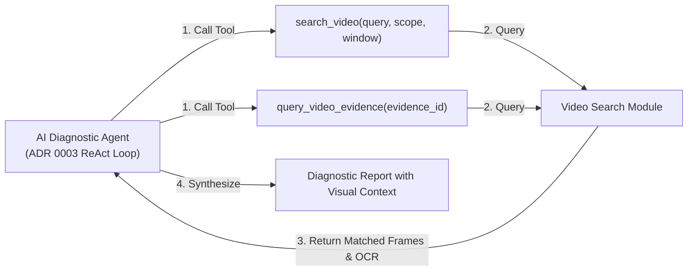

# Video Search Architecture — Real-Time Vector Embeddings

> **Current state (WIS-633, checked 2026-11-03).** A historical proposal; not built. Its Python modules,
> Alembic migrations (`migrations/versions/*.py`) and `src/.../*.py` paths are not in this repository,
> and no video-search table exists in `internal/migrate`. Any future implementation would be Go
> (Supervisor) or C++ (edge, rule 01).
> The RLS setting written below as `app.tenant_id` is `supervisor.tenant_id` in the code
> (`internal/store`).

> Component scope: this ADR represents an earlier video search and embedding proposal.
> The independent AI Supervisor product is governed by [docs/independent-supervisor.md](../../independent-supervisor.md) (PRD v2.0).
> Edge visual inspection is governed by Future Vision ([ADR 0007](0007-wisedo-future-vision-architecture.md)); it runs as a native C++20/OpenCV executable.

| Field              | Value                                                         |
| :----------------- | :------------------------------------------------------------ |
| **Document**       | 0006 — Video Search Architecture                              |
| **Status**         | Historical Proposal                                           |
| **ADR References** | ADR 0003 (AI Agent Harness), ADR 0004 (LLM Training Pipeline) |
| **Authors**        | Ayush Kumar (Implementation Owner)                            |
| **Created**        | 2026-09-24                                                    |

---

## 1. Overview

The Video Search Module enables **searchable video indexes** for plant
floor operations. During video capture from CCTV, machine vision
cameras, or operator recordings, real-time vector embeddings are
generated and stored in PostgreSQL + pgvector. Operators and engineers
can then search across video history using natural language:
The Video Search Module enables **real-time searchable video indexing** for industrial manufacturing operations. As IP cameras, industrial machine vision systems, and operator inspection tablets stream or record plant-floor events, the system extracts key video frames and encodes them into dense semantic vectors in real time.

- _"Show me all conveyor jam incidents on Line 3 this week"_
- _"Find the changeover procedure on Machine B from last shift"_
- _"When did the operator last inspect the packaging station?"_
  Plant operators, quality engineers, and autonomous AI agents can query hours or days of footage using natural language and image references:

The module is a **separate bounded context** from the OEE core,
following the same separation principle established in ADR 0003. It
**consumes** OEE evidence for context enrichment but **never modifies**
core state.

- _"Show all conveyor belt jams on Packaging Line 3 during shift 2"_
- _"Find occurrences where safety guards were opened on CNC Mill 4"_
- _"Locate when the operator executed the product changeover procedure yesterday"_
- _"Show machine display warning ERR-304 on Line 1"_

The module is architected as an **independent bounded context** (`video_search.*`). It consumes OEE evidence and downtime markers for correlation, while leaving core calculation pipelines completely unmodified.

---

## 2. Architecture

## 2. Architecture & System Context

### 2.1 System Context

### 2.1 System Architecture Diagram

```
 ┌─────────────────────────────────────────────────────────────────────┐
 │                        Plant Floor                                  │
 │                                                                     │
 │   ┌──────────┐  ┌──────────┐  ┌──────────┐  ┌──────────────────┐   │
 │   │ Camera 1 │  │ Camera 2 │  │ Camera N │  │ Operator Device  │   │
 │   │ (RTSP)   │  │ (RTSP)   │  │ (RTSP)   │  │ (on-demand rec)  │   │
 │   └────┬─────┘  └────┬─────┘  └────┬─────┘  └────────┬─────────┘   │
 │        │              │              │                 │             │
 │        └──────────────┴──────┬───────┴─────────────────┘             │
 │                              │                                       │
 └──────────────────────────────┼───────────────────────────────────────┘
                                │  RTSP / HTTPS
                                ▼
                   ┌─────────────────────────┐
                   │    Edge Processor        │
                   │  ┌────────────────────┐  │
                   │  │ Frame Extractor    │  │
                   │  │ Adaptive Sampler   │  │
                   │  │ CLIP Vision Encode │  │
                   │  │ Metadata Enricher  │  │
                   │  └────────────────────┘  │
                   └────────────┬──────────────┘
                                │
              ┌─────────────────┼──────────────────┐
              │                 │                   │
              ▼                 ▼                   ▼
   ┌──────────────────┐ ┌──────────────┐  ┌────────────────┐
   │  PostgreSQL 16   │ │  Redis 7     │  │  S3 / Object   │
   │  + pgvector      │ │  (hot cache) │  │  Storage       │
   │                  │ │              │  │  (SSE-KMS)     │
   │  video_search.*  │ │  recent      │  │  frames/       │
   │  tables          │ │  embeddings  │  │  thumbnails/   │
   │  HNSW index      │ │  session     │  │  clips/        │
   └────────┬─────────┘ └──────────────┘  └────────────────┘
            │
            │  cosine similarity search
            ▼
   ┌──────────────────────────────────────────────┐
   │           Video Search API                    │
   │  POST /v1/oee/video/search                    │
   │  GET  /v1/oee/video/frames/{id}               │
   │  GET  /v1/oee/video/evidence/{id}/frames      │
   └──────────────────────┬───────────────────────┘
                          │
              ┌───────────┴───────────┐
              │                       │
              ▼                       ▼
   ┌──────────────────┐    ┌──────────────────┐
   │  Operator UI     │    │  AI Agent        │
   │  (web dashboard) │    │  (ADR 0003)      │
   │                  │    │  search_video()  │
   │                  │    │  query_evidence()│
   └──────────────────┘    └──────────────────┘
```

```mermaid
flowchart TD
    subgraph Floor["Plant Floor Operations"]
        CAM1["IP Camera 1 (RTSP)"]
        CAM2["IP Camera 2 (RTSP)"]
        CAMN["Machine Vision / CCTV"]
        TAB["Operator Tablet (On-Demand)"]
    end

### 2.2 Component Responsibilities
    subgraph Edge["Edge Stream Ingestion"]
        STREAM["RTSP / WebRTC Receiver"]
        SAMPLER["Adaptive Frame Sampler<br/>(State-Driven: 0.2s - 5.0s)"]
        OCR["HMI / Display OCR Engine"]
        ENCODER["CLIP ViT-L/14 Vision Encoder<br/>(Self-Hosted GPU Worker)"]

| Component           | Responsibility                                | Location                    |
| ------------------- | --------------------------------------------- | --------------------------- |
| Edge Processor      | RTSP decode, adaptive sampling, CLIP encoding | Edge gateway / K8s DaemonSet |
| CLIP Vision Encoder | Frame → 768-dim vector                        | GPU pod (A10G, self-hosted)  |
| CLIP Text Encoder   | Query text → 768-dim vector                   | CPU pod (lightweight)        |
| PostgreSQL+pgvector | HNSW index for ANN search, RLS tenant isolation | Existing PG cluster, new schema |
| Redis               | Recent frame embedding hot cache, session     | Existing Redis instance      |
| S3 / Object Storage | Raw frames, thumbnails, 10-second clips       | SSE-KMS encrypted buckets    |
| Video Search API    | FastAPI routes under `/v1/oee/video/`         | Core service (new router)    |
        STREAM --> SAMPLER
        SAMPLER --> OCR
        SAMPLER --> ENCODER
    end

---
    subgraph Storage["Storage & Indexing Infrastructure"]
        PG[("PostgreSQL 16 + pgvector<br/>video_search.* schema<br/>HNSW Cosine Index")]
        S3[("S3 Object Storage<br/>Encrypted SSE-KMS<br/>Frames, Clips & Thumbs")]
        REDIS[("Redis 7<br/>Hot Embedding Cache & State")]
    end

## 3. Real-Time Embedding Pipeline
    subgraph Search["Search & Discovery Services"]
        TEXT_ENC["CLIP Text Encoder"]
        SEARCH_API["Video Search API<br/>/v1/oee/video/search"]
    end

### 3.1 Frame Extraction — Adaptive Sampling Strategy
    subgraph Consumers["Downstream Consumers"]
        UI["Web Ops Dashboard"]
        AGENT["AI Agent Harness (ADR 0003)<br/>Tools: search_video, query_evidence"]
        OEE["OEE Evidence Pipeline<br/>Downtime Correlation"]
    end

Video streams are **NOT** embedded frame-by-frame (that would be 25–60
embeddings per second per camera, which is impractical). Instead, an
**adaptive sampling strategy** adjusts rate based on equipment state:
    CAM1 & CAM2 & CAMN & TAB --> STREAM
    ENCODER & OCR --> PG
    SAMPLER --> S3
    ENCODER --> REDIS

| Mode                | Sample Rate        | Trigger Condition                       | What's Stored                            |
| ------------------- | ------------------ | --------------------------------------- | ---------------------------------------- |
| **Idle Monitoring** | 1 frame / 5 sec    | Equipment state = `STANDBY` or `NOT_SCHEDULED` | Embedding only (no raw frame)     |
| **Active Production** | 1 frame / 1 sec  | Equipment state = `PRODUCING`           | Embedding + thumbnail                    |
| **Event-Triggered** | 5 frames / sec     | Downtime event start, quality alert, state transition | Embedding + full-res frame + 10s clip |
| **On-Demand**       | Full frame rate    | Operator-initiated recording            | Full video + embeddings                  |
    SEARCH_API --> TEXT_ENC
    TEXT_ENC --> PG
    SEARCH_API --> PG
    SEARCH_API --> S3

The sample rate is driven by the equipment's current
`EquipmentStateFactV1.state_code` from the OEE dataset, creating a
direct integration point between the OEE core and video search.
    UI & AGENT --> SEARCH_API
    OEE -.->|Correlates downtime_event_id| PG
```

### 3.2 Why Adaptive Sampling?

### 2.2 Component Responsibilities

| Concern                   | Fixed 1fps                                                                                 | Adaptive                                        |
| ------------------------- | ------------------------------------------------------------------------------------------ | ----------------------------------------------- |
| Storage / day             | ~86,400 embeddings / camera                                                                | ~20,000–40,000 / camera                         |
| GPU utilization           | Constant load                                                                              | Burst on events, idle rest                      |
| Search relevance          | Many redundant idle frames                                                                 | Dense coverage when it matters                  |
| Event resolution          | May miss fast events                                                                       | 5fps captures transients                        |
| Component                 | Responsibility                                                                             | Deployment Target                               |
| :---                      | :---                                                                                       | :---                                            |
| **Edge Stream Ingestion** | Connects to camera RTSP feeds, decodes frames, applies adaptive rate throttling            | Edge Gateway or Kubernetes DaemonSet            |
| **Adaptive Sampler**      | Dynamically shifts sampling frequency ($0.2\text{s} - 5.0\text{s}$) based on machine state | Edge Python/C++ Worker                          |
| **CLIP Vision Encoder**   | Preprocesses image frames and generates 768-dimensional float32 vectors                    | GPU Pod (NVIDIA A10G / L4, TensorRT)            |
| **CLIP Text Encoder**     | Converts natural-language user search prompts into 768-dimensional query vectors           | CPU Pod (FastAPI backend)                       |
| **pgvector Storage**      | Stores frame vectors, metadata, and performs fast ANN nearest-neighbor cosine search       | PostgreSQL 16 (`video_search.*`)                |
| **S3 Object Storage**     | Stores raw frames, downscaled thumbnails, and 10-second MP4 event snippets                 | AWS S3 (Encrypted via customer-managed KMS key) |
| **Video Search API**      | Exposes REST/JSON endpoints with multi-tenant row-level security enforcement               | FastAPI application service                     |
| **AI Agent Harness**      | Invokes vector search via read-only tools to diagnose root causes of OEE downtime          | Agent Orchestrator (ADR 0003)                   |

### 3.3 Vision Embedding Model Selection

---

The model must be **self-hosted** (consistent with ADR 0004's data
sovereignty requirements — no cloud APIs for plant floor video).

## 3. Real-Time Embedding Pipeline

| Model               | Embedding Dim | Throughput (A10G) | Text-Image Alignment | License    |
| ------------------- | ------------- | ----------------- | -------------------- | ---------- |
| CLIP ViT-B/32       | 512           | ~450 img/s        | Good                 | MIT        |
| **CLIP ViT-L/14** ★ | **768**       | **~120 img/s**    | **Very Good**        | **MIT**    |
| SigLIP ViT-SO400M   | 1152          | ~80 img/s         | Excellent            | Apache 2.0 |
| EVA-CLIP ViT-G      | 1024          | ~40 img/s         | Excellent            | MIT        |

### 3.1 Adaptive Frame Sampling Strategy

**Recommendation: CLIP ViT-L/14** (768-dim)
Embedding full 30 FPS video generates 108,000 vectors per camera per hour, introducing unnecessary compute overhead and vector index bloat. Instead, the pipeline employs **adaptive, state-driven sampling**:

Reasons:

| Operational Mode      | Sampling Frequency               | Trigger Condition                                        | Stored Assets                               |
| :-------------------- | :------------------------------- | :------------------------------------------------------- | :------------------------------------------ |
| **Idle Monitoring**   | $0.2\text{ FPS}$ (1 frame / 5s)  | Machine state is `STANDBY`, `UNSCHEDULED`, or `OFF`      | Vector embedding only (no raw image stored) |
| **Active Production** | $1.0\text{ FPS}$ (1 frame / 1s)  | Machine state is `PRODUCING` or `RUNNING`                | Vector embedding + JPEG thumbnail           |
| **Event-Triggered**   | $5.0\text{ FPS}$ (5 frames / 1s) | Downtime trigger, E-stop, interlock trip, or scrap burst | High-res image + vector + 10s video clip    |
| **On-Demand**         | Native stream rate               | Operator manual recording or audit inspection            | Full video segment + dense embeddings       |

1. **Same model encodes images AND text** — enables direct cross-modal
   search without a separate text model
2. **768-dim** is a good balance between quality and storage
   (3 KB per embedding vs. 4.5 KB for 1152-dim)
3. **~120 img/s on A10G** handles the burst event-triggered mode
   (5 cameras × 5fps = 25 img/s) with headroom
4. **MIT license** — no restrictions on commercial self-hosted deployment
5. **Mature ecosystem** — well-supported by PyTorch, ONNX, TensorRT

```mermaid
flowchart TD
    STATE["Read Latest Equipment State<br/>(from OeeDatasetV1.equipment_states)"]
    BRANCH{"Operational Mode?"}

### 3.4 Embedding Generation Flow
    STATE --> BRANCH
    BRANCH -->|STANDBY / IDLE| S_IDLE["Sample at 0.2 FPS (1 frame / 5s)<br/>Store embedding only"]
    BRANCH -->|PRODUCING| S_ACTIVE["Sample at 1.0 FPS (1 frame / 1s)<br/>Store embedding + thumbnail"]
    BRANCH -->|DOWNTIME / FAULT| S_EVENT["Sample at 5.0 FPS (5 frames / 1s)<br/>Store high-res frame + 10s clip"]

    S_IDLE & S_ACTIVE & S_EVENT --> INGEST["Batch Preprocessing & Embedding"]
```

┌────────────────────────────────────────────────────────────────────┐
│ Edge Processor Pipeline │
│ │
│ 1. RTSP Stream ──▶ FFmpeg/OpenCV decode │
│ │ │
│ 2. Adaptive Sampler ◄───┘ │
│ ├── Check equipment state from latest OEE dataset │
│ ├── Select sampling rate (idle/active/event/on-demand) │
│ └── Drop or keep frame │
│ │ │
│ 3. Preprocess ◄─────────┘ │
│ ├── Resize to 224×224 │
│ ├── Normalize (CLIP mean/std) │
│ └── Batch (up to 32 frames) │
│ │ │
│ 4. CLIP ViT-L/14 ◄─────┘ │
│ ├── Forward pass (~8ms per image on A10G) │
│ ├── L2-normalize the 768-dim output │
│ └── Output: float32 vector │
│ │ │
│ 5. Metadata Enricher ◄──┘ │
│ ├── Attach: timestamp, camera_id, equipment_id │
│ ├── Attach: site_id, line_id, shift_code │
│ ├── Attach: state_code (from OEE dataset) │
│ ├── Attach: sampling_mode │
│ └── Optional: OCR text from HMI screens │
│ │ │
│ 6. Store ◄──────────────┘ │
│ ├── INSERT embedding + metadata → PostgreSQL (pgvector) │
│ ├── PUT frame/thumbnail → S3 (SSE-KMS encrypted) │
│ ├── SET recent frame → Redis (hot cache, 1-hour TTL) │
│ └── UPDATE frame_url reference in PostgreSQL │
│ │
└────────────────────────────────────────────────────────────────────┘

````

---
### 3.2 Vision Model Selection

## 4. Data Model — PostgreSQL + pgvector
In strict accordance with ADR 0004's data-sovereignty principles, plant footage must never leave the customer's VPC to third-party proprietary APIs. The embedding model is self-hosted:

The video search module uses its own schema (`video_search`),
completely separated from the OEE core's `oee_*` schema. This follows
the same isolation principle as the agent schema in ADR 0003 Sec. 6.1.
| Model Candidate | Vector Dim | Throughput (NVIDIA A10G) | Multimodal Alignment | License | Selected? |
| :--- | :--- | :--- | :--- | :--- | :--- |
| CLIP ViT-B/32 | 512 | $\sim 450 \text{ frames/s}$ | Good | MIT | No (lower accuracy) |
| **CLIP ViT-L/14** | **768** | **$\sim 120 \text{ frames/s}$** | **Excellent** | **MIT** | **Yes (Standard)** |
| SigLIP ViT-SO400M | 1152 | $\sim 80 \text{ frames/s}$ | Superior | Apache 2.0 | Optional Upgrade |
| EVA-CLIP ViT-G | 1024 | $\sim 40 \text{ frames/s}$ | State-of-the-Art | MIT | High GPU Demand |

### 4.1 Schema Design
**Key Advantages of CLIP ViT-L/14 (768-dim):**
1. **Shared Embedding Space:** Images and text queries are projected into the same unified latent space, enabling zero-shot search with no separate indexing.
2. **Compact Footprint:** 768 dimensions $\times 4 \text{ bytes} = 3.072 \text{ KB}$ per vector, enabling millions of vectors within modest database memory.
3. **High Throughput:** 120 FPS on an A10G easily supports 12 simultaneous cameras under active sampling.

**All tables enforce Row-Level Security (RLS)**, the same pattern used
by the OEE core (tenant_id column + forced RLS policy matching
`current_setting('app.tenant_id')`).
### 3.3 End-to-End Ingestion Flow

#### Table: `vs_camera` — Camera Registry
```mermaid
sequenceDiagram
    autonumber
    participant Cam as IP Camera (RTSP)
    participant Edge as Edge Sampler
    participant Vision as CLIP Vision Pod (GPU)
    participant DB as PostgreSQL (pgvector)
    participant S3 as S3 Object Store

| Column           | Type         | Description                               |
| ---------------- | ------------ | ----------------------------------------- |
| `camera_id`      | UUID PK      | Unique camera identifier                  |
| `tenant_id`      | UUID NOT NULL | Tenant isolation                          |
| `equipment_id`   | VARCHAR(128) | Linked equipment (from MasterDataRef)      |
| `line_id`        | VARCHAR(128) | Production line                           |
| `site_id`        | VARCHAR(128) | Plant site                                |
| `camera_name`    | VARCHAR(256) | Human-readable name                       |
| `stream_url_ref` | VARCHAR(256) | Secret-manager ref (never raw RTSP URL)   |
| `is_active`      | BOOLEAN      | Enable/disable toggle                     |
| `created_at`     | TIMESTAMPTZ  | Creation time                             |
| `updated_at`     | TIMESTAMPTZ  | Last update time                          |
    Cam->>Edge: Continuous RTSP H.264 stream
    Edge->>Edge: Determine sampling mode from equipment state
    Edge->>Edge: Extract keyframe & resize to 224x224
    Edge->>Vision: Post image batch (up to 32 frames)
    Vision->>Vision: Forward pass & L2-normalize vector
    Vision-->>Edge: Return 768-dim float32 vectors
    par Persist Vectors & Imagery
        Edge->>DB: INSERT into vs_frame_embedding (vector, timestamp, metadata)
        Edge->>S3: Upload thumbnail / event clip (SSE-KMS encrypted)
    end
    Edge->>DB: UPDATE frame_url and thumbnail_url references
````

## Indexes: `(tenant_id)`, `(tenant_id, equipment_id)`

#### Table: `vs_frame_embedding` — Core Searchable Index

## 4. PostgreSQL + pgvector Data Model

| Column            | Type          | Description                            |
| ----------------- | ------------- | -------------------------------------- |
| `embedding_id`    | UUID PK       | Unique embedding identifier            |
| `tenant_id`       | UUID NOT NULL | Tenant isolation                       |
| `camera_id`       | UUID FK       | Source camera                          |
| `captured_at_utc` | TIMESTAMPTZ   | Frame capture time (UTC)               |
| `equipment_id`    | VARCHAR(128)  | Equipment at capture time              |
| `line_id`         | VARCHAR(128)  | Line at capture time                   |
| `site_id`         | VARCHAR(128)  | Site at capture time                   |
| `state_code`      | VARCHAR(64)   | Equipment state at capture time        |
| `shift_code`      | VARCHAR(64)   | Shift identifier                       |
| `sampling_mode`   | VARCHAR(32)   | `IDLE`, `ACTIVE`, `EVENT`, `ON_DEMAND` |
| `vector`          | vector(768)   | CLIP ViT-L/14 embedding                |
| `frame_url`       | VARCHAR(512)  | S3 presigned-URL reference             |
| `thumbnail_url`   | VARCHAR(512)  | Low-res preview URL reference          |
| `video_clip_url`  | VARCHAR(512)  | 10-second context clip (event mode)    |
| `ocr_text`        | TEXT          | Extracted HMI/display text (optional)  |
| `created_at`      | TIMESTAMPTZ   | Row creation time                      |

The module maintains its own dedicated PostgreSQL schema (`video_search`), decoupled from the core OEE tables.

Indexes:

### 4.1 Schema Definition & Row-Level Security

- **HNSW** on `vector` with `vector_cosine_ops` (m=16, ef_construction=200)
- **B-tree** on `(tenant_id, equipment_id, captured_at_utc DESC)` for
  temporal + tenant-scoped queries

````sql
CREATE EXTENSION IF NOT EXISTS vector;
CREATE SCHEMA IF NOT EXISTS video_search;

#### Table: `vs_evidence_correlation` — OEE Evidence Link
-- Camera registration and configuration
CREATE TABLE video_search.vs_camera (
    camera_id       UUID PRIMARY KEY,
    tenant_id       UUID NOT NULL,
    equipment_id    VARCHAR(128) NOT NULL,
    line_id         VARCHAR(128) NOT NULL,
    site_id         VARCHAR(128) NOT NULL,
    camera_name     VARCHAR(256) NOT NULL,
    stream_url_ref  VARCHAR(256),            -- secret-manager pointer, never plaintext
    is_active       BOOLEAN NOT NULL DEFAULT true,
    created_at      TIMESTAMPTZ NOT NULL DEFAULT NOW(),
    updated_at      TIMESTAMPTZ NOT NULL DEFAULT NOW()
);

| Column               | Type           | Description                            |
| -------------------- | -------------- | -------------------------------------- |
| `correlation_id`     | UUID PK        | Unique correlation                     |
| `tenant_id`          | UUID NOT NULL  | Tenant isolation                       |
| `evidence_id`        | UUID NOT NULL  | OEE evidence pack reference            |
| `embedding_ids`      | UUID[]         | Frames in the evidence window          |
| `downtime_event_ids` | TEXT[]         | From `DowntimeFactV1.event_id`         |
| `correlation_type`   | VARCHAR(32)    | `DOWNTIME`, `QUALITY`, `CHANGEOVER`, `ANOMALY` |
| `created_at`         | TIMESTAMPTZ    | Creation time                          |
CREATE INDEX idx_vs_camera_tenant ON video_search.vs_camera(tenant_id);
CREATE INDEX idx_vs_camera_equipment ON video_search.vs_camera(tenant_id, equipment_id);

Index: `(tenant_id, evidence_id)`
-- Frame embeddings and multimodal metadata
CREATE TABLE video_search.vs_frame_embedding (
    embedding_id    UUID PRIMARY KEY,
    tenant_id       UUID NOT NULL,
    camera_id       UUID NOT NULL REFERENCES video_search.vs_camera(camera_id),
    captured_at_utc TIMESTAMPTZ NOT NULL,
    equipment_id    VARCHAR(128) NOT NULL,
    line_id         VARCHAR(128) NOT NULL,
    site_id         VARCHAR(128) NOT NULL,
    state_code      VARCHAR(64),
    shift_code      VARCHAR(64),
    sampling_mode   VARCHAR(32) NOT NULL,    -- 'IDLE', 'ACTIVE', 'EVENT', 'ON_DEMAND'
    vector          vector(768) NOT NULL,    -- L2-normalized CLIP embedding
    frame_url       VARCHAR(512),            -- S3 URI reference
    thumbnail_url   VARCHAR(512),            -- S3 thumbnail reference
    video_clip_url  VARCHAR(512),            -- 10-second context clip
    ocr_text        TEXT,                    -- Text recognized on machine displays
    created_at      TIMESTAMPTZ NOT NULL DEFAULT NOW()
);

#### Table: `vs_search_audit` — Search Audit Log
-- HNSW Vector Index for approximate nearest-neighbor cosine search
CREATE INDEX idx_vs_embedding_vector
    ON video_search.vs_frame_embedding
    USING hnsw (vector vector_cosine_ops)
    WITH (m = 16, ef_construction = 200);

| Column          | Type         | Description                               |
| --------------- | ------------ | ----------------------------------------- |
| `audit_id`      | UUID PK      | Unique audit entry                        |
| `tenant_id`     | UUID NOT NULL | Tenant isolation                         |
| `user_id`       | VARCHAR      | Actor who searched                        |
| `query_text`    | TEXT         | Original search query                     |
| `query_vector`  | vector(768)  | Encoded query vector                      |
| `result_count`  | INTEGER      | Number of results returned                |
| `search_type`   | VARCHAR(32)  | `TEXT`, `IMAGE`, `TEMPORAL`, `HYBRID`     |
| `latency_ms`    | INTEGER      | Search execution latency                  |
| `created_at`    | TIMESTAMPTZ  | Search time                               |
-- Composite B-tree index for fast filtered time-window searches
CREATE INDEX idx_vs_embedding_filtered
    ON video_search.vs_frame_embedding (tenant_id, equipment_id, captured_at_utc DESC);

### 4.2 HNSW Index Parameters
-- Evidence correlation table linking video frames to OEE evidence packs
CREATE TABLE video_search.vs_evidence_correlation (
    correlation_id     UUID PRIMARY KEY,
    tenant_id          UUID NOT NULL,
    evidence_id        UUID NOT NULL,        -- References OeeEvidencePackV1.evidence_id
    embedding_ids      UUID[] NOT NULL,
    downtime_event_ids TEXT[],               -- References DowntimeFactV1.event_id
    correlation_type   VARCHAR(32) NOT NULL, -- 'DOWNTIME', 'QUALITY', 'CHANGEOVER'
    created_at         TIMESTAMPTZ NOT NULL DEFAULT NOW()
);

| Parameter          | Value | Rationale                                  |
| ------------------ | ----- | ------------------------------------------ |
| `m`                | 16    | Good recall/speed balance for 768-dim      |
| `ef_construction`  | 200   | High build quality for accurate neighbors  |
| `ef_search`        | 100   | Runtime query parameter (tunable)          |
| Distance function  | cosine | CLIP embeddings are L2-normalized         |
CREATE INDEX idx_vs_correlation_evidence
    ON video_search.vs_evidence_correlation (tenant_id, evidence_id);

**Storage estimate:** 1 million embeddings × 768 dim × 4 bytes =
~3 GB vectors + ~1.5 GB index overhead = ~4.5 GB total.
-- Row-Level Security (Forced Isolation)
ALTER TABLE video_search.vs_camera ENABLE ROW LEVEL SECURITY;
ALTER TABLE video_search.vs_camera FORCE ROW LEVEL SECURITY;
CREATE POLICY vs_camera_tenant_policy ON video_search.vs_camera
    USING (tenant_id = NULLIF(current_setting('app.tenant_id', true), '')::uuid);

### 4.3 Row-Level Security (RLS)

Every table follows the same pattern as the OEE core:

```sql
ALTER TABLE video_search.vs_frame_embedding ENABLE ROW LEVEL SECURITY;
ALTER TABLE video_search.vs_frame_embedding FORCE ROW LEVEL SECURITY;
CREATE POLICY vs_embedding_tenant ON video_search.vs_frame_embedding
CREATE POLICY vs_embedding_tenant_policy ON video_search.vs_frame_embedding
    USING (tenant_id = NULLIF(current_setting('app.tenant_id', true), '')::uuid);

ALTER TABLE video_search.vs_evidence_correlation ENABLE ROW LEVEL SECURITY;
ALTER TABLE video_search.vs_evidence_correlation FORCE ROW LEVEL SECURITY;
CREATE POLICY vs_correlation_tenant_policy ON video_search.vs_evidence_correlation
    USING (tenant_id = NULLIF(current_setting('app.tenant_id', true), '')::uuid);
````

This ensures that:

- Tenant A cannot search Tenant B's video frames
- The `app.tenant_id` is set transaction-local by the adapter
  (`set_config('app.tenant_id', ...)`)
- FORCE RLS applies even to the table owner role

---

## 5. Search Query Architecture

### 5.1 Search Types

### 5.1 Search Query Types

| Search Type           | Input                        | Method                                                                     | Example                                                 |
| --------------------- | ---------------------------- | -------------------------------------------------------------------------- | ------------------------------------------------------- |
| **Text Search**       | Natural language query       | CLIP Text Encoder → cosine similarity                                      | _"conveyor jam on packaging line"_                      |
| **Image Search**      | Reference image              | CLIP Vision Encoder → cosine similarity                                    | Upload photo of a specific failure mode                 |
| **Temporal Search**   | Time range + equipment       | Filter by `captured_at_utc` + `equipment_id`                               | _"What happened on Line 2, 14:00–14:30?"_               |
| **Hybrid Search**     | Text + time + equipment      | Vector similarity + metadata filters                                       | _"Operator inspection on Machine B last shift"_         |
| **Evidence-Linked**   | OEE `evidence_id`            | Lookup `vs_evidence_correlation`                                           | _"Show frames during this downtime event"_              |
| Query Mode            | Input Parameter              | Query Execution Mechanism                                                  | Primary Use Case                                        |
| :---                  | :---                         | :---                                                                       | :---                                                    |
| **Natural Language**  | Text prompt string           | CLIP Text Encoder generates vector; pgvector cosine similarity ranking     | Search events by descriptive terminology                |
| **Visual Similarity** | Image upload                 | CLIP Vision Encoder extracts vector; searches nearest frame visual matches | Identify repeat defect patterns or equipment damage     |
| **Time-Bounded**      | Time window + machine        | Direct B-tree timestamp range query; ranked chronologically                | Review line behavior during specific maintenance shifts |
| **Hybrid Search**     | Text prompt + time + machine | B-tree filtering combined with HNSW vector ranking                         | Pinpoint specific incidents on designated machines      |
| **Evidence-Linked**   | `evidence_id`                | Direct correlation lookup in `vs_evidence_correlation`                     | Instant visual inspection of downtime events            |

### 5.2 Query Processing Flow

### 5.2 Hybrid Vector Search Flow

```mermaid
sequenceDiagram
    autonumber
    participant Client as User / AI Agent
    participant API as Video Search API
    participant TextEnc as CLIP Text Encoder
    participant DB as PostgreSQL (pgvector)
    participant S3 as S3 Presigner

    Client->>API: POST /v1/oee/video/search (query, equipment_id, time_window)
    API->>API: Authorize RequestContext & set app.tenant_id
    API->>TextEnc: Encode query string
    TextEnc-->>API: 768-dim query vector
    API->>DB: Execute filtered cosine search query (LIMIT 20)
    DB-->>API: Matching frame records + similarity scores
    API->>S3: Generate time-limited presigned GET URLs
    S3-->>API: Signed thumbnail & clip URLs
    API-->>Client: Return JSON response with matches, timestamps, and URLs
```

Operator / Agent
│
│ POST /v1/oee/video/search
│ {"query": "packaging jam", "scope": {...}, "window": {...}}
▼
┌──────────────────────────────────────┐
│ Video Search API │
│ │
│ 1. Validate RequestContext │
│ (tenant isolation, auth) │
│ │
│ 2. Encode query text │
│ └── CLIP Text Encoder │
│ └── 768-dim query vector │
│ │
│ 3. Execute search │
│ └── SELECT ... FROM │
│ vs_frame_embedding │
│ WHERE tenant_id = $1 │
│ AND equipment_id = $2 │
│ AND captured_at_utc │
│ BETWEEN $3 AND $4 │
│ ORDER BY vector <=> $5 │
│ LIMIT 20 │
│ │
│ 4. Generate presigned URLs │
│ └── S3 (time-limited, tenant) │
│ │
│ 5. Return results │
│ └── thumbnails, timestamps, │
│ equipment state, score │
└──────────────────────────────────────┘

````

### 5.3 Hybrid Search — Combining Vector + Metadata Filters
### 5.3 Hybrid Search SQL Execution

The most common real-world query is hybrid: the operator types a
description AND scopes it to a time range and equipment:

```sql
SELECT embedding_id, captured_at_utc, camera_name, state_code,
       sampling_mode, frame_url, thumbnail_url, ocr_text,
       1 - (vector <=> $query_vector) AS similarity_score
SELECT
    e.embedding_id,
    e.captured_at_utc,
    c.camera_name,
    e.equipment_id,
    e.state_code,
    e.sampling_mode,
    e.thumbnail_url,
    e.video_clip_url,
    e.ocr_text,
    1 - (e.vector <=> :query_vector) AS similarity_score
FROM video_search.vs_frame_embedding e
JOIN video_search.vs_camera c ON e.camera_id = c.camera_id
WHERE e.tenant_id = $tenant_id
  AND e.equipment_id = $equipment_id
  AND e.captured_at_utc BETWEEN $start_utc AND $end_utc
ORDER BY e.vector <=> $query_vector
LIMIT $max_results;
WHERE e.tenant_id = :tenant_id
  AND e.equipment_id = :equipment_id
  AND e.captured_at_utc >= :start_utc
  AND e.captured_at_utc < :end_utc
ORDER BY e.vector <=> :query_vector
LIMIT :max_results;
````

PostgreSQL + pgvector handles this efficiently because:

1. The B-tree index on `(tenant_id, equipment_id, captured_at_utc)`
   filters rows BEFORE the HNSW scan
2. The HNSW index on `vector` performs approximate nearest-neighbor
   on the filtered subset
3. Combined, this yields sub-100ms latency for typical queries

---

## 6. API Design

## 6. Video Search REST API Specification

### 6.1 Endpoints

All endpoints follow the project's existing convention under
`/v1/oee/` and require the same OIDC authentication / tenant isolation:

- `POST /v1/oee/video/search` — Execute semantic text/image hybrid query
- `GET /v1/oee/video/frames/{frame_id}` — Retrieve individual frame metadata and signed asset URLs
- `GET /v1/oee/video/evidence/{evidence_id}/frames` — Retrieve video frames correlated with an OEE evidence pack
- `GET /v1/oee/video/cameras` — List registered cameras for the authenticated tenant
- `POST /v1/oee/video/cameras` — Register new camera stream mapping

| Method | Path                                         | Description                            |
| ------ | -------------------------------------------- | -------------------------------------- |
| POST   | `/v1/oee/video/search`                       | Text/image search with filters         |
| GET    | `/v1/oee/video/frames/{frameId}`             | Retrieve frame details + presigned URL |
| GET    | `/v1/oee/video/evidence/{evidenceId}/frames` | Frames linked to an OEE evidence pack  |
| GET    | `/v1/oee/video/cameras`                      | List registered cameras (tenant)       |
| POST   | `/v1/oee/video/cameras`                      | Register a new camera                  |
| GET    | `/v1/oee/video/timeline`                     | Time-series frame density              |

### 6.2 Sample Request: `POST /v1/oee/video/search`

### 6.2 Sample Request — `POST /v1/oee/video/search`

```json
{
    "query": "conveyor jam packaging",
    "scope": {
        "equipment_id": "eq-line3-packaging01",
        "site_id": "site-mumbai"
    },
    "window": {
        "start_utc": "2026-09-24T06:00:00Z",
        "end_utc": "2026-09-24T14:00:00Z"
    },
    "max_results": 10,
    "search_type": "HYBRID"
  "query": "conveyor jam on carton outfeed",
  "scope": {
    "equipment_id": "eq-packaging-line03",
    "site_id": "site-plant-pune"
  },
  "window": {
    "start_utc": "2026-09-24T06:00:00Z",
    "end_utc": "2026-09-24T14:00:00Z"
  },
  "max_results": 10,
  "min_similarity": 0.75
}
```

### 6.3 Sample Response

```json
{
    "results": [
        {
            "frame_id": "a1b2c3d4-e5f6-7890-abcd-ef1234567890",
            "captured_at_utc": "2026-09-24T09:14:23Z",
            "camera_name": "Line 3 - Packaging Outfeed",
            "equipment_id": "eq-line3-packaging01",
            "state_code": "DOWN",
            "sampling_mode": "EVENT",
            "similarity_score": 0.87,
            "thumbnail_url": "https://s3.../thumb-a1b2c3d4.jpg?X-Amz-...",
            "video_clip_url": "https://s3.../clip-a1b2c3d4.mp4?X-Amz-...",
            "ocr_text": "ERR 304 - CONVEYOR JAM",
            "correlated_evidence_id": "987f6543-a1b2-c3d4-e5f6-789012345678",
            "correlated_downtime_event": "event-JAM-0924-0914"
        }
    ],
    "total_matches": 7,
    "search_latency_ms": 42
  "results": [
    {
      "frame_id": "3fa85f64-5717-4562-b3fc-2c963f66afa6",
      "captured_at_utc": "2026-09-24T09:14:22Z",
      "camera_name": "Line 3 Outfeed Overhead",
      "equipment_id": "eq-packaging-line03",
      "state_code": "DOWN",
      "sampling_mode": "EVENT",
      "similarity_score": 0.892,
      "thumbnail_url": "https://s3.ap-south-1.amazonaws.com/wisedo-frames/thumb_3fa85f64.jpg?X-Amz-Signature=...",
      "video_clip_url": "https://s3.ap-south-1.amazonaws.com/wisedo-frames/clip_3fa85f64.mp4?X-Amz-Signature=...",
      "ocr_text": "CONVEYOR INTERLOCK ERROR 304",
      "correlated_evidence_id": "8b51c14f-3746-4bc7-b86a-73347dd9c4a1",
      "correlated_downtime_event": "evt-jam-20260924-01"
    }
  ],
  "total_matches": 1,
  "search_latency_ms": 38
}
```

---

## 7. Integration with Existing Modules

## 7. AI Agent Harness Integration (ADR 0003)

### 7.1 OEE Evidence Correlation

The Video Search Module equips the AI Agent with visual perception capabilities through read-only tool registration:

When a `DowntimeFactV1` event is recorded in an `OeeDatasetV1`, the
video search module automatically correlates frames captured during
that downtime interval:



DowntimeFactV1.interval
= [2026-09-24T09:14:00Z, 2026-09-24T09:28:00Z)

         │  Query vs_frame_embedding WHERE
         │  captured_at_utc BETWEEN interval.start AND interval.end
         ▼

┌─────────────────────────────────────────────┐
│ vs_evidence_correlation │
│ evidence_id = <OEE evidence pack UUID> │
│ embedding_ids = [frame1, frame2, ..., frameN] │
│ downtime_event_ids = ["event-JAM-0924-0914"]│
│ correlation_type = "DOWNTIME" │
└─────────────────────────────────────────────┘

````
### 7.1 Diagnostic Workflow Example
1. **Trigger:** The AI agent analyzes an OEE evidence pack where Availability dropped due to a 42-minute unplanned stop (`JAM_CONVEYOR`).
2. **Action:** The agent executes `query_video_evidence(evidence_id)`.
3. **Observation:** The tool returns frame captures showing carton pile-up at sensor photo-eye 4 and HMI display reading `"ERROR 304"`.
4. **Recommendation:** The agent reports root cause as upstream guide rail misalignment causing carton tipping, corroborated by both telemetry and visual confirmation.

This means that when an operator or AI agent inspects an OEE evidence
pack with a downtime event, they can immediately retrieve the video
frames from that exact time window.

### 7.2 AI Agent Harness Integration (ADR 0003)

Two new tools are added to the Agent's tool registry:

| Tool                     | Input                        | Output                  | Use Case                                     |
| ------------------------ | ---------------------------- | ----------------------- | -------------------------------------------- |
| `search_video`           | query, scope, window         | `List[VideoFrame]`      | Semantic search across video history         |
| `query_video_evidence`   | evidence_id                  | `List[VideoFrame]`      | Retrieve frames linked to an evidence pack   |

The AI agent (ADR 0003 Sec. 5.2) can then answer questions like:

> **Operator:** "Why did Line 3 go down at 9:14 AM?"
>
> **Agent:** Uses `query_video_evidence(evidence_id)` to retrieve
> frames from the downtime window, sees "ERR 304 - CONVEYOR JAM" on
> the HMI screen (via OCR), and correlates with the `DowntimeFactV1`
> reason code to provide a root-cause explanation.

These tools are **read-only** (consistent with ADR 0003's read-only
agent pattern). The agent never writes to the video search schema.

### 7.3 Existing pgvector Infrastructure

ADR 0003 Sec. 6.1 already defines an `agent_embedding` table with
`vector(1024)` and an HNSW index. The video search module uses a
**separate schema and table** (`video_search.vs_frame_embedding` with
`vector(768)`) because:

1. **Different embedding model** — agent embeddings use a text model
   (1024-dim), video uses CLIP (768-dim)
2. **Different access patterns** — agent embeddings are queried by the
   LLM orchestrator, video embeddings by operators and the search API
3. **Different retention** — video embeddings may have shorter TTL
4. **Separate RLS** — video frames may have different access controls

Both share the same PostgreSQL cluster and `pgvector` extension.

---

## 8. Infrastructure Requirements
## 8. Required Code Changes

### 8.1 Hardware
| Target Path | Category | Purpose & Description |
| :--- | :--- | :--- |
| `src/wisedo_plantops_oee/video_search/__init__.py` | New Package | Module initialization and feature-flag validation. |
| `src/wisedo_plantops_oee/video_search/models.py` | New Code | SQLAlchemy models for `vs_camera`, `vs_frame_embedding`, `vs_evidence_correlation`. |
| `src/wisedo_plantops_oee/video_search/embeddings.py` | New Code | Self-hosted CLIP encoder integration (vision and text pipelines). |
| `src/wisedo_plantops_oee/video_search/pipeline.py` | New Code | Frame extraction, adaptive rate sampler, and S3 asset persistence. |
| `src/wisedo_plantops_oee/video_search/search.py` | New Code | Hybrid vector query builder combining B-tree filters with pgvector cosine distance. |
| `src/wisedo_plantops_oee/video_search/api.py` | New Code | FastAPI router implementation under `/v1/oee/video/*`. |
| `src/wisedo_plantops_oee/video_search/contracts.py` | New Code | Pydantic v2 DTOs for request/response serialization. |
| `migrations/versions/0001_video_search_schema.py` | Migration | Alembic migration creating `video_search` tables, HNSW indexes, and RLS policies. |
| `docker-compose.yml` | Infra | Update PostgreSQL service image to `ankane/pgvector:pg16`. |
| `.env.example` & `settings.py` | Config | Add `VIDEO_SEARCH_ENABLED`, `CLIP_MODEL_NAME`, `VIDEO_FRAME_BUCKET` configuration parameters. |
| `tests/unit/test_video_search.py` | Tests | Unit tests verifying vector encoding and cosine similarity search execution. |

| Component            | Technology             | Sizing (per plant)                    |
| -------------------- | ---------------------- | ------------------------------------- |
| Vision Encoder       | CLIP ViT-L/14 (GPU)   | 1× A10G GPU (shared with LLM inference) |
| Text Encoder         | CLIP Text Encoder (CPU) | 1× CPU pod (lightweight, <1 GB RAM) |
| PostgreSQL + pgvector | PostgreSQL 16          | Existing cluster, new schema, ~5 GB/M embeddings |
| Frame Storage        | S3 (SSE-KMS)           | ~50 GB/month per camera (thumbnails + event clips) |
| Frame Cache          | Redis 7                | Existing instance, ~100 MB for hot cache |
| Edge Processor       | Python + OpenCV        | 1× CPU pod per 10 cameras             |

### 8.2 Network

| Path                          | Protocol  | Security                          |
| ----------------------------- | --------- | --------------------------------- |
| Camera → Edge Processor       | RTSP/ONVIF | Plant network (air-gapped or VPN) |
| Edge → CLIP Encoder           | gRPC/HTTP | mTLS within cluster               |
| Edge → PostgreSQL             | asyncpg   | TLS, RLS                          |
| Edge → S3                     | HTTPS     | SSE-KMS, presigned URLs           |
| Edge → Redis                  | TLS       | AUTH + TLS (production)           |
| Search API → PostgreSQL       | asyncpg   | TLS, RLS                          |
| Search API → S3 (presign)     | HTTPS     | IAM role, time-limited URLs       |

### 8.3 Self-Hosting Requirement

Per ADR 0004's data sovereignty mandate, the CLIP model MUST be
self-hosted. Plant floor video cannot be sent to external APIs
(OpenAI, Google, etc.) for embedding. The model runs as a local
inference server (vLLM, Triton, or a simple FastAPI + PyTorch server).

---

## 9. Environment Configuration
## 9. References

### 9.1 New `.env.example` Variables

```bash
# --- Video Search Module ---
VIDEO_SEARCH_ENABLED=false
CLIP_MODEL_NAME=openai/clip-vit-large-patch14
CLIP_INFERENCE_URL=http://clip-server.ai-inference.svc.cluster.local:8080
VIDEO_FRAME_BUCKET=                          # S3 bucket for frames (SSE-KMS)
VIDEO_SAMPLING_IDLE_INTERVAL_SEC=5
VIDEO_SAMPLING_ACTIVE_INTERVAL_SEC=1
VIDEO_SAMPLING_EVENT_INTERVAL_SEC=0.2
VIDEO_EMBEDDING_BATCH_SIZE=32
VIDEO_MAX_RESULTS_PER_QUERY=50
VIDEO_PRESIGNED_URL_EXPIRY_SEC=3600
````

### 9.2 New `Settings` Fields

```python
# --- Video Search Module ---
VIDEO_SEARCH_ENABLED: bool = False
CLIP_MODEL_NAME: str = "openai/clip-vit-large-patch14"
CLIP_INFERENCE_URL: str = "http://localhost:8080"
VIDEO_FRAME_BUCKET: str = ""
VIDEO_SAMPLING_IDLE_INTERVAL_SEC: int = 5  # 1 frame per 5 seconds
VIDEO_SAMPLING_ACTIVE_INTERVAL_SEC: int = 1  # 1 frame per second
VIDEO_SAMPLING_EVENT_INTERVAL_SEC: float = 0.2  # 5 frames per second
VIDEO_EMBEDDING_BATCH_SIZE: int = 32
VIDEO_MAX_RESULTS_PER_QUERY: int = 50
VIDEO_PRESIGNED_URL_EXPIRY_SEC: int = 3600
```

---

## 10. Docker Compose Changes

The local development PostgreSQL service needs the `pgvector`
extension. Two options:

**Option A: Use the pgvector image directly**

```yaml
services:
    postgres:
        image: ankane/pgvector:pg16
        # ... rest unchanged
```

**Option B: Add an init script**

```yaml
services:
    postgres:
        image: postgres:16-alpine
        volumes:
            - ./scripts/init-pgvector.sql:/docker-entrypoint-initdb.d/01-pgvector.sql
```

Where `init-pgvector.sql` contains:

```sql
CREATE EXTENSION IF NOT EXISTS vector;
CREATE SCHEMA IF NOT EXISTS video_search;
```

---

## 11. Security Considerations

### 11.1 Tenant Isolation

- Every table has `tenant_id` + forced RLS (same as OEE core)
- `app.tenant_id` is set transaction-local, never from request bodies
- Presigned S3 URLs are scoped to the tenant's frame prefix
- Search audit log tracks who searched what (compliance)

### 11.2 Data Sensitivity

- Plant floor video may capture worker faces, proprietary processes
- Frames are encrypted at rest (SSE-KMS on S3, TDE on PostgreSQL)
- Presigned URLs expire after `VIDEO_PRESIGNED_URL_EXPIRY_SEC`
- Stream URLs are secret-manager references, never stored in plaintext
- Edge processor runs within the plant network perimeter

### 11.3 Embedding Privacy

- CLIP embeddings are NOT reversible to images (one-way function)
- However, they carry semantic information and should be treated as
  sensitive data (encrypted at rest, tenant-isolated)
- Embeddings are deleted when their retention window expires

---

## 12. Code Changes Required for Video Search

### 12.1 New Package Structure

```
src/wisedo_plantops_oee/
    video_search/                      # NEW bounded context
        __init__.py                    # Module init, feature flag check
        models.py                      # SQLAlchemy models (vs_camera, vs_frame_embedding, etc.)
        embeddings.py                  # CLIP encoding (vision + text)
        pipeline.py                    # Frame sampling + enrichment pipeline
        search.py                      # Search query engine (text, image, hybrid, evidence)
        correlation.py                 # OEE evidence ↔ frame linking
        api.py                         # FastAPI router for /v1/oee/video/*
        contracts.py                   # Pydantic DTOs for video search API
```

### 12.2 New Dependencies

Add to `pyproject.toml` under a new dependency group:

```toml
[dependency-groups]
video = [
    "transformers",              # CLIP model loading
    "Pillow",                    # Image processing
    "opencv-python-headless",    # RTSP frame extraction
    "pgvector",                  # pgvector SQLAlchemy integration
]
```

### 12.3 New Alembic Migration

```
migrations/versions/0001_video_search_schema.py
```

Creates:

- `video_search` schema
- `vs_camera` table with indexes
- `vs_frame_embedding` table with HNSW index
- `vs_evidence_correlation` table with indexes
- `vs_search_audit` table
- RLS policies on all tables

### 12.4 Files to Modify

| File                           | Change                                      |
| ------------------------------ | ------------------------------------------- |
| `pyproject.toml`               | Add `video` dependency group                |
| `docker-compose.yml`           | Switch to pgvector-enabled PostgreSQL image |
| `.env.example`                 | Add video search config vars                |
| `src/.../settings.py`          | Add video search settings fields            |
| `src/.../adapters/http/api.py` | Mount the video search router               |

### 12.5 Files to Create

| File                                            | Purpose                         |
| ----------------------------------------------- | ------------------------------- |
| `src/.../video_search/__init__.py`              | Module init                     |
| `src/.../video_search/models.py`                | SQLAlchemy models               |
| `src/.../video_search/embeddings.py`            | CLIP encoding                   |
| `src/.../video_search/pipeline.py`              | Frame sampling pipeline         |
| `src/.../video_search/search.py`                | Search engine                   |
| `src/.../video_search/correlation.py`           | Evidence correlation            |
| `src/.../video_search/api.py`                   | Video search API routes         |
| `src/.../video_search/contracts.py`             | API request/response DTOs       |
| `migrations/versions/0001_video_search.py`      | Schema migration                |
| `tests/unit/test_video_embeddings.py`           | CLIP encoding unit tests        |
| `tests/unit/test_video_search.py`               | Search query unit tests         |
| `tests/unit/test_video_correlation.py`          | Evidence linking tests          |
| `tests/integration/test_video_pgvector.py`      | pgvector HNSW integration tests |
| `tests/security/test_video_tenant_isolation.py` | Cross-tenant access tests       |
| `docs/adr/0005-video-search-architecture.md`    | Formal ADR (optional)           |

---

## 13. Implementation Order

```
Phase 1 ── Database schema + models
           └── Migration, SQLAlchemy models, RLS policies

Phase 2 ── CLIP embedding module
           └── Vision encoder, text encoder, batching

Phase 3 ── Frame sampling pipeline
           └── RTSP decode, adaptive sampler, S3 upload

Phase 4 ── Search API
           └── FastAPI router, hybrid query, presigned URLs

Phase 5 ── Evidence correlation
           └── Automatic downtime ↔ frame linking

Phase 6 ── Agent integration
           └── search_video + query_video_evidence tools

Phase 7 ── Tests
           └── Unit, integration (pgvector), security (RLS)
```

---

## 14. References

- Radford, A. et al. (2021). _Learning Transferable Visual Models From
  Natural Language Supervision_ (CLIP paper).
- pgvector documentation: <https://github.com/pgvector/pgvector>
- ADR 0003 — OEE Intelligence AI Agent Harness
- ADR 0004 — OEE Intelligence LLM Training Pipeline
- ONVIF — Open Network Video Interface Forum (camera protocol standard)
- Radford, Alec, et al. (2021). _Learning Transferable Visual Models From Natural Language Supervision (CLIP)_. OpenAI.
- pgvector: _Open-source vector similarity search for Postgres_. <https://github.com/pgvector/pgvector>
- ADR 0003: _OEE Intelligence AI Agent Harness_.
- ADR 0004: _OEE Intelligence LLM Training Pipeline_.
