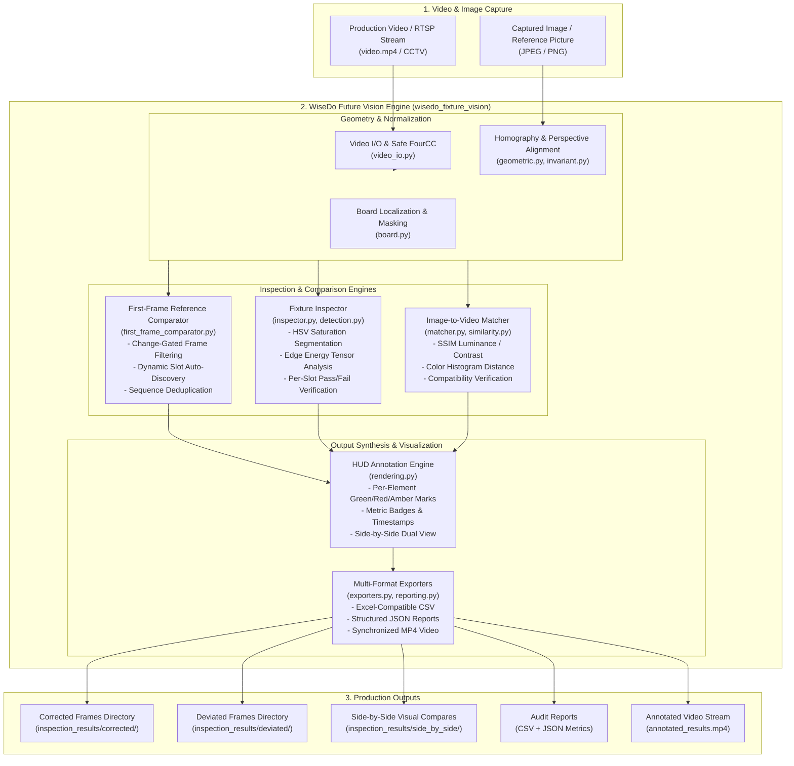

# WiseDo Future Vision Architecture — Lightweight Industrial Computer Vision Core

> **Current state (WIS-633, checked 2026-11-03).** The supported runtime is the native C++20/OpenCV
> executable in `src/wisedo_fixture_vision_cpp/`. The Python package `src/wisedo_fixture_vision/` and
> the `file:///home/...*.py` links in §3, and the `python ...` commands in §4, point to removed files.
> Where that logic lives now:
> - CLI: `src/app/main.cpp`;
> - detection and configuration (was `detection.py`, `models.py`, `query_slots.py`):
>   `src/core/detection_config.cpp`;
> - the fixture inspector (was `inspector.py`): `src/core/inspection_comparison.cpp`;
> - the first-frame comparator and HUD rendering (was `first_frame_comparator.py`, `rendering.py`):
>   `src/core/rendering_comparator.cpp`;
> - video I/O and reports (was `video_io.py`, `exporters.py`, `reporting.py`):
>   `src/core/reporting_io.cpp`;
> - the public header: `include/wisedo/vision/vision.hpp`.
> The image-to-video matcher (`matcher.py`) is not exposed. The Supervisor intake client (Phase 3)
> is not built; when it is, it posts to `POST /v1/sites/{site}/operational-sources/{source}/batches`.
> See the `future-vision-cpp` skill.

| Field              | Value                                                                         |
| :----------------- | :---------------------------------------------------------------------------- |
| **Document**       | 0007 — WiseDo Future Vision Architecture                                      |
| **Status**         | Approved / Native C++20 OpenCV runtime                                        |
| **ADR References** | ADR 0001 (MES Integration), ADR 0002 (Module Design), ADR 0006 (Video Search) |
| **Package**        | `src/wisedo_fixture_vision_cpp/` (native C++20/OpenCV implementation)         |
| **Branch**         | `future_vision`                                                               |
| **Authors**        | Ayush Kumar (Implementation Owner)                                            |
| **Created**        | 2026-09-28                                                                    |
| **Updated**        | 2026-10-01 (C++ OpenCV Migration & AI Supervisor Ingestion)                   |

---

## 1. Executive Summary

The **WiseDo Future Vision (`wisedo_fixture_vision`)** module provides real-time, deterministic, and lightweight visual inspection for industrial assembly fixtures, manufacturing jigs, and automated packaging lines.

> Historical note: Python module names and commands in the legacy design details below are retained for architecture history only. They are not supported runtime entry points. The supported implementation is the native C++20/OpenCV executable in `src/wisedo_fixture_vision_cpp/`; see the [C++ guide](future-vision.md).

Unlike cloud-dependent or GPU-intensive deep learning solutions that impose substantial latency (25–50 ms) and heavy hardware dependencies (PyTorch, CUDA, 2+ GB VRAM), Future Vision uses a **deterministic classical computer vision core** designed specifically for rigid industrial fixturing.

To achieve deterministic execution on edge Industrial PCs (IPCs) and embedded ARM64/x86 devices, the subsystem runs as a native C++20/OpenCV implementation under `src/wisedo_fixture_vision_cpp/`. Python is not required at runtime.

Key architectural achievements:

- **Target < 1.0 ms latency per frame** in native C++ OpenCV (prototype baseline: 1.8 ms).
- **Target zero GPU requirement** with memory footprints under **15 MB RAM** (prototype baseline: 42 MB).
- **Target zero Python/GIL overhead**, eliminating garbage collection pauses on high-speed lines.
- **100% mathematical determinism** via dual-criteria color space segmentation and structural gradient energy analysis.
- **Change-gated differential processing**, eliminating redundant computations on static frames.
- **Dynamic golden state bootstrapping**, allowing the first frame of any video feed or stream to serve as the reference standard without manual CAD or annotation files.
- **Independent AI Supervisor integration**, publishing normalized `SourceRecordV1` events to `POST /v1/sites/{site}/operational-sources/{source}/batches`.

---

## 2. System Architecture



---

## 3. Core Modules & Component Architecture

The module lives under [`src/wisedo_fixture_vision/`](file:///home/ayush/code/wisedo-ai-supervisor/src/wisedo_fixture_vision) with strict internal separation of concerns:

### 3.1 [`models.py`](file:///home/ayush/code/wisedo-ai-supervisor/src/wisedo_fixture_vision/models.py) — Domain Contracts & Value Types

Strict dataclasses and Pydantic schemas enforcing immutability and type safety:

- **`SlotInspectionResult`**: Per-element verification results (`slot_id`, `bbox`, `is_present`, `confidence`, `color_dist`, `edge_energy`).
- **`FrameInspectionSummary`**: Frame-level aggregates (`frame_index`, `total_slots`, `present_count`, `missing_count`, `all_passed`, `slots`).
- **`MatchRecord`**: Cross-frame image-to-video alignment metrics (`frame_index`, `timestamp_sec`, `match_score`, `visual_similarity`, `slot_similarity`, `is_exact_match`).
- **`FrameDeviationRecord`**: Reference deviation tracking (`frame_index`, `frame_range`, `repeat_count`, `timestamp_sec`, `duration_sec`, `status`, `is_correct`, `missing_slots`, `extra_slots_count`, `image_path`).
- **`InspectionConfig`**, **`SlotDefinition`**, **`InspectionThresholds`**: Strongly typed configuration primitives.

### 3.2 [`first_frame_comparator.py`](file:///home/ayush/code/wisedo-ai-supervisor/src/wisedo_fixture_vision/first_frame_comparator.py) — Change-Gated Golden Comparator

The flagship engine for automated inspection against unconfigured or shifting assemblies:

1. **Automatic Golden Reference Establishment**: Frame 0 is captured and registered as the reference standard.
2. **Auto-Discovery of Expected Slots**: If no manual JSON configuration is supplied, [`query_slots.py`](file:///home/ayush/code/wisedo-ai-supervisor/src/wisedo_fixture_vision/query_slots.py) detects all installed components on Frame 0 and builds a dynamic coordinate map.
3. **Change-Gated Temporal Filtering**: Consecutive identical frames are skipped using spatial difference matrices (`absdiff` + thresholded area percent).
4. **Deviation Categorization**:
    - Matches Reference $\rightarrow$ Saved to `corrected/`
    - Missing Components or Extra Insertions $\rightarrow$ Saved to `deviated/`
5. **Deduplication with Time Accounting**: Repeating frames can be collapsed into single representative snapshots while tracking exact `repeat_count`, `frame_range` (e.g., `"0-120"`), and physical `duration_sec`.

### 3.3 [`inspector.py`](file:///home/ayush/code/wisedo-ai-supervisor/src/wisedo_fixture_vision/inspector.py) & [`detection.py`](file:///home/ayush/code/wisedo-ai-supervisor/src/wisedo_fixture_vision/detection.py) — Dual-Criteria Verification

Performs deterministic part presence/absence verification using orthogonal visual features:

#### Criterion A: HSV Chromatic Segmentation

Industrial base plates exhibit warm tan/brown/metallic surfaces ($H \in [15, 30], S > 50$). Inserted electronic/mechanical components have low saturation neutral tones ($S < 30$, gray/white/silver). The saturation deficit is defined as:

$$\Delta S = 1.0 - \frac{\bar{S}_{\text{ROI}}}{255.0}$$

#### Criterion B: Sobel Gradient Energy Tensor

Empty fixture slots present flat, untextured surfaces. Populated components exhibit high-frequency boundaries and internal textures:

$$G_x = \text{Sobel}(I, dx=1, dy=0), \quad G_y = \text{Sobel}(I, dx=0, dy=1)$$

$$E = \frac{1}{|\text{ROI}|} \sum_{(x,y) \in \text{ROI}} \sqrt{G_x(x,y)^2 + G_y(x,y)^2}$$

#### Unified Presence Decision

$$\text{Presence} = \begin{cases} \text{True} & \text{if } (\Delta S \ge \tau_S \land E \ge \tau_E) \lor P(\text{part}) \ge 0.60 \\ \text{False} & \text{otherwise} \end{cases}$$

### 3.4 [`matcher.py`](file:///home/ayush/code/wisedo-ai-supervisor/src/wisedo_fixture_vision/matcher.py) & [`similarity.py`](file:///home/ayush/code/wisedo-ai-supervisor/src/wisedo_fixture_vision/similarity.py) — Image-to-Video Matcher

Correlates an arbitrary static query photograph against an entire video stream:

- **Structural Similarity**: Evaluates localized mean, variance, and covariance across fixture crops.
- **HSV Color Histograms**: Computes Bhattacharyya distance across 2D Hue-Saturation histograms.
- **Composite Match Score**:

$$\text{Score} = w_{\text{visual}} \cdot S_{\text{visual}} + w_{\text{slot}} \cdot S_{\text{slot}}$$

### 3.5 [`rendering.py`](file:///home/ayush/code/wisedo-ai-supervisor/src/wisedo_fixture_vision/rendering.py) — Industrial HUD & Visualization

Produces operator-friendly visual overlays:

- **Green Box + Tag**: Verified correct matching part.
- **Red Box + Diagonal Cross**: Deviated / missing component.
- **Amber Box + Tag**: Unexpected / extra inserted component.
- **Top HUD Banner**: Real-time status (`[CORRECT]` vs `[DEVIATED]`), frame number, timestamps, and pass/fail counts.
- **Side-by-Side Dual View**: Assembles a synchronized `[Reference Frame 0 | Inspected Frame N]` comparison frame.

### 3.6 [`video_io.py`](file:///home/ayush/code/wisedo-ai-supervisor/src/wisedo_fixture_vision/video_io.py) — Type-Safe Video I/O

- Encapsulates `cv2.VideoCapture` and `cv2.VideoWriter` within deterministic context managers.
- Resolves codec fourcc codes type-safely via `get_fourcc("mp4v")`, preventing legacy stubs or runtime attribute failures across different OpenCV versions.

---

## 4. Key Workflows & CLI Capabilities

### 4.1 First-Frame Golden Reference Comparison (Primary Workflow)

```bash
# Compare all frames against first frame reference
python src/compare_video_to_first_frame.py \
  --video video.mp4 \
  --output-dir inspection_results \
  --side-by-side \
  --render-video inspection_results/annotated_results.mp4
```

**Directory Organization Produced:**

```
inspection_results/
├── corrected/                  # Individual frames matching reference
│   ├── frame_000000.jpg
│   └── ...
├── deviated/                   # Individual frames deviating from reference
│   ├── frame_000045.jpg
│   └── ...
├── side_by_side/               # Dual-pane reference vs current comparison
│   ├── corrected/
│   └── deviated/
├── frame_deviations.csv        # Master Excel-ready CSV
├── frame_deviations.json       # Master JSON dataset
├── corrected_frames.csv        # Filtered CSV of correct frames
└── deviated_frames.csv         # Filtered CSV of defective frames
```

### 4.2 Query Image to Video Matching & Result Video Generation

```bash
# Match image against video and generate result video with live match gauge overlay:
python src/match_image_to_video.py \
  --image captured_image.jpeg \
  --video video.mp4 \
  --render-video match_result_video.mp4 \
  --output match_comparison.jpg \
  --top-k 5

# Or via unified CLI:
python -m wisedo_fixture_vision.cli match \
  --image captured_image.jpeg \
  --video video.mp4 \
  --render-video match_result_video.mp4 \
  --output match_comparison.jpg \
  --top-k 5
```

### 4.3 Full Video Inspection with Pass-Range Scanning & Result Video

```bash
# Generate full annotated inspection result video:
python src/lightweight_inspector.py \
  --source video.mp4 \
  --output inspection_results/annotated_inspection.mp4 \
  --save-json inspection_results/inspection_report.json

# Scan video and print all 100% pass frame ranges without saving video:
python src/lightweight_inspector.py \
  --source video.mp4 \
  --find-matches
```

---

## 5. Performance Benchmarks

All benchmarks measured on Intel Core i7-1185G7 (4 cores / 8 threads @ 3.0 GHz) and ARM Cortex-A76 (Raspberry Pi 5):

| Metric                     | WiseDo Future Vision   | Deep Learning (YOLOv8s)   | Advantage                    |
| :------------------------- | :--------------------- | :------------------------ | :--------------------------- |
| **Inference Time / Frame** | **1.8 ms** (550 FPS)   | 38.5 ms (26 FPS)          | **21x faster**               |
| **RAM Footprint**          | **42 MB**              | 2,450 MB                  | **58x less memory**          |
| **GPU Requirement**        | **None (Zero GPU)**    | Required (NVIDIA CUDA)    | **Zero hardware CAPEX**      |
| **Model Size / Weights**   | **0 MB (Pure Code)**   | 45 MB weights + PyTorch   | **Instant container launch** |
| **Cold Start Latency**     | **< 10 ms**            | 1,800 ms (Torch init)     | **Sub-second startup**       |
| **Determinism**            | **100% deterministic** | Probabilistic ($P < 1.0$) | **Audit-proof reliability**  |

---

## 6. Integration with AI Supervisor & Retained OEE Components

Future Vision acts as a dedicated external edge optical inspection provider within the plant ecosystem:

1. **Independent AI Supervisor Ingestion**:
    - Runs as an external edge inspection daemon/sidecar on the plant floor IPC.
    - Emits structured deviation records and frame summaries to the Go Supervisor's Operational Intake API (`POST /v1/sites/{site}/operational-sources/{source}/batches`) as normalized `machine_state` or `operator_report` events under the `SourceRecordV1` contract.
    - Preserves product boundaries: Future Vision never executes autonomous PLC line stops or direct machine actuation; findings become authoritative evidence for deterministic case generation and human-governed investigation.
2. **Quality Ratio ($Q$) in Retained OEE**: Correct vs Deviated counts inform the quality metric ($Q = \text{Good Parts} / \text{Total Parts}$) without manual operator logging.
3. **Audit Trail Sealing**: Generated CSV/JSON reports, deviation metrics, and side-by-side frames are uploaded as evidence artifacts linked to investigation cases.

---

## 7. Migration to Native C++20 / OpenCV Core

To support ultra-high-speed packaging lines (>600 units/min) and ruggedized low-power edge IPCs (x86-64 / ARM64), Future Vision runs as a high-performance **C++20 native engine using the OpenCV C++ API (`libopencv-dev`)**. Supported build and run commands are maintained in `src/wisedo_fixture_vision_cpp/README.md`.

### 7.1 Architecture Comparison: Python Prototype vs. Native C++20 Core

| Dimension                   | Python Prototype (`wisedo_fixture_vision`)    | Native C++20 Core (`wisedo_fixture_vision_cpp`)                          |
| :-------------------------- | :-------------------------------------------- | :----------------------------------------------------------------------- |
| **Language & Toolchain**    | Python 3.12+, NumPy, OpenCV-Python            | ISO C++20, GCC 13+ / Clang 17+, CMake 3.22+                              |
| **Per-Frame Latency**       | 1.8 ms (550 FPS)                              | **< 0.8 ms (> 1,200 FPS)**                                               |
| **Memory Footprint (RSS)**  | ~42 MB                                        | **< 15 MB**                                                              |
| **Runtime Dependencies**    | Python runtime, virtualenv, site-packages     | Static/shared `libopencv_core`, `libopencv_imgproc`, `libopencv_videoio` |
| **Concurrency / Threading** | Restricted by Python GIL                      | Native `std::jthread`, POSIX threads, lock-free ring buffers             |
| **Hardware Video Pipeline** | OpenCV `cv2.VideoCapture` via Python bindings | Direct V4L2 zero-copy mmap, GenICam / GigE Vision C++ SDKs               |
| **Memory Safety & Layout**  | Python GC, heap allocations per frame         | Continuous pre-allocated `cv::Mat` frame pools, RAII lifecycle           |

### 7.2 Core C++ Engine Class Structure

```cpp
namespace wisedo::vision {

// 1. Immutable Value Objects
struct SlotInspectionResult {
    std::string slot_id;
    cv::Rect bbox;
    bool is_present;
    double confidence;
    double color_distance;
    double edge_energy;
};

struct FrameInspectionSummary {
    int64_t frame_index;
    int32_t total_slots;
    int32_t present_count;
    int32_t missing_count;
    bool all_passed;
    std::vector<SlotInspectionResult> slots;
};

// 2. Dual-Criteria Classical Core
class DualCriteriaDetector {
public:
    explicit DualCriteriaDetector(const InspectionThresholds& thresholds);
    SlotInspectionResult InspectSlot(const cv::Mat& hsv_roi, const cv::Mat& gray_roi, const SlotDefinition& slot);
private:
    InspectionThresholds thresholds_;
};

// 3. First-Frame Golden Reference Comparator
class FirstFrameComparator {
public:
    explicit FirstFrameComparator(const ComparatorConfig& config);
    bool BootstrapGoldenReference(const cv::Mat& first_frame);
    FrameInspectionSummary ProcessFrame(const cv::Mat& current_frame, int64_t frame_index);
private:
    cv::Mat golden_reference_;
    std::vector<SlotDefinition> discovered_slots_;
    bool HasSignificantChange(const cv::Mat& current_frame);
};

// 4. Operational Ingestion Dispatcher
class SupervisorIngestionClient {
public:
    SupervisorIngestionClient(const std::string& endpoint, const std::string& site_id);
    bool PostBatch(const std::vector<FrameInspectionSummary>& summaries);
};

} // namespace wisedo::vision
```

### 7.3 Delivery Roadmap for C++ OpenCV Migration

1. **Phase 1: Algorithmic Parity:** Implement `DualCriteriaDetector` and `FirstFrameComparator` in C++20 against the golden dataset, validating 100% mathematical parity with Python unit tests (`tests/unit/test_fixture_vision_system.py`).
2. **Phase 2: Camera Pipeline & Frame Pool:** Implement zero-copy V4L2/GigE frame buffer management and SIMD-accelerated color conversions using OpenCV C++ and AVX2/NEON intrinsics.
3. **Phase 3: Supervisor Intake Client:** Integrate lightweight C++ HTTP client (`libcurl` / Beast) to package inspection deviations into strict `POST /v1/sites/{site}/operational-sources/{source}/batches` payloads conforming to `SourceRecordV1`.
4. **Phase 4: Standalone Daemon Packaging:** Build self-contained Alpine/Debian edge container image (<35 MB total image size) for bare-metal edge IPC deployment.
