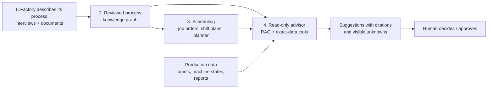
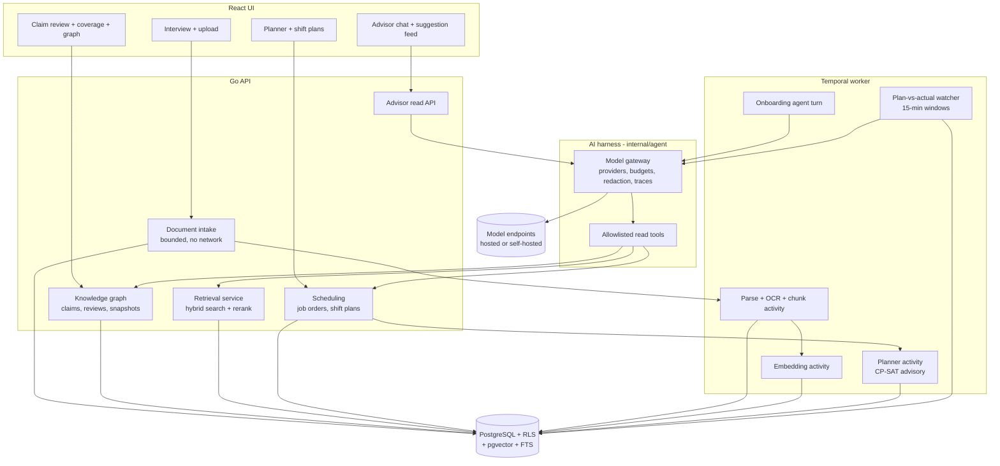
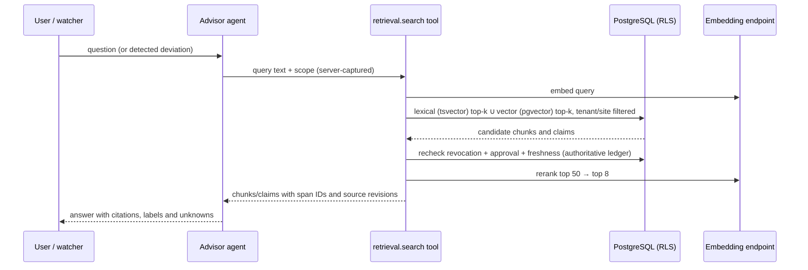
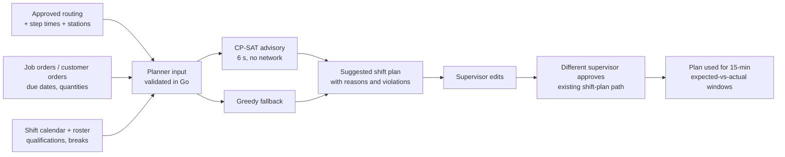

# Onboarding agent, factory knowledge, scheduling and the read-only advisor

Research and design note, 2026-10-29; progress updated 2026-11-02. Owner: Ayush Kumar. Status:
**knowledge capture built (steps 1–7 merged); retrieval, advisor, scheduling and pilot not built**.
This file describes the target flow, what exists in this repository, what is missing, and the plan to
finish it. "Built" means merged code with tests and recorded gates; it does not mean
customer-accepted. Linear is the source of truth for issue state; where this note and an issue
disagree, the issue wins.

Contents

0. [Progress](#0-progress)
1. [Target flow](#1-target-flow)
2. [What is already built](#2-what-is-already-built)
3. [Gap analysis for the target flow](#3-gap-analysis-for-the-target-flow)
4. [System design](#4-system-design)
5. [Model and API choice (Chinese providers preferred)](#5-model-and-api-choice-chinese-providers-preferred)
6. [Competitors and how we win](#6-competitors-and-how-we-win)
7. [Requirements to finish](#7-requirements-to-finish)
8. [Build plan](#8-build-plan)
9. [Risks and open decisions](#9-risks-and-open-decisions)
10. [Documentation problems found during this research](#10-documentation-problems-found-during-this-research)

---

## 0. Progress

The onboarding agent is built in Linear issues under WIS-610, one PR each, with tests, negative
controls and gates recorded on the issue.

| Step | What it does | Issue | PR | State |
|---|---|---|---|---|
| 1 | Supplier-to-dispatch vocabulary in the knowledge graph (supplier, customer, location, inspection point; `supplied_by`, `received_at`, `stored_at`, `inspected_at`, `ships_to`; lead, cycle and setup times, batch size, yield, sample size, inspection method) and the nine-cell `process_understanding` checklist | WIS-611 | #203 | Merged |
| 2 | Onboarding specialist: an interview turn proposes candidate entities and typed claims; every name and number must be written in a cited span; everything stays a candidate | WIS-612 | #204 | Merged |
| 3 | Document upload: Word, Excel, CSV and text extracted with the standard library inside the intake gate; stored as a document source with automatic citable passages | WIS-613 | #209 | Merged |
| 4 | The onboarding specialist reads selected document passages (up to 8, 12 KiB) instead of whole sources | WIS-614 | #214 | Merged |
| 5 | Value-stream checklist cells can be bound to approved claims and approved | WIS-615 | #215 | Merged |
| 6 | Review the facts an agent turn proposed, on the interview page | WIS-616 | #216 | Merged |
| 7 | An interview chooses which checklist it covers, so a process with both checklists can be onboarded | WIS-617 | #217 | Merged |
| 8 | Screens: document upload, the value-stream checklist and the approved process graph | WIS-618 | #219, #220, #221 | Merged |
| 9 | Retrieval step 1: chat captures only the passages of the approved claims most relevant to the question (word match, whole claims, up to 8 passages and 12 KiB) instead of every cited source; sites over 70 sources are answered | WIS-620 | #222 | Merged |
| 10 | An approved snapshot holds the documented 200 entities and 500 claims (stored body up to 8 MiB, migration 072) instead of refusing at 64 KiB (about 45 claims) | WIS-621 | #223 | Merged |
| 11 | Shift suggestions compare each job order's cycle time with the value approved during onboarding, with citations; advice only | WIS-628 | #224 | Merged |
| 12 | Retrieval step 2: span words precomputed and GIN-indexed (migration 073) for chat passage ranking | WIS-626 | #229 | Merged |
| 13 | Read-only advisor suggestion for a shortfall case: approved facts in effect during the case windows, server observations, cited hypotheses | WIS-629 | #228 | Merged |
| 14 | Tasks screen for approved investigation tasks; an operator reads only their own tasks | WIS-630, WIS-634 | #227, #236 | Merged |
| 15 | A detected case starts investigating when the agent is on; a scripted investigation reaches an executor-created task; real-backend e2e | WIS-636, WIS-635 | #232, #230, #233 | Merged |
| 16 | End-to-end pilot: two tenants at once from upload to an observed task outcome, as an integration run and as a browser gate (`make supervisor-e2e CASE=onboarding-pilot`) | WIS-631 | #235, #242 | Merged; actual-model variant open |
| 17 | PDF upload: a born-digital PDF is extracted in a resource-capped child process (pdfcpu screens, ledongthuc/pdf extracts); encrypted, active, linked and oversized PDFs are refused with their own codes | WIS-624 | #237 | Merged |
| 18 | Hosted model per site (Qwen, Singapore): opt-in by the site owner with a DPA reference, pinned and priced runs, dictionary pseudonymisation; rules 01 and 08 amended | WIS-622, WIS-623 | #239, #240 | Merged; actual-model report open |
| 19 | Semantic search: pgvector (migration 075), local embeddings and rerank fused with word ranking; `word_fallback` when embeddings are missing | WIS-627 | #241 | Merged; quality measurement open (WIS-647) |
| 20 | Reviewer screens: Setup → Facts to review; the owner marks a document authoritative and confirms it current on Documents; an owner or supervisor publishes a snapshot on Approved process | WIS-641 | #243, #244 | Merged |
| 21 | Onboarding and chat case sets for `make supervisor-eval CASE=onboarding,chat`, with a `CASE=` selector | WIS-640 | #245 | Merged; actual Qwen report open |
| 22 | OCR through a local vision model: photos (`/source-scans`) and scanned PDFs (`/source-scan-batches`) read into model-extracted sources (migration 076), failures quarantined with a reason, `supervisor-eval CASE=ocr`, and lower authority (never independent corroboration; designation needs `confirm_model_extracted`) | WIS-625 | #246, #252–#255 | Merged; actual-model run open |
| 23 | Setup → Processes: an owner registers areas and processes (each citing a document or a commissioning note) and starts the value-stream checklist; the browser pilot commissions through it | WIS-644 | #272 | Merged |
| 24 | Route summary on Setup → Approved process: operations in their approved `precedes` order, step count, exact total cycle and setup time and the longest supplier lead time (computed in Go, cited); a gap, branch, loop or edge leaving the process is `NOT_READY` with no totals; a missing time is missing, never zero; `GET .../process-snapshots/{snapshot}/route-summary` | WIS-642 | #273 | Merged |
| 25 | Fax-encoded (CCITT Group 4 and one-dimensional Group 3) scanned pages decoded in the PDF child, size checked before decoding; a PDF with typed and scanned pages stored as one upload: a typed document plus page jobs, linked (migration 081) | WIS-645 | #275, open PR | Slice 1 merged; slice 2 in review |

States were checked on 2026-11-06; Linear is the source of truth.

Open work. The first group needs a credential, a model or a reviewer, not code:

| Issue | What | Needs |
|---|---|---|
| WIS-623, WIS-640, WIS-631 | Actual-model runs on Qwen: qualification report, onboarding and chat cases, pilot variant | A Qwen API key in a file; reviewer sign-off on the proposed onboarding thresholds |
| WIS-625 | `supervisor-eval MODE=actual CASE=ocr` | A local vision model (`SUPERVISOR_AGENT_VISION_MODEL`); reviewer confirmation of the lower-authority policy |
| WIS-627, WIS-647 | Retrieval quality with real embeddings and rerank | A local embedding model |
| WIS-646 | Case sets grown to the frozen release sizes, with a held-out partition and independent labels | Authoring and a second labeller |

Code follow-ups:

| Issue | What |
|---|---|
| WIS-643 | "Checked against the original" confirmation on the owner's panel for OCR documents |

The agent runs on local or fixture providers unless a site's owner turns hosted inference on.
Scanned and photographed pages need a pinned local vision model; without one they are refused
with `EXTRACTION_UNAVAILABLE`.

---

## 1. Target flow

1. **Onboarding.** The factory explains, end to end, how a product is made: raw-material
   procurement and suppliers, goods receiving and incoming inspection, storage, the production
   lines and stations a product passes through (routing, cycle and setup times, quality checks),
   finished-goods storage, packing, dispatch and delivery. Input comes from role interviews (owner,
   supervisor, operator) and from documents (SOPs, work instructions, routing sheets, Excel plans,
   photos of paper logs).
2. **Knowledge graph.** The onboarding agent turns that input into *candidate* claims, each citing
   the exact source span. A human reviewer approves, rejects or resolves conflicts; approved claims
   become an immutable `ApprovedProcessSnapshotV1`. Nothing unreviewed becomes a fact.
3. **Scheduling.** From the approved routings, capacities, shift calendars and orders, the system
   proposes a shift plan (advisory solver). A supervisor edits it and a different supervisor
   approves it. Manual planning always works without the solver.
4. **Read-only advisor.** An agent answers questions and watches plan versus actual. It retrieves
   factory knowledge (RAG over approved claims and documents) and exact numbers (tools over plans,
   counts and context windows), and gives suggestions with citations, labelled as approved fact,
   observation or hypothesis. It can never write, approve or dispatch; any consequential action
   goes through the existing human approval path (rule 05).

---

## 2. What is already built

Baseline verified against the code on `origin/main` (`e245ac3`) and the open WIS-277/279 stack,
2026-10-29, before the onboarding work began. What has shipped since is in [Progress](#0-progress);
in particular the upload gate below is now wired (WIS-613) and agent turns propose typed facts
(WIS-612). "Built" means code with routes or workers and tests; it does not mean customer-accepted.

### 2.1 Onboarding and knowledge

| Area | Built | Where |
|---|---|---|
| Evidence sources | Plain-text sources (≤ 256 KiB), immutable revisions, SHA-256, authority class, currentness/freshness, revocation, human-created character spans | `internal/evidence`, migrations 005, 008, 018, 019, 039; `/v1/sites/{site}/sources…`, `/source-spans/{span}` |
| Knowledge graph | Entities (site, area, asset, process, operation, order, material, tool, role, qualification, document, constraint); predicates `located_in, part_of_asset, performs, part_of, precedes, consumes, produces, requires_tool, requires_qualification, responsible_role, follows_document, has_constraint` plus `capacity_per_hour, escalation_after_seconds, objective, actual_step`; every claim cites 1–20 spans; conflicts, reviews, revocations, entity merges, coverage, discovery inventories, immutable approved snapshots, bounded traversal (2 hops, 200 entities, 500 claims) | `internal/knowledge`, migrations 006–017, 040, 041; `/claims`, `/conflicts`, `/entities`, `/coverage`, `/process-snapshots…` |
| Role interviews (WIS-271) | Resumable sessions per role; questions derived from coverage gaps; each answer stored as evidence + span; agent turn returns ≤ 3 follow-up questions and ≤ 20 candidate claims (only `objective`, `actual_step`) | `internal/onboarding/interviews.go`, `turns.go`, `internal/agent/interview.go`, migrations 048, 057, 060, 061 |
| Master data (WIS-603) | Lines, items (name, unit), routings (ordered steps → workstation), shift calendars (timezone + weekly shifts), workstation profiles | `internal/workstation/master_data.go`, migrations 034, 052 |
| Bulk import and agent drafts (WIS-605/606/607) | CSV import with dry run; agent-drafted configuration with field-level citations, promoted only by a different human; visual line/routing editor | `configuration_import.go`, `configuration_drafts.go`, `internal/agent/drafts.go`, migrations 054, 058, 059 |
| Operational intake (WIS-272) | Source registry, batches and CSV/JSON imports for `production_plan, production_delta, machine_state, operator_report, heartbeat, watermark`; liveness; error CSV | `internal/operational`, `internal/ingestion`, migrations 020–022, 026, 031, 042 |
| Upload gate (not wired) | Bounded read, MIME inspection, explicit `ErrExtractionUnavailable` for PDF/DOCX; **no route calls it, no parser, no OCR** | `internal/onboarding/intake.go` |

### 2.2 AI harness

| Area | Built | Where |
|---|---|---|
| Agent runtime (WIS-275) | `DelegationEnvelopeV1`, role tool ceilings, site policy, per-cycle budgets (3 invocations, 12 tool calls, 24k tokens, 4 min), breakers, cancellation, traces in `agent_*` tables | `internal/agent`, migrations 055, 056, 065 |
| Model client | One OpenAI-compatible `/v1/chat/completions` client with strict `json_schema` response format; **endpoints must be local/private and address-pinned** (vLLM, llama.cpp, Ollama); no cloud provider, no fallback | `internal/agent/localmodel.go`; env `SUPERVISOR_AGENT_PROVIDER`, `_BASE_URL`, `_MODEL`, `_MODEL_REVISION`, `_API_KEY_FILE`, `_ENDPOINT_ALLOWLIST`, `_ENDPOINT_ADDRS`, `_TIMEOUT`, `_MAX_CONCURRENT`, `_MAX_QUEUED`, `_MODE_ENABLED` |
| Tools | `context.get`, `evidence.get` (full source text as `untrusted_source`), `claims.search` (linear filter by entity/predicate over the pinned snapshot, ≤ 50, no ranking), `measurements.get` | `internal/agent/tools.go` |
| Deterministic adapter | Fixture provider, labelled not-actual, refused in production | `fixture_provider.go`, `fixture_script.go` |
| Evaluation (WIS-280) | Manifest-driven harness; `MODE=actual` runs each case 3×; deterministic mode cannot qualify | `cmd/supervisor-eval`, `evals/supervisor/manifest.json` |

### 2.3 Read-only advice, cases and actions

| Area | Built | Where |
|---|---|---|
| Operations chat (WIS-517) | Author-only conversations; answers rebuilt from validated statements labelled approved_fact / reported_observation / hypothesis; rejects numbers not in a source (`NUMBER_NOT_IN_SOURCE`) and unapproved facts; a statement may list the quantities it states by span and value, and the server resolves each to exactly one standing approved claim or refuses the answer (`QUANTITY_NOT_APPROVED`); the reply's `quantities` carry the claim's own value and unit (WIS-640); explicit non-answers when disabled or no approved snapshot | `internal/chat`, `internal/agent/chat.go`, migrations 062, 063 |
| Production context (WIS-272) | Exact 15-minute windows (expected / actual / deficit), READY/LIMITED/NOT_READY, two-window shortfall rule | `internal/production`, `internal/plantcontext`, migration 024 |
| Cases, proposals, approvals, tasks (WIS-273/274/276/277) | Durable cases with Temporal workflow; grounded `RecoveryProposalV1`; distinct-human approval with 30-minute TTL; one `inspect_report_only` task per approved action; outcome observation | `internal/cases`, `internal/recovery`, `internal/approvals`, `internal/tasks`, `internal/outcome`; migrations 027–068. Task execution and outcome are in PRs #188/#190/#191 (open) |
| Feedback (WIS-279, first slice) | Append-only `OutcomeFeedbackV1` | PR #197 (open), migration 069 |

### 2.4 Scheduling

| Area | Built | Where |
|---|---|---|
| Job orders | Order, operation, item, target quantity, cycle time, priority, due date, pinned instruction, fields | migration 033; `/job-orders`, `/workstations/{ws}/current-job-order` |
| Shift plans | One plan per line and shift; assignments of job-order revisions to workstations; distinct-supervisor approval over the exact digest; summaries and handovers | `shiftplans.go`, migrations 032, 036, 038 |
| Planners | `PlanGreedy` and `PlanCPsat` (C++ OR-Tools CP-SAT child process, 6 s, advisory, recorded exception in rule 01) — **library code only: no route, no worker, no UI** | `internal/workstation/planning.go`, `cpsat.go`, `src/workstation_cpsat` |
| Production plans | Plan revisions with `PlanApprovalV1` | `internal/plans`, migration 023 |

### 2.5 Web

On `main`: interviews, configuration drafts, CSV import, master data, routing editor, profile
builder, source mapping, shifts, workstation and the case inbox (`web/src/cases.tsx`, #187).
**Missing screens:** chat, claim review / coverage, knowledge graph view, evidence upload,
proposals/approvals, tasks, planner.

---

## 3. Gap analysis for the target flow

| Stage | What the flow needs | Today | Gap |
|---|---|---|---|
| Procurement and suppliers | Supplier, purchased material, lead time, incoming inspection plan | Entity `material` and `consumes/produces` only | No supplier, purchase order, lead time or receiving concepts |
| Receiving and stores | Goods receipt, lot/batch, location, movement | Not modelled (WIS-519 is Todo) | Material, lot, location, movement identities and events |
| Production process | Routing with station, cycle time, setup time, batch size, BOM per step, quality checkpoints, alternates | Routing = ordered steps → workstation; `capacity_per_hour` claim | Step-level time/capacity, BOM, quality checkpoints, alternate stations, changeover |
| Quality | Inspection points, methods, limits, dispositions | Manual station quality records (WIS-520) | Process-level inspection plan in the graph |
| Finished goods and dispatch | Packing, FG stock, customer order, dispatch/delivery | Not modelled | Customer order, shipment, delivery promise |
| Interview coverage | Questions across the whole value stream | Coverage cells for shortfall investigation only; candidate claims limited to `objective`, `actual_step` | Value-stream requirement template, more claim predicates in agent turns |
| Documents | PDF, DOCX, XLSX, photos of paper logs | Plain text only; upload gate not wired | Parser pipeline, OCR, chunking, auto-spans |
| Retrieval (RAG) | Find the right claims and passages for a question | Captures up to 70 sources from the latest snapshot and makes the model read them all; no search | Chunking, embeddings, lexical + vector search, reranking, permission/revocation filtering |
| Model provider | Hosted Chinese model APIs and self-hosted fallback | Local/private OpenAI-compatible endpoints only | Hosted-provider adapter (allowlisted hosts, region, pricing table, redaction), routing and fallback |
| Scheduling | Planner suggestion from approved routing + orders + calendar | Planners exist as libraries; routings lack times | Planner route/activity, data mapping from master data, UI, approval through existing shift-plan path |
| Advisor | Answers and proactive suggestions combining knowledge, plan and actuals | Chat over snapshot; case investigation for shortfalls | Retrieval tool, schedule/plan tools, suggestion feed, chat UI |
| UI | Review, chat, planner, graph | See §2.5 | Six screens listed above |

---

## 4. System design

Authority stays inside the existing Go application, PostgreSQL ledger and Temporal worker (rules
00 and 01). No graph database is a source of truth. Since 2026-11-12, rule 01 allows a parsing,
layout, OCR or retrieval *method* to be a Python component that Go calls (a pinned local service or
a short-lived child process) behind a validated, versioned contract: Go supplies the tenant, site
and captured scope, validates what comes back, and stores text only through the evidence path, and
the rule 11 parser limits apply to it. None exists yet: today OCR reads pages through the Go
vision-model client. The model is called only through Go HTTP clients, and model output is data
that deterministic code validates (rule 08).

### 4.1 Component view

### 4.2 Onboarding: value-stream knowledge

**Extend the graph, do not replace it.** Add entity types and predicates through a versioned
manufacturing profile (WIS-519 already asks for typed profiles, not a plugin system):

- Entities: `supplier`, `customer`, `location` (store, staging, FG), `lot`, `inspection_point`,
  `shipment_route`.
- Relationships: `supplied_by`, `received_at`, `inspected_at`, `stored_at`, `issued_to`,
  `routes_through` (operation → station, with step number), `alternate_station`,
  `checks_quality_of`, `packs`, `ships_to`.
- Properties: `lead_time_days`, `cycle_time_seconds`, `setup_time_seconds`, `batch_size`,
  `changeover_seconds`, `yield_ratio`, `inspection_method`, `sample_size`, `dispatch_cutoff`.

All values are claims with spans, so every number has provenance; decimals are canonical strings
(rule 04).

**Value-stream requirement template.** Extend `SiteCoverageV1` with a capability
`process_understanding` whose required cells walk the stream: suppliers per critical material →
receiving and incoming inspection → storage → routing per item (stations, cycle/setup times) →
in-process quality → packing and FG → dispatch and delivery promise → responsible role and
escalation contact per stage. Interviews ask only about missing or contested cells (existing rule:
at most three open questions per participant).

**Interview agent turn.** Widen the candidate claim predicates beyond `objective` and `actual_step`
to the profile above; each candidate must cite the answer span it came from (already enforced). The
agent may also ask a clarifying question instead of guessing. Accepted candidates stay *candidates*
until a reviewer approves them.

**Documents.** New intake path, durable and fail-closed (rule 08):

1. Upload (multipart, size and type limits, server-generated object key, file name display-only).
2. Parse activity without network, bounded CPU/memory/time:
   - text, CSV: native;
   - DOCX, XLSX: zip + XML with decompression-bomb limits (XLSX via a BSD-licensed Go library such
     as excelize, to be license-reviewed);
   - PDF with a text layer: a permissively licensed Go PDF text extractor (evaluate
     `ledongthuc/pdf` vs `pdfcpu`; avoid AGPL/commercial `unipdf`);
   - scanned PDF and photos: a vision-language model call through the same gateway (Qwen-VL class)
     returning page text, labelled as `ocr` extraction with lower authority. A native OCR binary
     would be C++ and needs its own recorded rule-01 decision.
   - Anything else, encrypted or failing: quarantine with an explicit reason, never fabricated text.
     A full vision queue is not a failure: the worker's vision slots are shared by every tenant, so
     a page that meets a full queue waits and is tried again, for at most 30 minutes, before it is
     quarantined (WIS-717, `ScanWorkflow` in `internal/dispatch/scans.go`).
3. Store the extracted text as an evidence source revision (raising the 256 KiB limit or storing
   page-level sources), then chunk into **automatic spans** (heading-aware, ~400–800 tokens with
   overlap, never crossing a page/table boundary).
4. The onboarding agent proposes claims from chunks; reviewers approve as today.

### 4.3 RAG pipeline (retrieval)

Goal: give the model the few passages and claims that matter, with provenance, and never anything
the reader may not see or that was revoked.

- **Index:** a `retrieval_chunks` table (tenant, site, source, revision, span, text, `tsvector`,
  `vector(n)`, model/version) plus claim text rows from approved snapshots. Forced RLS like every
  table. The embedding model and dimension are versioned; re-embedding is a background job.
- **Search:** hybrid — PostgreSQL full-text (works for exact part numbers and station names) plus
  pgvector cosine similarity, merged with reciprocal rank fusion, then a cross-encoder reranker.
  Multilingual models so Hindi/regional-language answers retrieve English SOPs.
- **Authority at query time:** filter by tenant/site in SQL, then recheck every hit against the
  evidence ledger (revoked or unapproved content is never returned, rule 06), exactly like the
  current `evidence.HeadsTx` checks.
- **New tool:** `retrieval.search(query, kinds?, limit≤8)` added to the allowlist next to the four
  existing tools (rule 08 lists the allowed tools, so this needs a rule update and review). Returned
  IDs are allowlisted for the run, so a citation to anything not retrieved is rejected.
- **pgvector** is a PostgreSQL extension, not a new service, so it fits rule 00; the migration that
  creates it runs under the migrator role, and the deployment images must ship it. If pgvector is
  refused, lexical search plus reranking alone is a working first step.

### 4.4 AI harness extensions

Keep `internal/agent` as the only harness. Add:

- **Provider adapter for hosted APIs.** Same OpenAI-compatible request shape as `localmodel.go`, but
  with a fixed host allowlist per provider and region, TLS, API key from file, and no redirects.
  Today the client deliberately refuses non-private endpoints, so allowing a hosted endpoint is a
  **policy decision** that needs to be recorded (see §9).
- **Routing:** a small model for bulk extraction and classification, the main model for tool use
  and answers, escalation to a larger model only on validation failure; self-hosted fallback.
- **Versioned price table and budgets.** Rule 08 already says an unknown price disables billable
  calls; implement it with per-tenant monthly caps.
- **Redaction / pseudonymisation** before any hosted call: people, customers and site names become
  stable tokens; raw telemetry is aggregated first (no call per machine event).
- **Embeddings and reranking** through the same gateway (separate endpoints), preferably
  self-hosted.
- **Qualification:** every provider/model pair is a separate WIS-280 manifest run; a model change
  is a new qualification, not a config flip.

### 4.5 Scheduling

- Wire `PlanCPsat`/`PlanGreedy` behind `POST /v1/sites/{site}/shift-plan-suggestions` (Temporal
  activity, idempotent, read-only). A suggestion is data, never a plan; the approved plan path is
  unchanged (rule 05 and the rule-01 CP-SAT exception).
- Feed it from approved claims and master data: step cycle/setup times, alternate stations,
  operator qualifications, planned breaks. A missing time is a visible blocker, never a guess
  (rule 06).
- Explain each assignment and each unmet order (due-date risk, capacity shortfall, missing
  qualification) so the advisor can cite it.
- No employee scheduling optimisation beyond station assignment (WIS-519 exclusion).

### 4.6 Read-only advisor

- **Inputs:** the approved process snapshot, retrieval results, the approved shift plan and job
  orders, plant-context windows, machine stoppages and operator reports.
- **Tools (read-only):** `context.get`, `evidence.get`, `claims.search`, `measurements.get` (existing)
  plus proposed `retrieval.search`, `schedule.get` (approved plan, assignments, due dates) and
  `graph.path` (upstream/downstream of a station or material from the approved snapshot).
- **Proactive suggestions:** the existing 15-minute window watcher already opens cases on repeated
  shortfall. Extend it to emit *suggestions* (not cases) for plan risk: an order whose remaining
  quantity no longer fits the shift, a station blocked by material, a quality hold upstream.
  Aggregate and deduplicate before any model call (rule 08).
- **Output contract:** each suggestion separates observation, approved fact and hypothesis; cites
  spans and measurement IDs; lists unknowns; offers at most three options. Anything consequential
  becomes a proposal for human approval through the existing WIS-274 path; the advisor itself has no
  write tools.
- **UI:** a chat screen and a suggestion feed on the supervisor workspace, each with a "why can I
  trust this" panel (sources, readiness reason codes, freshness, missing data).

---

## 5. Model and API choice (Chinese providers preferred)

Prices and policies change monthly; the figures below were gathered on 2026-10-29 from vendor pages
where reachable and from third-party trackers where marked. Re-verify before signing anything.

| Use | Recommendation | Why | Alternative |
|---|---|---|---|
| Main agent (tool calls, structured extraction, answers) | **Qwen Plus tier** on Alibaba Cloud Model Studio, **Singapore/International** region; escalate hard cases to the Max tier | Strongest published tool-use results among Chinese models (even in a competitor's own model card); written no-training commitment; inference outside mainland China; OpenAI-compatible | DeepSeek V4 open weights served by a non-Chinese host (not `api.deepseek.com`) |
| Bulk extraction / classification | **Qwen Flash tier** (batch API) | About an order of magnitude cheaper | GLM Flash, MiniMax Flash |
| Embeddings + reranker | **Self-hosted Qwen3-Embedding + Qwen3-Reranker** (0.6B–4B, Apache 2.0) | Multilingual (Hindi and other Indian languages), documents never leave our infrastructure, one small GPU | BAAI `bge-m3` (MIT, dense + sparse); hosted text-embedding / rerank API for the pilot |
| OCR / scanned documents | Qwen-VL class model via the gateway | No native OCR binary in the core | A recorded rule-01 exception for a native OCR worker |
| Sovereign / on-premise fallback | **Self-hosted open weights with vLLM**: Qwen3.6-35B-A3B (Apache 2.0, one GPU) for a single plant; DeepSeek-V4-Flash or GLM (MIT) on a multi-GPU node for many plants | Same OpenAI-compatible API, the Go client only changes base URL; vLLM guided decoding enforces the JSON schema | — |

**Do not use** `api.deepseek.com` for customer plant data: data is stored in the PRC and the policy
allows training use. Kimi K2 and MiniMax M2.x are being retired (late 2026) — pick models with a
published support window.

**Indicative cost per plant** (2,000 agent calls/day, 8k input + 1k output tokens each,
≈ 480M input + 60M output tokens/month):

| Option | ≈ USD / month |
|---|---|
| Qwen Plus tier, no cache | 290 |
| Qwen Plus with 15% escalated to Max | 440 |
| Qwen Flash (bulk work) | 20 |
| DeepSeek Flash-class (peak price) | 215 |
| GLM 5.x | 940 |
| Self-hosted embeddings + reranker on one cloud L4 | 300–500 (estimate) |
| Self-hosted Qwen3.6-35B-A3B on one H100/L40S | 1,000–2,500 cloud (estimate), or hardware cost on-premise |

Expected API spend for one plant: about **USD 250–500 per month**. Prompt caching (stable system
prompt and tool definitions) cuts this further.

**Compliance.** Singapore subsidiaries of Chinese companies remain reachable under PRC law; some
Indian and Asian customers (defence, automotive tier suppliers, government work) will forbid
PRC-linked processors. Mitigations: provider configurable per tenant; Singapore region with a signed
data processing addendum; pseudonymisation before every hosted call; embeddings self-hosted; a
fully self-hosted profile for customers who refuse hosted APIs; provider, region and model version
recorded in every trace. India's DPDP Act allows transfer restrictions by notification — confirm
current status with counsel.

**Structured output.** No hosted provider guarantees JSON-schema conformance on every model; keep
validating every model output in Go (rule 08). Only self-hosted vLLM guided decoding enforces it.

Main sources: Alibaba Model Studio pricing, regions and privacy notice
(alibabacloud.com/help/en/model-studio/model-pricing, …/regions, …/privacy-notice); DeepSeek
pricing and privacy policy (api-docs.deepseek.com/quick_start/pricing/,
cdn.deepseek.com/policies/en-US/deepseek-privacy-policy.html); Z.ai pricing and privacy
(docs.z.ai); GLM-5.1, DeepSeek-V4 and Kimi-K2.6 model cards on Hugging Face; Qwen3 Embedding paper
(arXiv 2506.05176); BAAI bge-m3 model card.

---

## 6. Competitors and how we win

Vendor claims below are as published by the vendors (2025–2026); outcome figures are not verified.

| Vendor | What the AI does | How it learns the process | Data it needs | Weakness for our segment |
|---|---|---|---|---|
| Siemens Industrial / Operations Copilot, Opcenter APS | Copilots, agent marketplace, autonomous APS research | Siemens engineering and MES data | Siemens automation, MES | Enterprise stack and price |
| Microsoft Factory Operations Agent | Natural-language Q&A over unified IT/OT data | Fabric data model, integrator-built | MES, ERP, sensors in Fabric | Preview; integrator-led |
| Rockwell GuardianAI, Plex agents, FactoryTalk Conductor | Drive-signal predictive maintenance, work instructions from CAD, agent orchestration | CAD and Rockwell data | Rockwell drives, Plex | Hardware-bound; approval not stated |
| Cognite Atlas AI | Agents over an industrial knowledge graph | Connectors + contextualisation | Historian, ERP, documents, 3D | Heavy for low-digital plants |
| Sight Machine | Agent crews on a semantic process model, recommend then control | Data model from machine data | Machine and process data | Large plants, Azure |
| Tulip AI Composer | SOPs and video into frontline apps; prebuilt agents | **Document and video ingestion** | Tulip apps | Output is apps, not a reviewed, cited process model |
| Seeq | Analyst agent, custom agents | Analyst workbooks | Historian | Process industry |
| Augury | Machine-health agents; OKF know-how profiles | **Human-approved know-how profiles** | Its own sensors | Maintenance-centric |
| SAP Joule (shop-floor and planning agents) | Breakdown action plans, rescheduling, release checks | S/4 master data | S/4HANA, Digital Manufacturing | SAP customers only |
| Palantir AIP | Network scheduling | Ontology by forward-deployed engineers | ERP, MES, PLM | Defence/aerospace, price |
| Haier COSMOPlat, Huawei Pangu | Industrial large-model agents across many scenarios | Scenario customisation | Platform | China-centric, costly customisation |
| Faclon Labs, Altizon, Infinite Uptime, Ripik.ai (India) | OEE, maintenance, process optimisation, copilots | Connectors (Faclon also handwritten logs) | PLC, SCADA, sensors | Heavy and process industry focus |
| TranZact, MRPeasy, Odoo, Katana | Digital records, MRP, basic scheduling | Manual setup | None | No grounded intelligence |

Market signal: an IoT Analytics count of 29 industrial agentic-AI products at Hannover Messe 2026
found most model-agnostic, maintenance-focused, and blocked by weak data foundations and LLM
non-determinism. "Has agents" no longer differentiates.

**Gaps we can exploit**

1. Everyone else needs data plumbing first (Fabric, S/4, historian, own sensors). Small and mid
   discrete plants on paper and Excel are left out.
2. Nobody turns interviews plus SOPs into a **reviewed, cited process model** covering procurement
   to dispatch; most focus on machines, not orders.
3. "Grounded" usually means retrieval, not citation to an exact source revision with visible
   refusal reasons.
4. Deterministic, published KPI math with readiness states is rare.
5. Human approval is vague or being reduced in favour of autonomy.

**Differentiators to build (in priority order)**

1. **Value without telemetry:** start from interviews, SOPs, Excel and photos of paper logs.
2. **Interview-built, reviewed value-stream graph** from supplier to dispatch, every fact cited.
3. **Voice-first, multilingual interviews** (Hindi and regional languages) on a phone — needs a
   speech-to-text model through the gateway.
4. **"Why can I trust this" panel** on every answer: sources, freshness, readiness codes, unknowns.
5. **Reproducible math:** shortfall windows and OEE a plant can recompute in its own Excel.
6. **Small-factory scheduler** from the approved routing, manual planning always available.
7. **Fast human approval** (two taps on a phone) that keeps the distinct-approver rule.
8. **Order-level exception coverage:** late material, quality hold, dispatch risk — not only
   machine faults.
9. **Vertical starter templates** (auto components, fabrication, apparel, plastics, packaging) to
   shorten time to a first approved graph.
10. **Connectors as an upgrade path:** MQTT/UNS (WIS-518), Tally or ERP exports, edge vision.
11. **Per-plant pricing** with no operator seats, plus a self-hosted model option.
12. **Exportable knowledge** (open format export of the approved graph) to reduce lock-in fear.

---

## 7. Requirements to finish

### 7.1 Functional

- Value-stream manufacturing profile (entities, predicates, properties) with migrations and contracts.
- `process_understanding` coverage template and interview questions for every stage.
- Interview agent turn extended to the new predicates; candidate-only, span-cited.
- Document upload and parse pipeline (text, CSV, DOCX, XLSX, text-layer PDF, image OCR), quarantine,
  automatic spans.
- Retrieval index, hybrid search, reranking, query-time authority checks, `retrieval.search` tool.
- Hosted provider adapter, routing, price table, budgets, redaction, embeddings/rerank endpoints.
- Planner suggestion route/activity fed from approved data; explanation of each assignment.
- Advisor tools `schedule.get`, `graph.path`; suggestion feed from the window watcher.
- Web: evidence upload, claim review + coverage, graph view, chat, suggestion feed, planner,
  proposals/approvals, tasks.

### 7.2 Non-functional (existing rules apply)

- Tenant isolation with forced RLS on every new table; non-disclosing 404s (rule 03).
- Deterministic arithmetic for any number the advisor states (rule 04); the model never computes.
- No consequential action without distinct-human approval (rule 05).
- Fail closed with reason codes; revoked content never retrieved (rule 06).
- Strict JSON, idempotency, problem details, pagination on every new route (rule 07).
- Untrusted input boundary, bounded parsing, no shell/SQL/HTTP tools for the model (rule 08).
- Gates per change: `make supervisor-check`, `make supervisor-contracts`,
  `make supervisor-integration CASE=<selector>`, `make supervisor-e2e` for UI, and
  `make supervisor-eval MODE=actual` for any model-facing change (rule 09).
- Behavioural tests with negative controls (rule 10).

### 7.3 Infrastructure

- PostgreSQL 16+ with the `pgvector` extension in local, CI and production images.
- Model access: an Alibaba Model Studio international account (Singapore) with a signed DPA, or a
  GPU host for vLLM; a small GPU (L4 class) for embeddings and reranking.
- Object storage for uploaded originals with retention (WIS-290 item still open).
- Speech-to-text endpoint if voice interviews are in scope.

### 7.4 From the customer (pilot)

- Named sponsor and process reviewer, role members (owner, supervisor, operator).
- One line and one product family; item list, routing sheets, station list, shift calendar.
- SOPs, work instructions, inspection plans; supplier list for critical materials; dispatch rules.
- A production plan and a good-count source (even manual entry), plus permission to use a hosted
  model or a requirement for self-hosting.

---

## 8. Build plan

Proposed sequence. Each step is one Linear issue (create or attach to the epics shown) with its own
branch, gates and reviewer. Estimates are engineering guesses for one developer with review.

| # | Increment | Epic | Depends on | Size |
|---|---|---|---|---|
| 1 | Decide provider policy (hosted vs self-hosted, region, DPA) and record it | WIS-265 / rule 01, 08 update | — | S |
| 2 | Hosted provider adapter, price table, budgets, redaction; qualify Qwen Plus/Flash with `supervisor-eval MODE=actual` | WIS-275 / WIS-280 follow-up | 1 | M |
| 3 | Value-stream manufacturing profile (entities, predicates, properties) + coverage template | WIS-265 / WIS-519 | — | M |
| 4 | Interview agent: new predicates, stage-by-stage questions | WIS-271 follow-up | 3 | M |
| 5 | Document upload + parsers (text, CSV, DOCX, XLSX, PDF) + quarantine + auto-spans | WIS-265 | — | L |
| 6 | OCR of scans and photos via vision model | WIS-265 | 2, 5 | M |
| 7 | Retrieval: pgvector + FTS index, embeddings activity, hybrid search, rerank, `retrieval.search` tool; replace "read all 70 sources" in chat | WIS-517 follow-up | 2, 5 | L |
| 8 | Claim review, coverage and graph screens; evidence upload screen | WIS-278 follow-up | 3, 5 | L |
| 9 | Planner suggestion route + activity from approved routing data; planner screen | WIS-520 follow-up | 3 | M |
| 10 | Advisor tools `schedule.get`, `graph.path`; suggestion feed from the window watcher; chat screen with trust panel | WIS-517 / WIS-267 | 7, 9 | L |
| 11 | Proposals/approvals and tasks screens | WIS-278 follow-up | open PRs #188/#190/#191 | M |
| 12 | End-to-end synthetic pilot: onboarding → plan → shortfall → suggestion → approval → outcome, two isolated tenants | WIS-265 / WIS-281 | all | M |

Milestones:

- **M-A (knowledge):** steps 1–5 and 8 — a factory can be onboarded from interviews and documents
  into a reviewed value-stream graph.
- **M-B (retrieval + advisor):** steps 6, 7 and 10 — cited answers over the factory's own knowledge
  and live plan.
- **M-C (scheduling):** step 9 — suggested shift plans from approved routings.
- **M-D (pilot):** steps 11–12 and the WIS-281 shadow shifts.

---

## 9. Risks and open decisions

| Decision / risk | Options | Recommendation |
|---|---|---|
| Allow hosted model endpoints? Today the client only accepts private/local endpoints | (a) Hosted Qwen Singapore with DPA and redaction; (b) self-hosted only | (a) for the pilot, behind a per-tenant switch, with (b) available; record the decision |
| PRC-linked processors and customer contracts | Hosted Chinese API; non-Chinese host for open weights; on-premise | Offer all three per tenant |
| pgvector in the stack | Add extension; lexical-only first | Add it; ship lexical-first if blocked |
| OCR without C++ in the core | Vision model via API; native OCR with a new rule-01 exception | Vision model first |
| Model churn and price rises (late-2026 retirements, Zhipu price rises) | Pin model revision, re-qualify on change | Versioned price table and WIS-280 run per model change |
| Empty-looking product when data is missing (`NOT_READY`) | Hide; explain | Explain: the trust panel and onboarding blockers are a feature |
| Platform bundling by SAP/Siemens/Odoo; Tulip/Augury moving into knowledge capture | — | Win on low-digital plants, provenance and price; move fast on steps 3–8 |
| Interview fatigue | — | Three-question limit, voice, templates |

---

## 10. Documentation problems found during this research

- `docs/independent-supervisor.md` §5 and this repository's top-level `README.md` status section
  list WIS-271 and WIS-273–WIS-281 as pending; Linear has most of them Done and the code contains
  their routes and migrations (044–068). *Corrected by WIS-632 (2026-11-02).*
- Linear WIS-517 is titled "cited operations chat with scoped **hybrid retrieval**", but `origin/main`
  contains no retrieval code (no full-text index, no embeddings, no vector search); chat captures up
  to 70 sources from the latest approved snapshot instead. *Retrieval step 1 is WIS-620 (#222);
  indexed and hybrid search are WIS-626 and WIS-627; recorded on WIS-517 by WIS-632.*
- Linear WIS-278 (role workspaces) is Done, but `main` has no chat, claim-review, proposal or task
  screens.
- Several `.claude/skills/*/SKILL.md` status lines are stale (agent runtime "contracts only",
  discovery interviews "pending", task execution "pending").
- ADR 0003 (pgvector, Python) is historical and was not built; this note supersedes its retrieval
  idea with the Go + PostgreSQL design in §4.3.
